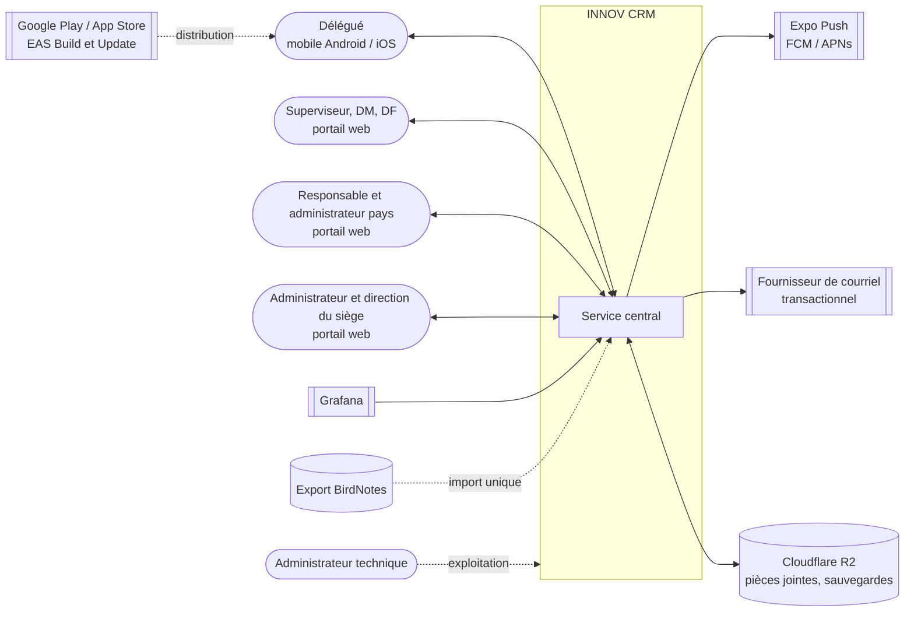
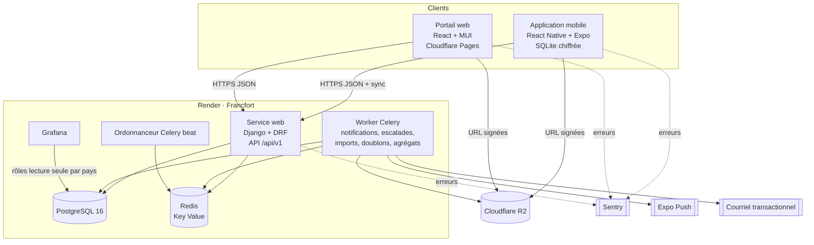
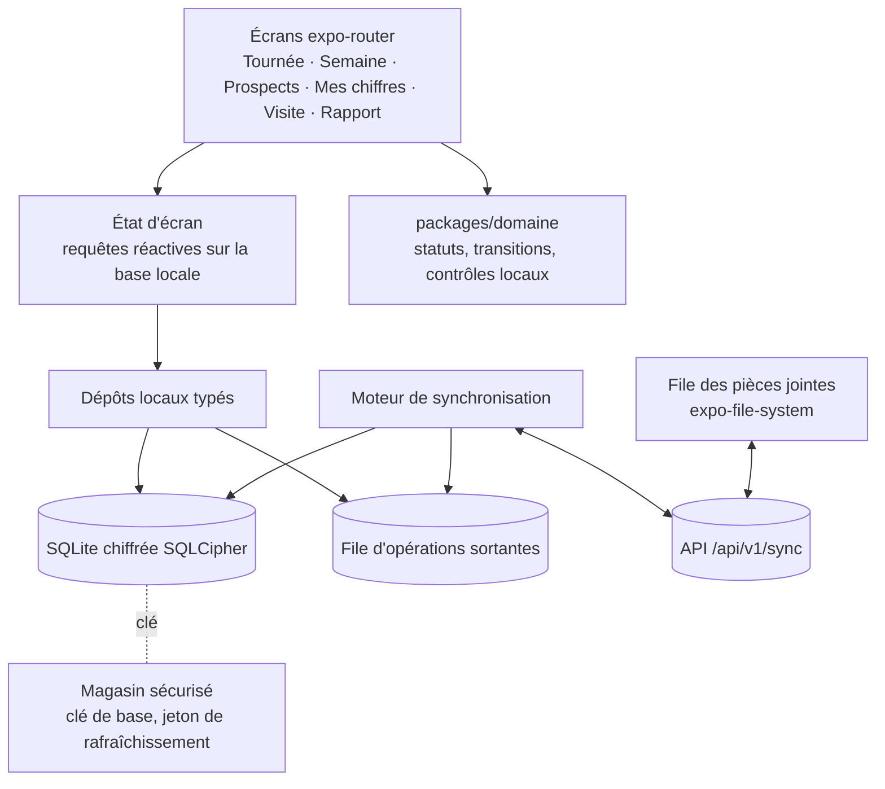
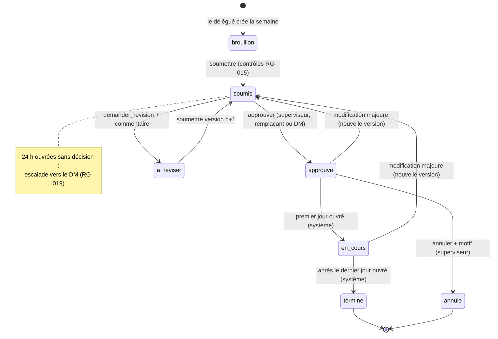
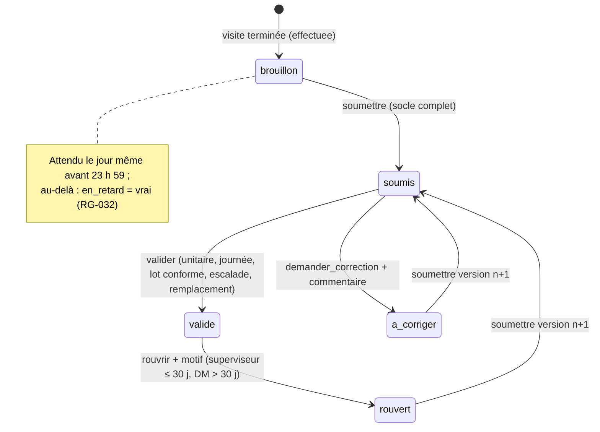
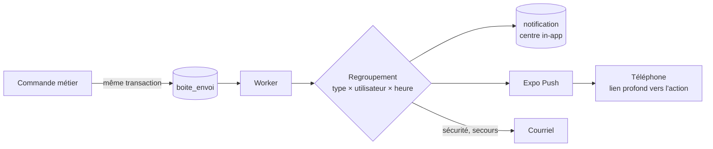
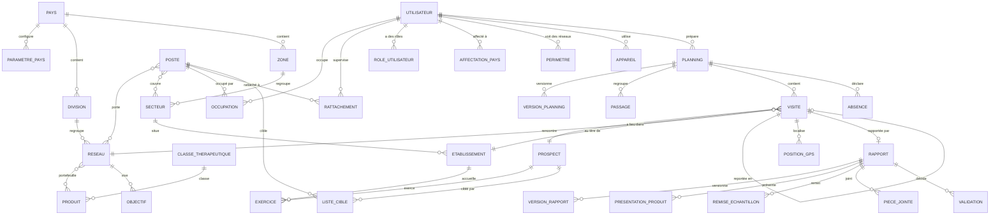
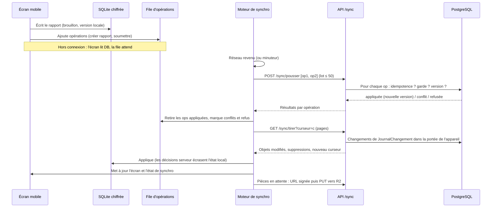
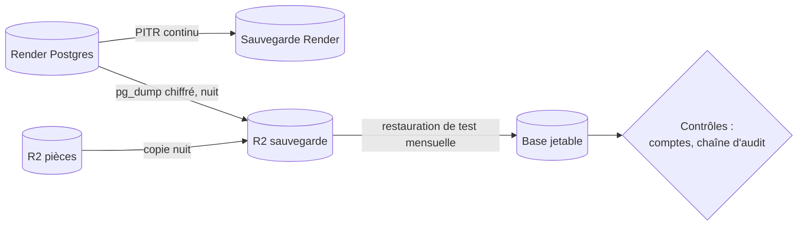
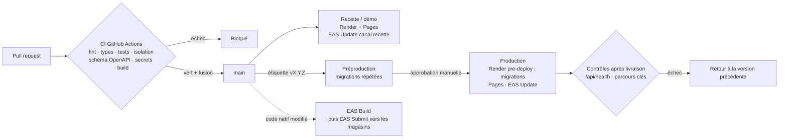

# INNOV CRM — Architecture

| Élément | Valeur |
|---|---|
| Version du document | 1.0 |
| Version produit visée | `1.0.0` |
| Statut | Proposition issue du cadrage validé le 4 octobre 2026 |
| Documents liés | [`prd.md`](prd.md) (référence métier, exigences `ORG-…`, règles `RG-…`) · [`architecture-essentials.md`](architecture-essentials.md) (règles non négociables) |

**Conventions** : **[D]** décision confirmée au cadrage ; **[R]** recommandation de l'architecture, à confirmer au plus tard dans la version indiquée ; **[H]** hypothèse chiffrée à vérifier. Les décisions d'architecture sont numérotées `ADR-…` (section 28). Les noms d'entités, de rôles et de statuts sont ceux du glossaire de `prd.md` (section 26).

---

## Sommaire

1. Objectifs et principes architecturaux
2. Hypothèses techniques
3. Vue d'ensemble du système
4. Composants du système
5. Architecture de l'application mobile
6. Architecture du portail web
7. Services métier
8. Base de données
9. Stockage des pièces jointes
10. Notifications
11. Authentification et autorisations
12. Isolation des données par pays
13. Modèle de données principal
14. Synchronisation hors connexion
15. Gestion des conflits
16. Journalisation et audit
17. Sécurité
18. Sauvegarde et restauration
19. Supervision et alertes
20. Environnements
21. Déploiement
22. Tests
23. Performance et capacité
24. Disponibilité et continuité
25. Intégrations
26. Migrations de données
27. Risques techniques
28. Décisions architecturales
29. Évolutions prévues après la version 1.0.0

---

## 1. Objectifs et principes architecturaux

### 1.1 Objectifs

| ID | Objectif | Exigences liées |
|---|---|---|
| AO-01 | Garantir qu'aucune donnée ne traverse la frontière d'un pays, d'un réseau ou d'un délégué sans autorisation | USR-002, SEC-008, RG-001, RG-040 |
| AO-02 | Permettre au délégué de travailler 7 jours sans réseau, sans perte ni doublon | OFF-001 à OFF-007, RG-050 à RG-054 |
| AO-03 | Rendre chaque décision traçable et non modifiable après coup | AUD-001, RG-034, RG-037 |
| AO-04 | Supporter au moins 500 délégués par pays et 17 pays | NFR-001 à NFR-004 |
| AO-05 | Être construit, exploité et dépanné par **une seule personne** | DC-13 |
| AO-06 | Être démontrable à tout moment | DEM-001, NFR-015 |

### 1.2 Principes

1. **Monolithe modulaire** : un seul service serveur, découpé en modules aux frontières strictes ; pas de microservices (ADR-001).
2. **Le serveur est la seule autorité** sur les permissions, les transitions d'état et les décisions. Les applications ne font que proposer.
3. **Isolation par construction** : toute table métier porte `pays_id` ; toute lecture passe par le moteur de périmètre ; un test automatisé échoue si un point d'accès l'oublie (section 12).
4. **Hors connexion d'abord pour le délégué** : la base locale du téléphone est la source de vérité de l'écran ; le réseau ne sert qu'à synchroniser (section 14).
5. **Commandes plutôt que modifications** : les changements d'état (soumettre, approuver, démarrer une visite) sont des commandes métier validées par le serveur, pas des champs modifiés librement.
6. **Append-only pour ce qui prouve** : audit, versions de planning et de rapport, positions GPS ne sont jamais modifiés.
7. **Un seul langage par couche, un seul modèle de types** : Python au serveur, TypeScript partout ailleurs ; les types d'API sont générés depuis le schéma OpenAPI (ADR-012).
8. **Simplicité opérationnelle** : services managés, pas de composant que l'unique développeur ne saurait restaurer seul.
9. **Configuration par pays plutôt que code par pays** : aucun `if pays == …` dans le code (section 7.3).

## 2. Hypothèses techniques

| ID | Hypothèse | Statut | Conséquence si fausse |
|---|---|---|---|
| HT-01 | 17 pays à terme, ≤ 500 délégués actifs par pays au démarrage, ≈ 8 visites par délégué et par jour | [H] | Revoir partitionnement et dimensionnement (section 23) |
| HT-02 | ~10 000 prospects et ~3 000 établissements par pays ; liste cible de 150 à 400 prospects par délégué | [H] | Revoir la taille de la synchronisation initiale |
| HT-03 | Téléphones Android 10+ et iOS 16+, mélangés, personnels ou fournis | [D] Android+iOS ; [H] versions | Revoir la compatibilité Expo |
| HT-04 | Réseau mobile 2G/3G intermittent hors des grandes villes | [H] | — |
| HT-05 | Hébergement Render (région Francfort), Cloudflare Pages, Cloudflare R2 | [D] | — |
| HT-06 | Offres payantes Render (base persistante, sauvegardes, PITR) avant le pilote `0.9.7` | [H] | Bloquant pour la production |
| HT-07 | Render Postgres autorise les extensions `pg_trgm`, `unaccent`, `fuzzystrmatch` et la création de rôles supplémentaires | [H] à vérifier en `0.0.2` | Sans rôles : isolation Grafana par vues dédiées seulement (section 25.2) |
| HT-08 | Les heures du téléphone peuvent être fausses | [D] | Double horodatage local/serveur (section 14.6) |
| HT-09 | Export BirdNotes disponible en CSV ou Excel | [H] (O-01) | Développer un connecteur spécifique |

## 3. Vue d'ensemble du système

### 3.1 Contexte



### 3.2 Composants principaux



## 4. Composants du système

| Composant | Technologie | Hébergement | Responsabilité | Statut |
|---|---|---|---|---|
| Service central (API) | Python 3.12, Django 5.2 LTS, Django REST Framework, drf-spectacular | Render, service web Docker | Authentification, permissions, règles métier, synchronisation, API | [D] pile AMM |
| Worker | Celery 5 | Render, background worker | Tâches asynchrones : notifications, rappels, escalades, imports, détection de doublons, agrégats, sauvegardes logiques, purges | [D] |
| Ordonnanceur | Celery beat (planification en base) | Render, background worker | Déclenche les tâches périodiques à l'heure de chaque pays | [D] |
| Base de données | PostgreSQL 16 | Render Postgres (offre payante en production) | Données métier, audit, journal des changements | [D] |
| Cache et file | Redis 7 | Render Key Value | File Celery, limitation de débit, cache court | [D] |
| Portail web | React 19, TypeScript, Vite, MUI, TanStack Query, react-router, react-hook-form, zod, i18next, Recharts | Cloudflare Pages | Interface des rôles du portail | [D] |
| Application mobile | React Native, Expo (SDK courant), TypeScript, expo-router, expo-sqlite avec SQLCipher | Google Play, App Store via EAS | Interface du délégué, hors connexion | [D] React Native + Expo |
| Stockage objet | Cloudflare R2 (compatible S3) | Cloudflare | Pièces jointes, imports, exports, sauvegardes | [D] |
| Notifications push | Expo Push Service (FCM, APNs) | Expo | Acheminement des notifications | [R] `0.8.5` |
| Courriel | Fournisseur transactionnel (Brevo, Postmark ou équivalent) | SaaS | Courriels de sécurité et de secours | [R] `0.0.3` |
| BI | Grafana | Render (service Docker avec disque) ou Grafana Cloud | Tableaux de bord analytiques | [D] Grafana ; [R] hébergement `0.7.9` (O-04) |
| Suivi des erreurs | Sentry | SaaS | Erreurs et performances serveur, portail, mobile | [R] `0.0.7` |
| Surveillance de disponibilité | UptimeRobot | SaaS | Alerte si l'API ou le portail ne répond pas ; sonde de l'API sur `/api/health/` | [D] (décidé le 4 octobre 2026) |
| CI/CD | GitHub Actions, EAS Build, EAS Update, EAS Submit | GitHub, Expo | Tests, livraisons | [D] |

### 4.1 Organisation du dépôt [R] `0.0.1`

```
/
├── backend/                 # Django : config/, apps/<module>/, tests/
├── portail/                 # React + Vite
├── mobile/                  # Expo (React Native)
├── packages/
│   ├── api-types/           # types TypeScript générés depuis backend/schema.yaml
│   ├── domaine/             # statuts, transitions, règles pures partagées (TypeScript)
│   ├── i18n/                # catalogues fr / en partagés portail + mobile
│   └── design/              # jetons de design (couleurs, typographie) de la maquette
├── deploy/                  # render.yaml, scripts de sauvegarde et de restauration
├── docs/                    # guides, décisions détaillées
├── prd.md
├── architecture.md
└── architecture-essentials.md
```

Espaces de travail npm pour `portail`, `mobile` et `packages/*`. Le schéma OpenAPI `backend/schema.yaml` est versionné ; la CI échoue s'il diffère du schéma généré.

## 5. Architecture de l'application mobile

### 5.1 Choix [D]

React Native avec Expo : un seul code TypeScript pour Android et iOS, partage des types et des règles avec le portail, base locale chiffrée fiable, notifications push et mises à jour à distance du code JavaScript (EAS Update). La PWA a été écartée : stockage local purgeable par iOS, notifications et synchronisation en arrière-plan limitées, incompatibles avec 7 jours hors connexion (DC-35).

### 5.2 Couches



### 5.3 Modules et bibliothèques [R] `0.2.8`

| Besoin | Choix recommandé | Remarque |
|---|---|---|
| Navigation | expo-router | Liens profonds pour les notifications (`innovcrm://visite/<id>`) |
| Base locale | expo-sqlite avec SQLCipher | Alternative évaluée : WatermelonDB (synchronisation imposée, moins adaptée aux commandes) |
| Accès aux données | Couche de dépôts typés, migrations locales versionnées | Schéma local ≠ schéma serveur : seulement les données utiles au délégué |
| Clés et jetons | expo-secure-store (Keychain / Keystore) | Clé SQLCipher aléatoire de 256 bits générée à l'installation |
| Déverrouillage | expo-local-authentication (biométrie) + code local | Après 5 minutes d'inactivité (SEC-004) |
| Position | expo-location, au premier plan uniquement, au démarrage et à la fin d'une visite | Jamais en arrière-plan (RG-028) |
| Notifications | expo-notifications | Push distantes + rappels locaux de visite |
| Fichiers | expo-image-picker, expo-document-picker, expo-file-system | Compression des photos avant mise en file |
| Réseau | Détection d'état réseau (NetInfo) | Déclenche la synchronisation au retour du réseau |
| Mises à jour | EAS Update (canaux par environnement), politique `runtimeVersion` | Le code natif change uniquement par une nouvelle build |
| i18n | i18next + `packages/i18n` | Langue de l'utilisateur, à défaut celle du pays |
| Erreurs | Sentry React Native | Sans données personnelles dans les traces |

### 5.4 Écrans (maquette INNOV CRM)

Tournée (programme du jour, prochaine visite en tête, distance, file hors connexion visible en orange) · Semaine (glisser-déposer depuis la liste cible, statut d'approbation, commentaires) · Visite en 3 étapes (démarrer avec GPS → produits dans l'ordre et retour du prescripteur → échantillons, prochaine action, commentaire) · Prospects (recherche locale sur la liste cible, recherche en ligne dans le secteur) · Mes chiffres · Notifications · Profil (langue, sécurité, état de synchronisation, déconnexion).

### 5.5 Données présentes sur le téléphone (OFF-001)

Mise en œuvre 0.1.6 : la base locale chiffrée existe (`mobile/src/baseLocale.ts`, SQLCipher par `expo-sqlite`, clé de 256 bits dans le Keychain/Keystore) ; elle garde la liste cible du délégué (PRP-011 CA2) et se vide à la déconnexion. La synchronisation (0.8) la reprendra.

| Donnée | Portée | Renouvellement |
|---|---|---|
| Paramètres du pays utiles au délégué | Pays actif | Synchronisation |
| Référentiels (types, spécialités, motifs, produits du portefeuille de ses réseaux) | Ses réseaux | Synchronisation |
| Liste cible : prospects, établissements, exercices | Son poste | Synchronisation |
| Plannings | Semaine en cours et suivante, plus la précédente en lecture | Synchronisation |
| Visites et rapports | Les siens, 30 derniers jours + en cours | Purge locale au-delà |
| Historique résumé | 3 dernières visites par prospect de sa liste cible | Synchronisation |
| Brouillons, file d'opérations, pièces en attente | Les siens | Jusqu'à envoi confirmé |
| Indicateurs personnels | Semaine en cours | Synchronisation |

Volume estimé : < 10 Mo après la synchronisation initiale (NFR-004) [H].

## 6. Architecture du portail web

- Application monopage React 19 + TypeScript + Vite, servie statiquement par Cloudflare Pages.
- MUI avec un thème construit depuis `packages/design` (jetons de la maquette : bleu marine `#1B2A5B`, orange `#F26B1D`, Plus Jakarta Sans pour les titres, DM Sans pour le texte, thème clair et sombre).
- Données serveur via TanStack Query ; formulaires react-hook-form + zod (schémas partagés depuis `packages/domaine` quand la règle est identique au serveur) ; graphiques Recharts.
- Espaces par rôle : Accueil (superviseur, direction, administration), Visites et rapports, Planning, Prospects, Pilotage, Équipe, Paramètres (6 espaces : utilisateurs et rôles, référentiels, règles de validation, notifications, intégrations, système).
- Le pays actif est choisi dans l'en-tête quand l'utilisateur en a plusieurs ; il est transmis à chaque appel (section 11.4).
- Aucune règle d'autorisation n'est décidée par le portail : il masque ce que l'API refuserait, mais l'API reste seule juge.
- Mode tablette : mise en page fluide jusqu'à 360 px de large (NFR-008).

## 7. Services métier

### 7.1 Modules du serveur [R] `0.0.1`

| Module (`backend/apps/`) | Contenu | Exigences |
|---|---|---|
| `socle` | Modèle de base (UUID, `pays_id`, version, horodatages, archivage), pays, paramètres pays, jours fériés, i18n, utilitaires de fuseau | ORG-001, ORG-011, ORG-012 |
| `identite` | Utilisateurs, rôles par pays, affectations pays, transferts, appareils, double authentification, sessions | USR-*, ORG-002, ORG-009, ORG-010, SEC-* |
| `organisation` | Divisions, réseaux, zones, secteurs, postes, occupations, rattachements, périmètres DF/DM, remplacements | ORG-003 à ORG-008, ORG-013 |
| `perimetre` | Moteur de périmètre : calcule ce qu'un utilisateur voit et peut faire | USR-002 |
| `referentiel` | Types, spécialités, classes thérapeutiques, produits, portefeuilles, motifs d'écart, modèles de champs de rapport | PRP-001, ORG-004, RPT-008 |
| `prospects` | Prospects, établissements, exercices, listes cibles, propositions de modification, doublons, fusions | PRP-002 à PRP-014 ; mise en œuvre 0.1.2 : `Prospect` (nom normalisé et index trigramme, téléphones E.164, numéro d'ordre unique par pays), visibilité des fiches `a_valider` (RG-041) |
| `planning` | Plannings, versions, passages, absences, contrôles, kilométrage | PLN-* |
| `visites` | Visites, positions GPS, écarts, imprévues, conformité | VIS-* |
| `rapports` | Rapports, versions, présentations, remises, prochaines actions, champs pays, validations, réouvertures | RPT-* |
| `notifications` | Boîte d'envoi, centre de notifications, préférences, push, courriel, regroupement | NOT-* |
| `pilotage` | Objectifs, indicateurs, agrégats, exports, vues de pilotage pour Grafana | DSH-* |
| `synchro` | Points d'accès de synchronisation, journal des changements, idempotence, conflits | OFF-* |
| `audit` | Écriture et consultation du journal d'audit | AUD-* |
| `imports` | Lots d'import, simulation, rapports d'erreurs, connecteurs (organisation, produits, BirdNotes) | ORG-014, PRP-013 ; mise en œuvre 0.1.4 : connecteur BirdNotes (`birdnotes.py`, correspondances dans `correspondances.py`), `LotImport` (compteurs et anomalies en JSON), `ReferenceExterne` (clé source → objet), commande `importer_birdnotes`, API `imports/` réservée à l'administrateur pays (`imports.gerer`) |

### 7.2 Règles entre modules

- Un module n'écrit **jamais** dans les tables d'un autre ; il appelle ses **services** (fonctions Python explicites `services.py`).
- Les lectures transverses passent par des **sélecteurs** (`selectors.py`) qui appliquent le périmètre.
- Les effets secondaires (notification, audit, agrégat) sont déclenchés par des **événements de domaine** écrits dans la même transaction (boîte d'envoi transactionnelle), puis traités par le worker.
- Les transitions d'état sont définies **une fois** par entité dans une machine à états (`etats.py`) ; le miroir TypeScript de `packages/domaine` est vérifié par un test de cohérence généré.

### 7.3 Configuration par pays

Toute variation entre pays (échéances, seuils, contrôles, champs du rapport, listes de valeurs, libellés, géolocalisation, durées de conservation) est une **donnée** dans `ParametrePays` ou les référentiels. Le code ne teste jamais un code pays.

### 7.4 Machines à états et commandes

Les commandes métier exposées par l'API (exemples) :

| Commande | Entité | Transition | Garde |
|---|---|---|---|
| `soumettre` | Planning | `brouillon`/`a_reviser` → `soumis` | Délégué titulaire, superviseur actif (RG-010), contrôles bloquants (RG-015) |
| `approuver` | Planning | `soumis` → `approuve` | Superviseur du poste, remplaçant actif, ou DM (escalade, RG-023) |
| `demander_revision` | Planning | `soumis` → `a_reviser` | Idem + commentaire (RG-017) |
| `demarrer` | Visite | `prevue` → `en_cours` | Délégué titulaire, planning approuvé ou visite imprévue |
| `terminer` | Visite | `en_cours` → `effectuee` | Heure de fin ≥ heure de début |
| `declarer_ecart` | Visite | `prevue`/`en_cours` → écart | Motif (RG-031) |
| `soumettre` | Rapport | `brouillon`/`a_corriger`/`rouvert` → `soumis` | Socle complet (RPT-002) |
| `valider` | Rapport | `soumis` → `valide` | Périmètre ; mode `unitaire`, `journee`, `lot` (journées `conforme` seulement), `escalade`, `remplacement` |
| `demander_correction` | Rapport | `soumis` → `a_corriger` | Commentaire |
| `rouvrir` | Rapport | `valide` → `rouvert` | Superviseur ≤ 30 j, DM > 30 j, motif (RG-036) |

Chaque commande : vérifie le périmètre, vérifie la garde, applique la transition, écrit la version figée si besoin, écrit l'événement d'audit et l'événement de domaine — **dans une seule transaction**.

**Workflow d'un planning** (statuts de `Planning`, PRD section 17.1) :



**Workflow d'un rapport** (statuts de `Rapport`, PRD section 17.3) :



### 7.5 Tâches périodiques (worker)

| Tâche | Fréquence | Remarque |
|---|---|---|
| Rappels (planning non soumis, rapport non soumis) | Toutes les 15 min, évaluée à l'heure locale de chaque pays | Respecte les jours fériés |
| Escalades et alertes de retard | Toutes les 15 min | Heures ouvrées du pays |
| Passage `approuve` → `en_cours` → `termine` | Chaque nuit, heure du pays | — |
| Délégués non synchronisés depuis 48 h | Toutes les heures | — |
| Fin d'affectations, de remplacements, de périmètres datés | Chaque nuit | Audit à chaque retrait |
| Agrégats de pilotage | Toutes les 5 min (portail), toutes les heures (Grafana) | DSH-011 |
| Détection de doublons différée | Après chaque import, chaque nuit | — |
| Sauvegarde logique et copie des pièces jointes | Chaque nuit | Section 18 |
| Purges de conservation et anonymisation | Chaque semaine | RG-060 |

## 8. Base de données

- PostgreSQL 16, une **base unique** partagée par tous les pays, isolation par colonne `pays_id` + moteur de périmètre + sécurité au niveau des lignes (section 12) (ADR-003).
- Clés primaires **UUID v7** (triables dans le temps), générées par le créateur de l'objet, y compris le téléphone (ADR-006).
- Colonnes communes à toute table métier : `id`, `pays_id`, `version` (entier incrémenté à chaque écriture), `cree_le`, `cree_par`, `modifie_le`, `modifie_par`, `archive_le` (archivage logique, RG-005).
- Horodatages en `timestamptz` (UTC) ; le fuseau d'affichage vient du pays (RG-006).
- Extensions : `pg_trgm`, `unaccent`, `fuzzystrmatch` pour la recherche et les doublons (HT-07).
- Index : `(pays_id, …)` en tête de tous les index des tables métier ; index trigramme sur les noms normalisés des prospects et établissements.
- Partitionnement par mois des tables à forte croissance dès leur création : `evenement_audit`, `journal_changement`, `position_gps` ; à partir de `0.9.4`, selon les mesures, `visite`, `rapport`, `presentation_produit` par année [R].
- Rôles de base : `innov_app` (service, sans `BYPASSRLS`, sans droit de modifier le schéma), `innov_migration` (migrations), `innov_grafana_<pays>` et `innov_grafana_siege` (lecture seule sur le schéma `pilotage`) [R] `0.0.4` (HT-07).
- Schémas : `public` (métier), `pilotage` (vues et tables d'agrégats pour Grafana et tableaux de bord).

## 9. Stockage des pièces jointes

- Cloudflare R2, un compartiment par environnement (`innov-<env>-pieces`), **privé**.
- Clé d'objet : `<pays>/<annee>/<mois>/<uuid>` — jamais de nom de personne ni de prospect dans la clé.
- Téléversement : le client demande une URL signée (`PUT`, validité 15 minutes, taille et type imposés) **après** avoir synchronisé le rapport ; le serveur confirme l'objet (taille, type, empreinte SHA-256) avant de le rattacher.
- Lecture : URL signée `GET` de 5 minutes, délivrée seulement si l'utilisateur voit le rapport (RPT-007).
- Types acceptés : JPEG, PNG, HEIC converti en JPEG sur le téléphone, PDF ; 10 Mo maximum [H] ; photos redimensionnées à 1 600 px avant envoi.
- Purge à 3 ans (RG-060) par tâche hebdomadaire ; copie nocturne vers le compartiment de sauvegarde (section 18).

## 10. Notifications



- Chaque événement de la table de la section 18 du PRD produit une ligne `notification` (centre) et, selon les préférences et le caractère obligatoire, un envoi push.
- **Regroupement** (NOT-003) : une notification push au plus par type, utilisateur et heure ; les suivantes incrémentent un compteur et le texte devient « n … ».
- **Contenu** : jamais de nom de prospect ni de donnée de santé dans le texte visible ; la charge utile ne contient que le type et l'identifiant de l'objet (RG-062).
- **Rappels de visite** : programmés localement par l'application mobile à partir du planning, donc fonctionnels hors connexion.
- **Jetons push** : stockés par appareil, supprimés à la révocation de l'appareil ; reçus d'erreur d'Expo traités (jeton invalide → suppression).
- **Courriel** : uniquement sécurité du compte et secours > 48 h [H] (NOT-004) ; modèles `fr`/`en`.
- **Après 1.0.0** : WhatsApp Business comme canal d'escalade (DC-27).

## 11. Authentification et autorisations

### 11.1 Authentification [D] méthode ; [R] détails `0.0.3`

| Élément | Portail | Mobile |
|---|---|---|
| Identifiant | Nom d'utilisateur nominatif + mot de passe | Idem |
| Hachage | Argon2id | — |
| Double authentification | TOTP (application d'authentification) obligatoire pour `admin_siege`, `direction_siege`, `responsable_pays`, `admin_pays`, `df`, `dm` ; codes de secours | Idem si l'utilisateur a ces rôles et utilise le mobile |
| Jeton d'accès | JWT signé, 15 minutes, en mémoire | JWT 15 minutes, en mémoire |
| Jeton de rafraîchissement | Cookie `HttpOnly`, `Secure`, `SameSite=Strict`, rotation à chaque usage, détection de réutilisation | Magasin sécurisé, lié à l'identifiant de l'appareil, rotation, valide 7 jours sans usage (cohérent avec OFF-007) |
| Verrouillage | 5 échecs → 15 minutes (SEC-002) | Idem côté serveur ; verrouillage local par code ou biométrie après 5 minutes |
| Inactivité | Déconnexion après 30 minutes | Verrouillage local ; données inaccessibles après 7 jours sans synchronisation |

Bibliothèques recommandées : `djangorestframework-simplejwt` (avec liste de révocation), `django-otp`, `argon2-cffi`, limitation de débit DRF + Redis.

Mise en œuvre (0.0.3) : le jeton d'accès porte l'identifiant de session (`sid`) et chaque requête vérifie que la session est ouverte, ce qui rend la révocation immédiate sans liste de révocation. Le cookie de rafraîchissement du portail (`SameSite=Strict`, chemin `/api/v1/auth/`) impose que **le portail et l'API partagent le même domaine parent** ; la requête de rafraîchissement porte en plus l'en-tête `X-Innov-Client: portail`, ce qui oblige le navigateur à une vérification CORS.

### 11.2 Modèle d'autorisation

- **Rôles** : attribués **par pays** (`RoleUtilisateur(utilisateur, pays, role, debut, fin)`).
- **Périmètre** : calculé par le module `perimetre` à chaque requête, pour le pays actif :
  - `admin_siege`, `direction_siege` : tous les pays (agrégats ; nominatif audité) ;
  - `responsable_pays`, `admin_pays` : tout le pays ;
  - `df`, `dm` : postes dont un réseau est dans leur `Perimetre` daté ;
  - `superviseur` : postes rattachés (`Rattachement` actif) + postes des remplacements actifs ;
  - `delegue` : ses occupations actives ; prospects de sa liste cible et de ses secteurs ; ses propres visites et rapports.
- Mise en œuvre 0.2.1 (ORG-012, PLN-001) : application `planning`. `JourFerie(pays, date, libelle, variable)` et `Planning(delegue, semaine, statut)`, sous sécurité au niveau des lignes. `planning/calendrier.py` donne les jours ouvrés d'une semaine (paramètre `jours_ouvres`) avec leurs jours fériés ; `jours_planifiables` sert aux contrôles de la semaine (0.2.4). Le délégué ne lit que ses propres plannings ; la validation (cycle 0.3) aura sa propre vue.
- Mise en œuvre 0.2.2 (PLN-002) : `Visite(planning, poste, reseau, prospect, etablissement, date, heure, objectif, note, statut, est_imprevue)` sous sécurité au niveau des lignes ; les champs facultatifs en base permettent une visite incomplète en préparation. `services.champs_manquants` et `exiger_complet` (code `planning_incomplet`, liste des visites et de leurs champs manquants) serviront à la soumission (0.2.8). Les statuts et transitions de la visite (§17.2) rejoignent `etats.py` et `etats.json`. Routes : `POST plannings/{id}/visites/`, `PATCH visites/{id}/`, `POST visites/{id}/retirer/` (droit `plannings.preparer`) ; la semaine (`plannings/semaine/`) renvoie aussi `modifiable`, `visites` et `reseaux`.
- Mise en œuvre 0.2.3 (PLN-003, PLN-009) : `Visite.ordre` et `services.ranger` (les visites d'un passage restent ensemble ; les unités à heure fixe occupent leurs places dans l'ordre chronologique, les autres gardent la leur) ; `Passage(planning, etablissement, date, heure)`, unique par planning, jour et lieu, dont l'heure est recopiée sur ses visites ; `Absence(planning, date, periode, type, commentaire)` et `services.part_travaillee` pour les seuils de 0.2.4. Tables sous sécurité au niveau des lignes. Routes : `POST plannings/{id}/ordre/`, `POST plannings/{id}/passages/`, `POST passages/{id}/dissocier/`, `POST plannings/{id}/absences/`, `PATCH absences/{id}/`, `POST absences/{id}/retirer/` (droit `plannings.preparer`) ; la semaine renvoie `passages` et `absences`.
- Mise en œuvre 0.2.4 (PLN-004) : `planning/controles.py` calcule `bloquants` (RG-015), `signalements` (RG-016) et les `objectifs` du jour, sans rien stocker ; `exiger_sans_bloquant` gardera la soumission (0.2.8). La semaine renvoie `controles` ; les codes forment l'énumération `CodeControleEnum`, traduite par les clients.
- Mise en œuvre 0.2.5 (PLN-005) : `services.poser_depuis_cible`, `copier_visite` et `reprendre_semaine_precedente` passent tous par `ajouter_visite`, donc par les mêmes règles (jour planifiable, réseau, passage, ordre). Routes : `POST plannings/{id}/poser/`, `POST plannings/{id}/reprendre/`, `POST visites/{id}/copier/` ; la semaine renvoie `reprenables`.
- Mise en œuvre 0.2.6 (PLN-006, PLN-010) : `planning/kilometrage.py` (haversine, sans service externe ni montant) ; la semaine renvoie `kilometrage` (total, jours, étapes). Mobile : routes `jour/[date]` et `visite/[id]` (`src/Itineraire.tsx`), rattachées à l'onglet Semaine. Portail : page `/planning` (`pages/Planning.tsx`), glisser-déposer HTML5 avec un équivalent au clavier, visible pour `plannings.preparer`.
- Mise en œuvre 0.2.7 (PLN-007) : `SaisieVisite` et `SaisieAbsence` acceptent un `id` tiré par le téléphone ; `services._deja_envoye` rend l'objet déjà créé (création idempotente) ou refuse un identifiant pris (`identifiant_pris`). Mobile : `src/Brouillons.ts` (brouillon, file d'attente, rejeu, distinction panne / refus) sur la base locale chiffrée ; la semaine est gardée par lundi.
- Mise en œuvre 0.2.8 (PLN-008, ORG-007, RG-013, RG-016) : `Planning.soumis_le` et `en_retard` ; `services.echeance` (paramètre pays, fuseau du pays), `services.soumettre` (transition `brouillon`/`a_reviser` → `soumis` par `etats.py`, superviseur rattaché, planning non vide, `controles.exiger_sans_bloquant`, audit `planning.soumission`). Route `POST plannings/{id}/soumettre/` (droit `plannings.preparer`) ; le planning renvoie `echeance`. Signalements `echeance_depassee` et `soumis_en_retard`. Builds : `mobile/eas.json` (profils `apercu`, `simulateur`, `recette`), identifiant du projet EAS par variable d'environnement (`EAS_PROJECT_ID`), workflow manuel `.github/workflows/builds-test.yml`.
- Mise en œuvre 0.2.9 (stabilisation) : `services._verrouiller` (`select_for_update` sur le planning, statut relu) au début de chaque commande qui le modifie ; `services._changer` remplace les `update()` en série pour garder version et journal des changements ; contrôle bloquant `jour_non_planifiable` ; `jour_absent` (journée, ou matin et après-midi) ; la semaine renvoie `fuseau`. Mobile : file d'attente sérialisée (`modifierFile`, un seul rejeu à la fois) ; `src/MaSemaine.tsx` sur l'accueil ; `src/semaineLocale.ts` garde la semaine pour l'onglet Semaine, la journée et le détail. Recette : `recette-0.2.md`.
- Mise en œuvre 0.3.1 (PLN-011, PLN-018) : `TypeAbsence` gagne `commando`, `deplacement`, `accompagnement` (`AVEC_VISITES`) ; `Absence.demande_superviseur` ; `part_travaillee` ignore les activités avec visites ; `controles.signalements` lève `hors_secteur` et `hors_cible` les jours d'une telle activité. Droit `plannings.valider` (superviseur) ; `services.plannings_a_valider` (plannings soumis des postes rattachés cette semaine-là, du plus ancien au plus récent) ; route `GET plannings/a-valider/`. Portail : page `/validation` (`pages/Validation.tsx`). L'interface dit « activité » ; le modèle et l'API suivent en 0.3.2.
- Mise en œuvre 0.3.2 (PLN-011 CA2, PLN-004 CA2) : le modèle `Absence` devient `Activite` (migration `0009`, `RenameModel` ; la table `planning_activite` garde sa politique `isolation_pays`), l'API suit (`plannings/{id}/activites/`, `activites/{id}/`, codes `activite_*`, audit `activite.*`) ; l'activité du compte devient le composant `ActiviteCompte`. `services.supervise(superviseur, planning)` (un poste occupé cette semaine-là lui est rattaché) sert à la file et à la consultation ; route `GET plannings/{id}/consultation/` (droit `plannings.valider`) : la charge de la semaine (`vues._semaine`, partagée avec `plannings/semaine/`) plus le délégué et ses postes ; un planning en préparation ou hors supervision répond `404`. Portail : `pages/ConsultationPlanning.tsx` (`/validation/{id}`, pages d'objet dans `App.tsx`) ; la vue semaine est partagée dans `composants/SemainePlanning.tsx` et `composants/planningTextes.ts` ; chaque visite porte le nombre de ses alertes.
- Mise en œuvre 0.3.3 (PLN-012, PLN-017, RG-023, RG-037) : `VersionPlanning` (numéro, contenu JSON figé, soumission, décision, auteur, mode `direct`) créée par `services.figer` à chaque soumission ; un planning soumis avant 0.3.3 est figé à sa décision (`version_a_decider`). `services.approuver` : verrou, transition `soumis → approuve`, responsable du poste (`supervise` : le superviseur rattaché, ou le DM pour le poste d'un superviseur-visiteur), refus si un point bloquant est apparu depuis la soumission (`planning_bloque`, 409), audit `planning.approbation`, notification au délégué. Route `POST plannings/{id}/approuver/` (droit `plannings.valider`, désormais aussi au DM) ; `PlanningSerializer.decision`. Module `notifications` : `Notification` (destinataire, type, données, `lue_le`, sécurité au niveau des lignes), écrite dans la transaction de l'événement ; texte composé par le client ; routes `GET notifications/`, `POST notifications/{id}/lue/`, `POST notifications/lues/` (droit `notifications.lire`, chacun les siennes). Le push (Expo) et les préférences restent pour 0.3.8. Portail : bandeau de décision de `ConsultationPlanning` ; mobile : `src/MesNotifications.tsx` sur l'accueil.
- Mise en œuvre 0.3.4 (PLN-013, ORG-013, RG-017, RG-020) : `services.demander_revision` (commentaire général et/ou remarques par visite, au moins un texte ; `VersionPlanning.remarques`), route `POST plannings/{id}/reviser/`, notification `revision_demandee` ; le planning passe `a_reviser`, redevient modifiable, et sa resoumission fige la version suivante. `services.mode_de_decision` : `direct` pour le responsable du poste, `remplacement` pour son remplaçant actif aujourd'hui, partagé par la file, la consultation, l'approbation et la révision (`_decider`). `organisation.Remplacement` (superviseur, remplaçant, début et fin inclus, désigné par ; sécurité au niveau des lignes) ; services `designer_remplacant` (superviseurs du pays, pas de chevauchement, début à partir d'aujourd'hui, notification `remplacement_attribue`), `terminer_remplacement` (fin à hier, ou retrait s'il n'a pas commencé) ; routes `remplacements/`, `remplacements/candidats/`, `remplacements/{id}/terminer/` (droit `remplacements.gerer` : administrateur pays pour tous, DM pour les superviseurs de ses réseaux, superviseur pour lui-même). Portail : dialogue de révision et remarques dans le détail d'une visite (`ConsultationPlanning`), page `/remplacements`, notifications non lues sur l'accueil (`composants/MesNotifications.tsx`). Mobile : bandeau de révision et remarques sur les visites.
- Mise en œuvre 0.3.5 (PLN-014, PLN-008 CA2) : `services.soumettre` garde `en_retard` d'une nouvelle soumission après révision (décision du 5 octobre 2026 : seul compte le retard de la première) ; `controles.signalements` ne signale `echeance_depassee` qu'en préparation. `services.destinataires_decision` (responsables du poste et remplaçants actifs) reçoit la notification `planning_soumis` (version, délégué, semaine). `PlanningSerializer.numero_version`. Portail : « Version n · après révision » dans la file et la consultation, carte de la révision précédente (commentaire, remarques par visite, visite retirée), notification menant au planning à décider ; la décision affichée au délégué est celle de la version en cours. Mobile et portail : « Soumettre la version n » et « pas de retard compté » pendant la révision.
- Mise en œuvre 0.3.6 (PLN-014 CA1, CA2 ; AUD-003) : `services.comparer(avant, apres)` rapproche deux contenus figés par l'identifiant des visites (fourni par le téléphone, stable d'une version à l'autre) et rend ajoutées, retirées, déplacées (date ou heure, avec le moment d'avant) et modifiées (`CHAMPS_MODIFIES` : prospect, lieu, objectif, note) ; `versions_avec_comparaison` associe chaque version à la précédente. Routes `plannings/<id>/versions/` (liste, du plus récent : soumission, décision, résumé des changements) et `plannings/<id>/versions/<numero>/` (contenu figé et comparaison détaillée) ; ouvertes au délégué du planning et à qui le décide (`supervise` : responsables du poste et remplaçant actif), 404 sinon. Portail : carte « n versions » (consultation et planning du délégué, dès deux versions) et dialogue de la version (soumission, décision, commentaire, comparaison, contenu). Mobile : lien « Historique : n versions » sur la semaine et écran `versions/[id]` à versions dépliables.
- Mise en œuvre 0.3.7 (PLN-015, RG-018) : `etats.APRES_APPROBATION` (approuvé, en cours). `services._exiger_modifiable(planning, apres_approbation=True)` rend vrai pour un planning approuvé que la commande peut modifier, refuse `modification_en_attente` pendant une modification soumise ; `_exiger_jour_ouvert` verrouille les journées passées dès qu'une version est approuvée. `modifier_visite` classe la saisie par `_changements` (le téléphone renvoie tout le formulaire) : l'heure seule est mineure (`_tracer_mineures` : audit `visite.modification_mineure` et `VersionPlanning.modifications` de la référence) ; tout autre changement, l'ajout, le retrait et les activités passent par `_modification_majeure` → `_soumettre(planning, MotifVersion.MODIFICATION)`, dans la même transaction (un contrôle final bloqué annule le changement). `VersionPlanning.motif` (soumission, révision, modification ; migration 0013 qui marque « révision » les versions existantes après la première) et `PlanningSerializer.motif_version` ; notification `planning_soumis` avec `motif`. `services.reference` (dernière version approuvée), `contenu_effectif` (heures changées appliquées : l'historique compare la version suivante à la référence telle qu'exécutée) et `suivi_apres_approbation`, exposé en `approbation` sur la semaine et la consultation (référence, modifiable, visites en attente, retraits, mineures). Mobile : formulaire de visite « après approbation » (jours passés retirés, « Seule l'heure change » ou « Ce changement sera soumis », « Soumettre la modification », « Retirer et soumettre », pas de copie), ajout sur les journées à venir, visites « En attente d'approbation ». Portail : `composants/SuiviApprobation.tsx` (`AttenteApprobation`, `HeuresChangees`), badge « En attente » sur la carte de visite, libellé de version par `libelleVersion`.
- Mise en œuvre 0.3.8 (NOT-001, NOT-006, PLN-016, RG-019) : Celery (`config/celery.py`, file Redis `REDIS_URL` ; sans Redis, exécution sur place) et beat toutes les 15 minutes sur `apps.planning.taches.echeances`, service `worker` (worker et beat) dans `docker-compose.yml` ; commande `executer_echeances`. `apps/planning/echeances.py` : une passe par pays actif, dans sa transaction avec `innov.pays` fixé (ADR-003) ; `heures_ouvrees` (jours ouvrés du pays, fériés exclus), `rappels` (paramètre `rappel_planning_non_soumis`, jusqu'à l'échéance), `escalades` → `escalader` (`VersionPlanning.escalade_le`, audit `planning.escalade`, notification `escalade` aux DM de `organisation.services.dms_des_reseaux`), `alertes_non_approuves` (paramètre `alerte_planning_non_approuve`). `notifications.services.notifier_une_fois` (clé dans les données). `ModeDecision.ESCALADE` : `services.mode_de_decision` le rend au DM du périmètre quand la version en attente est escaladée (`est_escalade`) ; `plannings_a_valider` y ajoute les plannings escaladés ; `escalade` (date, responsables) sur la ligne de file et la consultation. `GET notifications/?centre=1` (100 dernières). Portail : `Cloche` (barre du haut), page `/notifications`, `textesNotifications.tsx` (textes, icônes, destinations), `/planning?semaine=`. Mobile : `src/textesNotifications.ts`, écran `app/notifications.tsx` (`CentreNotifications`).
- Mise en œuvre 0.3.9 (RG-013, PLN-008 CA1, décision du 6 octobre 2026, prd.md §14.21) : `planning.services.fermeture(pays, semaine)` lit `echeance_soumission_planning` dans la semaine du planning (lundi 0 h, migration `socle/0003` qui efface les anciennes valeurs) ; `est_ferme` (statut non validé, pas de `Planning.reouvert_le`, fermeture passée) garde `_exiger_modifiable`, `approuver`, `demander_revision` et `creer_planning` (`semaine_fermee`, 409) ; un planning validé ne se modifie plus dès la fermeture (`semaine_commencee`). `rouvrir` (responsable ou remplaçant via `mode_de_decision`, crée le planning au besoin, `reouvert_le`/`reouvert_par`, audit `planning.reouverture`, notification `redaction_rouverte`), `demander_reouverture` (`notifier_une_fois`, clé `reouverture:<délégué>:<semaine>`, notification `reouverture_demandee` à `destinataires_decision`), `semaines_fermees` (délégués des postes rattachés, remplacements compris). Routes `GET plannings/fermes/`, `POST plannings/fermes/rouvrir/` (`plannings.valider`), `POST plannings/semaine/reouverture/` (`plannings.preparer`) ; `PlanningSerializer.ferme`, `reouvert_le` ; `Semaine.fermee`, `demande_envoyee`. Échéances : rappel du vendredi 9 h jusqu'à la fermeture, escalade suspendue pour un planning fermé, alerte du DM à 0 h. Portail : `composants/Reouverture.tsx` (`BoutonRouvrir`), « Semaines fermées » sous la file, consultation d'un planning fermé ; mobile et portail : bloc « Semaine fermée » et « Demander la réouverture ».
- Mise en œuvre 0.4.1 (VIS-001, prd.md §14.22) : `apps/planning/programme.py` construit la semaine du délégué sur `services.reference` et `contenu_effectif` (heures mineures comprises), avec les fiches vivantes des visites (statut, prospect, lieu) remises à la date et à l'heure approuvées ; `modification_en_attente` vient de `suivi_apres_approbation`. Route `GET programme/?semaine=` (`plannings.preparer`), `ProgrammeSerializer`. `echeances.avancer_plannings` (approuvé → en cours le lundi, en cours → terminé la semaine finie, audit `planning.en_cours`, `planning.termine`) dans la passe périodique. Mobile : `src/Programme.tsx` (`ProgrammeDuJour`) sur l'accueil, gardé dans la base locale sous `programme.courant`, qui garde aussi la semaine pour le détail hors ligne.
- Mise en œuvre 0.4.2 (VIS-002, prd.md §14.23) : `programme.historique(visite)` (même délégué, même prospect, date antérieure, planning approuvé, en cours ou terminé, 3 au plus). Route `GET visites/<id>/detail/` (`plannings.preparer`, visites du délégué, retirées comprises), `DetailVisiteSerializer` (visite, coordonnées du prospect et du lieu, historique). Mobile : `src/DetailVisite.tsx` (`useDetailVisite`, `garderDetail`, base locale `visite.<id>`), rendu sous le détail (`Itineraire.VueDetail`) ; le programme du jour prépare le détail des visites du jour.
- Mise en œuvre 0.4.3 (VIS-003, prd.md §14.24) : `Visite.debut_le`, `debut_latitude`, `debut_longitude`, `debut_precision_m`, `sans_gps`, `distance_debut_m` (migration `planning/0016`). `apps/planning/execution.demarrer` : verrou sur la visite, rejeu idempotent (même `debut_le`), `etats.exiger_transition_visite`, date approuvée lue sur `contenu_effectif` de la référence, paramètre `geolocalisation_active`, distance haversine (`kilometrage.distance_km`), audit `visite.demarrage`. Route `POST visites/<id>/demarrer/` (`DemarrageSerializer`), `Programme.geolocalisation`. Mobile : `src/Execution.tsx` (`demarrerVisite`, `prendrePosition` via expo-location avec 15 s au plus, distance calculée sur le téléphone d'après le détail gardé, envoi `demarrer_visite` dans la file de `Brouillons.ts`, `changerVisite` + `ecouterProgramme` pour tenir le programme gardé à jour) ; le programme rejoue la file avant de se recharger.
- Mise en œuvre 0.4.4 (VIS-004, prd.md §14.25) : `Visite.fin_le`, `fin_latitude`, `fin_longitude`, `fin_precision_m`, `fin_sans_gps`, `distance_fin_m` (migration `planning/0017`). `execution.terminer` (CA1 : fin après début, `_position`, `_exiger_passe`, audit `visite.fin` avec la durée) ; route `POST visites/<id>/terminer/`. Paramètre pays `attente_gps_secondes` (60 s, 10 à 300), rendu par le programme. Mobile : `terminerVisite` rejoue d'abord la file (un démarrage hors ligne part avant la fin), envoi `terminer_visite` ; la prochaine visite se recalcule sur le téléphone ; annonce de la visite terminée dans le programme.
- Mise en œuvre 0.4.5 (VIS-005, prd.md §14.26) : `Visite.motif_ecart` (valeur de la liste `motif_ecart`), `commentaire_ecart`, `ecart_le` (migration `planning/0018`), communs aux écarts à venir (annulation, report, non-réalisation). `execution.declarer_absent` (rejeu idempotent, `motif_valide` → `motif_requis`, `_exiger_jour_approuve` partagé avec `demarrer`, audit `visite.prospect_absent`) ; route `POST visites/<id>/absent/` (`EcartSerializer`) ; `Programme.motifs_ecart` (valeurs actives du pays, gardées avec le programme pour le hors ligne). Mobile : `declarerAbsent` (rejoue d'abord la file, envoi `absent_visite`), panneau de motifs dans `ExecutionVisite`, annonce dans le programme.
- Mise en œuvre 0.4.6 (VIS-006, VIS-009, prd.md §14.27) : `execution._declarer_ecart` commun aux écarts (verrou, rejeu idempotent, transition, motif, heure passée, règle de jour propre à chaque écart, audit) ; `annuler` (`_exiger_pas_passee`, audit `visite.annulee`), `non_realisee` (`_exiger_journee_finie`, audit `visite.non_realisee`). Routes `POST visites/<id>/annuler/` et `visites/<id>/non-realisee/`. `programme.a_justifier` (visites approuvées restées prévues avant aujourd'hui, semaine en cours et précédente, via `_visites_approuvees`), `Programme.a_justifier`. Mobile : `declarerEcart(type)` (envois `annuler_visite`, `non_realisee_visite`), `useVisiteDuProgramme` (statut à jour dans le détail), carte « À justifier ». Démonstration : `passe_execute` (journées passées effectuées, quelques écarts, une visite à justifier).
- Mise en œuvre 0.4.7 (VIS-007, prd.md §14.28) : `Visite.reportee_de` (OneToOne, `related_name="report"`, migration `planning/0019`), `VisiteSerializer.report` (id, date, heure de la suite). `execution.reporter` : verrou, rejeu, transition, motif, `_exiger_pas_passee`, `_exiger_apres` (`report_avant`), `_planning_de` (planning de la semaine du nouveau jour, `creer_planning` au besoin), `services.ajouter_visite(..., report=True)` qui lève le verrou `semaine_commencee` et passe par `_modification_majeure` dans une semaine approuvée (CA2) ; audit `visite.reportee`. Route `POST visites/<id>/reporter/` (`ReportSerializer`, `id` de la nouvelle visite). `programme.a_justifier` et `historique` s'appuient sur l'existence d'une version approuvée, pas sur le statut du planning. Mobile : `declarerEcart(..., nouveauJour)`, `joursProposes`, `joursOuvresDe`, envoi `reporter_visite`.
- Mise en œuvre 0.4.8 (VIS-008, RG-027, prd.md §14.29) : `Visite.justification` (migration `planning/0020`) avec `est_imprevue`. `execution.visite_imprevue` (rejeu par identifiant, `_exiger_justification`, planning approuvé de la semaine du jour réel, réseau par défaut, position comme au démarrage, statut « en cours », audit `visite.imprevue`) ; route `POST visites/imprevue/` (`ImprevueSerializer`). Les imprévues sont exclues de `_contenu` (versions), `controles._visites`, `kilometrage.estimer`, de la reprise de semaine et de `manquants` ; `programme` les ajoute à leur jour et met en tête la visite en cours la plus récente. Mobile : `src/Imprevue.tsx` (`VisiteImprevue`, `declarerImprevue`), `ChoixProspect` et `ChoixLieu` partagés avec le formulaire de visite, `ajouterAuProgramme`, envoi `imprevue_visite`. Portail : repère « Imprévue » sur la carte de visite.
- Mise en œuvre 0.4.9 (VIS-010, RG-029, prd.md §14.30) : `apps/planning/conformite.py` (`seuils`, `ecarts_du_jour`, `recalculer`, `figer`, `de_la_semaine`) et le modèle `ConformiteJournee` (délégué, date, classement, écarts, seuils appliqués, `fige_le` ; migrations `planning/0021` et `0022` avec sécurité au niveau des lignes). `execution._recalculer` à chaque réception ; `_semaine` rend `conformite` pour un planning approuvé (semaine du délégué et consultation du superviseur), recalculée tant que non figée (CA3). Paramètre pays `duree_visite_minutes` ({min, max}, `_bornes`). Portail : `composants/Conformite.tsx` (`CarteConformite`) sur la consultation, éditeur du paramètre dans « Paramètres ».
- Mise en œuvre 0.5.1 (RPT-001, RPT-002, RPT-008, RG-030, RG-033, prd.md §14.31) : nouvelle application `apps/rapports`. `ChampRapport` (pays, code unique parmi les champs actifs, libellé, type `texte`/`nombre`/`liste`/`case`, options, obligatoire, ordre) et `Rapport` (OneToOne avec la visite, délégué, statut `brouillon`/`soumis`/`a_corriger`/`valide`/`rouvert`, produits ordonnés, résultat, résumé, prochaine action, `champs` et `definitions` : copie des champs du pays à l'ouverture) ; migrations `rapports/0001` et `0002` (sécurité au niveau des lignes). `services.py` : `rapport_de` (création à la première lecture, `visite_non_effectuee`), `enregistrer` (`produit_hors_portefeuille`, `resultat_invalide`, `champ_inconnu`, `champ_invalide`), `manquants`, `soumettre` (`rapport_incomplet`, rejeu sans effet), `produits_proposes` (portefeuille au jour de la visite), gestion des champs auditée (`rapport.champ_*`, `rapport.soumission`). Action `rapports.rediger` (superviseur, délégué) ; routes `visites/<id>/rapport/` (GET, PUT), `visites/<id>/rapport/soumettre/`, `rapports/champs/` (lecture `parametres.lire`, gestion `parametres.modifier`), `rapports/champs/<id>/`, `rapports/champs/<id>/archiver/`. Liste de référence `resultat_visite` (migrations `referentiel/0006` et `0007`). `VisiteSerializer.rapport_statut`. Mobile : `src/Rapport.tsx` (`FormulaireRapport`, `manquantsDe`), écran `app/rapport/[id].tsx`, `ActionRapport` dans l'exécution, bouton dans l'annonce de fin de visite. Portail : `composants/ChampsRapport.tsx` dans « Paramètres ». Démonstration : portefeuilles datés d'un trimestre, un champ « Patients concernés par semaine », rapports soumis sur les visites passées, un brouillon, un rapport attendu.
- Mise en œuvre 0.5.2 (RPT-003, prd.md §14.32) : `Rapport.objectif_prevu` (relevé de `Visite.objectif` par `rapport_de`) et `Rapport.resultat_obtenu` (texte facultatif, saisi par `enregistrer`) ; migration `rapports/0003` avec reprise des rapports existants. `RapportSerializer` expose aussi `est_imprevue` et `justification` de la visite. Mobile : `ObjectifPrevu` en tête du formulaire et de la lecture, résultat obtenu placé sous l'objectif.
- Mise en œuvre 0.5.3 (RPT-004, RPT-005, RG-038, prd.md §14.33) : `Rapport.produits` devient `Rapport.presentations` (liste ordonnée `{produit, libelle, retour}`, `produit` vide pour un « autre ») et `Rapport.remises` (`{type, produit, article, libelle, quantite}`) ; migration `rapports/0004` (reprise des rapports existants, retour vide). Énumérations `RetourPrescripteur` et `TypeRemise`. `services._presentations` (portefeuille au jour de la visite, doublon refusé, « autre » selon le paramètre pays `produit_autre_autorise`) et `services._remises` (échantillon du portefeuille, cadeau de la liste `article_promotionnel`, quantité 1 à 999) ; `manquants` ajoute `retours`. Le libellé est recopié dans le rapport pour que sa lecture ne dépende pas du référentiel. Liste `article_promotionnel` (migrations `referentiel/0008` et `0009`). Mobile : `src/RapportProduits.tsx` (`ProduitsPresentes`, `ChoixRetour`, `Remises`). Portail : paramètre dans « Paramètres », liste dans « Référentiels ».
- Mise en œuvre 0.5.4 (RPT-006, prd.md §14.34) : `Rapport.prochaine_action_type` (valeur de la liste `type_action`), `prochaine_action_echeance` (pas avant la visite, `echeance_passee`) et `visite_proposee` ; migrations `rapports/0005`, `referentiel/0010` et `0011`. `manquants` ajoute `prochaine_action_type`. `services.action_precedente(visite)` : dernier rapport non brouillon du même délégué chez le même prospect, avant la visite ; exposé par `RapportSerializer.action_precedente` et `DetailVisiteSerializer.action_precedente` (le détail est gardé sur le téléphone). Mobile : `src/ProchaineAction.tsx` (type, précision, échéance en jours après la visite, visite proposée) et `src/ActionPrecedente.tsx` (rappel sur le détail et le rapport). Portail : liste dans « Référentiels ».
- Mise en œuvre 0.5.5 (RPT-007, prd.md §14.36) : modèle `PieceJointe` (identifiant fourni par le téléphone, rapport, fichier, nom, type, taille, `prise_le`) ; migrations `rapports/0006` et `0007` (sécurité au niveau des lignes). `services.joindre` : rejeu sans doublon, contrôle de la taille (10 Mo), du nombre (3), du type par les premiers octets (JPEG, PNG, HEIC, PDF), ajout possible après la soumission si `prise_le` la précède (téléversement différé) ; `retirer_piece` archive (RG-005) ; audit `rapport.piece_jointe_ajout` et `_retrait`. Routes `visites/<id>/rapport/pieces/` (POST multipart) et `visites/<id>/rapport/pieces/<piece>/` (GET du fichier, `Cache-Control: private, no-store`, `nosniff` ; DELETE). Fichiers sous `MEDIA_ROOT` (`INNOV_FICHIERS`, jamais servi directement, ignoré par git), rangés par pays et par rapport ; le stockage objet R2 se branche au déploiement. Mobile : `src/PiecesJointes.tsx` (expo-image-picker, expo-document-picker), envoi `piece_jointe` dans la file d'attente, `fichierAEnvoyer` (adresse locale sur le téléphone, contenu dans un navigateur). Suite d'isolation étendue aux deux routes.
- Mise en œuvre 0.5.6 (RPT-009, prd.md §14.37) : aucun changement serveur. Mobile : `src/BrouillonRapport.ts` garde sous la clé `rapport.<visite>` de la base locale chiffrée le dernier rapport reçu, la saisie locale, son heure et un indicateur « envoyé » ; `garderFichier` copie les pièces en attente sous `documentDirectory/pieces-en-attente/` (expo-file-system), effacées après envoi. `FormulaireRapport` enregistre sans bouton : écriture locale immédiate, `enregistrerRapport` après 800 ms sans frappe ; erreur transitoire → envoi `brouillon_rapport` dans la file (`Brouillons.ts`, une seule entrée par visite, la saisie lue au moment du rejeu). Au chargement, une saisie locale non envoyée l'emporte ; sans réseau, le rapport s'ouvre depuis la copie locale. La fin de visite prépare la copie locale (`terminerVisite`). L'état d'enregistrement remonte dans le sous-titre de l'en-tête (`surGarde`).
- Mise en œuvre 0.1.8 (PRP-007 à PRP-014) : `prospects/doublons.py` (détecteur, suggestions, fusion, défusion, file), `prospects/propositions.py` (propositions et décideurs : administrateur pays, ou superviseur des postes occupés par l'auteur), tables `Fusion`, `DoublonProbable`, `Changement` (historique champ par champ) et `Proposition`, toutes sous sécurité au niveau des lignes. Une fusion déplace exercices et listes cibles vers la fiche conservée et garde la liste de ce qu'elle a déplacé (`transferts`) : la défusion rend exactement ces objets. Import de l'organisation : `imports/organisation.py`, lecture du classeur par `imports/tableur.py` (XML lu avec `defusedxml`).
- Mise en œuvre 0.1.7 (PRP-005 CA2) : la recherche des fiches applique ce périmètre (`prospects/recherche.py`) ; pour les rôles de terrain, le périmètre des fiches est formé des secteurs de leurs postes, de leurs listes cibles et de leurs propres fiches ; la portée « pays » se demande explicitement (RG-024) ; une fiche commune reste lisible par son identifiant.
- **Permissions d'action** : vérifiées dans les commandes (section 7.4), jamais seulement dans l'interface.
- **Réponse hors périmètre** : `404` (et non `403`) pour ne pas révéler l'existence de l'objet (USR-002 CA2).

### 11.3 Matrice

La matrice d'autorisations de référence est celle du PRD (section 6.3). Elle est traduite en une table de tests paramétrés (section 22.2) ; toute modification de la matrice modifie d'abord le PRD.

### 11.4 Pays actif

- Le client envoie l'en-tête `X-Pays: <code>` à chaque appel ; le serveur vérifie que l'utilisateur a un rôle actif dans ce pays (pays principal ou affectation en cours), sinon `403`.
- Le siège peut omettre l'en-tête pour les vues consolidées ; il reçoit alors des agrégats uniquement.

## 12. Isolation des données par pays

L'isolation est la propriété la plus critique du système (AO-01). Elle repose sur **trois couches indépendantes** :

| Couche | Mécanisme | Échoue si… |
|---|---|---|
| 1. Application | Toute vue d'API hérite d'une classe de base qui impose `get_queryset()` via `selectors` filtrés par le périmètre ; un test parcourt toutes les routes enregistrées et échoue si l'une n'hérite pas de la classe de base | un développeur ajoute une route sans filtre |
| 2. Base de données | Sécurité au niveau des lignes (RLS) PostgreSQL sur `pays_id` : chaque transaction de requête exécute `SET LOCAL innov.pays = '<id>'` (ou la liste pour le siège) ; le rôle `innov_app` n'a pas `BYPASSRLS` ; les politiques refusent toute ligne d'un autre pays | la couche 1 est contournée (requête brute, bogue de sélecteur) |
| 3. Tests | Suite d'isolation : deux pays, deux réseaux, deux superviseurs, deux délégués ; chaque rôle tente de lire, rechercher, exporter, télécharger une pièce jointe, recevoir une notification et interroger Grafana hors périmètre | une régression apparaît |

État : les trois couches sont en place. Couche 2 **[D]** (décision du 4 octobre 2026) : politiques `isolation_pays` (ENABLE + FORCE) sur toutes les tables portant `pays_id` ; `VuePerimetre` ouvre une transaction par requête et y fixe `innov.pays` (identifiant du pays actif, `*` pour le siège, `aucun` sans rôle) ; hors requête métier (migrations, commandes, authentification) la variable est vide et rien n'est filtré. Un test vérifie que toute table de `ModeleDePays` est protégée ; `check --deploy --database default` refuse un rôle SUPERUSER ou BYPASSRLS. Les tests d'isolation s'exécutent sous un rôle ordinaire.

Décision **[D]** : RLS activée (ADR-003). Coût : chaque tâche Celery et chaque commande d'administration doit fixer explicitement son pays ; c'est voulu. Si HT-07 se révèle faux (rôles impossibles sur Render), la couche 2 est limitée à la RLS sur le rôle unique, et la couche 3 devient bloquante pour toute livraison.

Autres règles :
- Les **identifiants** ne sont jamais séquentiels (UUID) : impossible de deviner un objet d'un autre pays.
- Les **exports, recherches, pièces jointes, notifications et synchronisations** passent par les mêmes sélecteurs.
- Les **tâches du worker** reçoivent le pays en paramètre et ouvrent une transaction avec ce pays.
- **Grafana** lit le schéma `pilotage` avec un rôle de base dédié au pays (section 25.2).

## 13. Modèle de données principal

### 13.1 Modèle simplifié



### 13.2 Entités et attributs clés

| Entité | Attributs clés (hors colonnes communes) | Remarques |
|---|---|---|
| `Pays` | `code` ISO, `nom`, `fuseau`, `langue`, `devise`, `statut` (`actif`, `suspendu`, `archive`) | Pas de `pays_id` (c'est la racine) |
| `ParametrePays` | `cle`, `valeur` (JSON typé), `debut` | Historisé |
| `JourFerie` | `date`, `libelle`, `demi_journee` | — |
| `Utilisateur` | `identifiant`, `nom`, `prenom`, `courriel`, `telephone`, `pays_principal_id`, `langue`, `actif`, `otp_active` | Jamais supprimé |
| `RoleUtilisateur` | `utilisateur_id`, `pays_id`, `role`, `debut`, `fin` | `role` ∈ 9 codes du PRD |
| `AffectationPays` | `utilisateur_id`, `pays_id`, `motif`, `debut`, `fin`, `accorde_par` | Siège uniquement |
| `Appareil` | `utilisateur_id`, `identifiant_installation`, `plateforme`, `version_app`, `jeton_push`, `derniere_synchro`, `revoque_le` | Mise en œuvre 0.0.6 : `systeme`, `modele`, `dernier_contact` (connexion ou rafraîchissement) en attendant `derniere_synchro` (0.8) ; `jeton_push` en 0.8 |
| `Division`, `Reseau` | `code`, `libelle`, `division_id` | — |
| `ClasseTherapeutique`, `Produit` | `libelle`, `classe_id`, `actif` | `Portefeuille(reseau_id, produit_id, debut, fin)` ; mise en œuvre 0.1.1 : les listes simples (types, spécialités, classes thérapeutiques, motifs d'écart) partagent l'entité `Valeur(liste, code, libelle, ordre, parent)` ; « actif » = non archivé |
| `Zone`, `Secteur`, `Localite` | `libelle`, rattachements | `Localite(secteur_id, libelle)` livrée en 0.1.4, unique par secteur |
| `Poste` | `type_poste` (`vm`, `vm_otc`, `kam`, `dermo`), `libelle`, réseaux (n–n), secteurs (n–n) | Peut être vacant |
| `Occupation` | `poste_id`, `utilisateur_id`, `debut`, `fin`, `principal` | — |
| `Rattachement` | `poste_id`, `superviseur_id`, `debut`, `fin` | — |
| `Perimetre` | `utilisateur_id`, `reseau_id`, `debut`, `fin` | DF, DM |
| `Remplacement` | `superviseur_id`, `remplacant_id`, `debut`, `fin`, `designe_par` | — |

Mise en œuvre (0.0.5) : les liens datés de l'organisation (`Occupation`, `Rattachement`, `Perimetre` — nommé `PerimetreReseau` dans le code —, `AffectationPays`) sont des dates du pays ; un lien est actif le jour `j` si `debut <= j < fin` (fin exclue). `Division` et `Reseau` existent dès 0.0.5 avec code et libellé seulement, pour porter postes et périmètres ; le portefeuille arrive avec ORG-004 (0.1.1). Un rôle exercé hors du pays principal ne compte que pendant une affectation active.
| `Prospect` | `type`, `specialite_id`, `grade_id`, `activite` (`hospitalier`, `prive`), `secteur_id`, `localite_id`, `civilite`, `nom`, `prenom`, `nom_normalise`, `cle_phonetique`, `numero_ordre`, `telephone_mobile`, `telephone_pro`, `courriel`, `potentiel` (`A`,`B`,`C`), `statut`, `cree_par_poste_id`, `fusionne_dans_id` | Fiche commune au pays ; grade, activité, secteur et localité facultatifs (0.1.4) |
| `Etablissement` | `type`, `nom`, `nom_normalise`, `adresse`, `localite_id`, `secteur_id`, `activite`, `latitude`, `longitude`, `statut` | La localité appartient au secteur ; elle le donne quand il est omis |
| `Exercice` | `prospect_id`, `etablissement_id`, `debut`, `fin`, `principal` | Mise en œuvre 0.1.5 : `presence` (jours et horaires en clair [H]) ; actif si `debut <= j < fin` ; un seul exercice en cours par couple ; `services.exercice_actif` sert au contrôle RG-015 des visites |
| `ListeCible` | `poste_id`, `prospect_id`, `frequence_cible`, `periode` (mois), `debut`, `fin` | Mise en œuvre 0.1.6 : entité `Cible(poste, prospect, frequence, debut, fin)` ; la fréquence se compte par cycle de visite (`cycle_visite_semaines`) et non par mois ; défaut selon le potentiel (`frequence_cible_a|b|c`) |
| `CandidatDoublon` | `fiche_a_id`, `fiche_b_id`, `score`, `criteres`, `decision`, `decide_par` | Paires « garder séparées » mémorisées |
| `Fusion` | `conservee_id`, `absorbee_id`, `mode` (`automatique`, `manuelle`), `etat_avant` (JSON), `defusionnee_le` | Réversible |
| `Planning` | `delegue_id`, `semaine` (lundi), `statut`, `version_courante`, `soumis_le`, `en_retard`, `approuve_par`, `mode_decision` | Unique `(delegue_id, semaine)`. Mise en œuvre 0.2.1 : `delegue`, `semaine`, `statut` ; les autres champs arrivent avec les versions et la validation |
| `JourFerie` | `pays_id`, `date`, `libelle`, `variable` | Mise en œuvre 0.2.1 (ORG-012) : unique `(pays, date)` hors archives ; modifiable jusqu'à la veille |
| `VersionPlanning` | `planning_id`, `numero`, `contenu` (JSON figé), `soumis_le`, `en_retard`, `decision`, `decide_le`, `decide_par`, `mode`, `commentaire`, `remarques` | Contenu immuable ; la décision s'inscrit une fois |
| `Passage` | `planning_id`, `etablissement_id`, `date`, `heure` | — |
| `Activite` | `planning_id`, `date`, `periode`, `type`, `commentaire`, `demande_superviseur` | — |
| `Visite` | `planning_id`, `poste_id`, `reseau_id`, `prospect_id`, `etablissement_id`, `passage_id`, `date_prevue`, `heure_prevue`, `objectif`, `statut`, `est_imprevue`, `justification`, `motif_ecart_id`, `debut_reel`, `fin_reel`, `visite_origine_id`, `conformite` (JSON), `horodatage_local` | — |
| `PositionGPS` | `visite_id`, `moment` (`debut`, `fin`), `latitude`, `longitude`, `precision_m`, `capturee_le`, `distance_etablissement_m` | Append-only, purge 12 mois |
| `Rapport` | `visite_id` (unique), `statut`, `resultat`, `resume`, `observations`, `objections`, `champs_pays` (JSON), `soumis_le`, `en_retard`, `valide_le`, `valide_par`, `mode_validation` | — |
| `VersionRapport` | `rapport_id`, `numero`, `contenu` (JSON figé), `soumis_le` | Append-only |
| `PresentationProduit` | `rapport_id`, `produit_id`, `ordre`, `retour` (`non_prescrit`, `peu`, `prescrit`, `tres_bien`) | — |
| `RemiseEchantillon` | `rapport_id`, `produit_id` ou `article`, `quantite` | Sans stock |
| `ProchaineAction` | `rapport_id`, `type`, `echeance`, `note` | — |
| `PieceJointe` | `rapport_id`, `cle_objet`, `type_mime`, `taille`, `empreinte`, `statut` (`en_attente`, `disponible`) | — |
| `Decision` | `objet_type`, `objet_id`, `action`, `mode`, `auteur_id`, `commentaire`, `le` | Approbations, révisions, validations, corrections, réouvertures |
| `Objectif` | `reseau_id`, `periode_debut`, `periode_fin`, `indicateur`, `cible`, `fixe_par` | — |
| `Notification`, `PreferenceNotification`, `BoiteEnvoi` | — | Section 10 |
| `EvenementAudit` | `le`, `acteur_id`, `role`, `pays_id`, `action`, `objet_type`, `objet_id`, `contexte` (JSON), `resultat`, `empreinte_precedente` | Append-only, partitionné |
| `JournalChangement` | `sequence` (bigserial), `pays_id`, `entite`, `entite_id`, `version`, `operation`, `le` | Support de la synchronisation |
| `OperationSync` | `id_operation` (UUID client), `appareil_id`, `recu_le`, `resultat` (JSON) | Idempotence |
| `LotImport`, `LigneImport` | `type`, `source`, `statut`, `simulation`, `erreurs` | Mise en œuvre 0.1.4 : `LotImport(source, fichier, simulation, statut, lance_par, debut, fin, compteurs, anomalies)` sans `LigneImport` (le fichier n'est pas conservé) ; `ReferenceExterne(source, entite, identifiant, objet_type, objet_id, complements, lot_id)` |

## 14. Synchronisation hors connexion

### 14.1 Principes [D] règles ; [R] protocole `0.8.3`

- **Protocole maison sur HTTPS** (ADR-005) en deux sens : **tirer** les changements depuis un curseur, **pousser** une file d'opérations.
- Le téléphone génère les UUID ; chaque opération porte un **identifiant d'opération** unique : rejouer une opération ne produit aucun effet supplémentaire (OFF-003, REC-07).
- Les changements d'état sont des **commandes** (section 7.4) rejouées sur le serveur, qui revérifie les gardes.
- Les décisions du serveur gagnent toujours (RG-050).

### 14.2 Séquence



### 14.3 Pousser

`POST /api/v1/sync/pousser` — corps : lot ordonné d'opérations `{id_operation, entite, entite_id, type (creer | modifier | commande), commande?, version_base, donnees, horodatage_local}`.

Traitement par opération, chacune dans sa propre transaction et dans l'ordre :
1. `id_operation` déjà connu → renvoyer le résultat mémorisé.
2. Vérifier le périmètre (même règle que l'API en ligne).
3. `creer` : insérer avec l'UUID fourni (refus si l'UUID existe pour un autre objet).
4. `modifier` : si `version_base` ≠ version serveur → **conflit** ; sinon appliquer.
5. `commande` : vérifier la garde de la machine à états ; si l'état serveur a changé (ex. planning déjà approuvé) → **refus motivé** avec l'état serveur.
6. Écrire `JournalChangement`, l'audit et les événements de domaine.

Une opération refusée n'empêche pas les suivantes, **sauf** celles qui en dépendent (même `entite_id`), marquées « bloquées » jusqu'à résolution.

### 14.4 Tirer

`GET /api/v1/sync/tirer?curseur=<sequence>&limite=500` — renvoie les objets dont une ligne de `JournalChangement` a une séquence supérieure au curseur **et** qui entrent dans la portée de l'appareil (section 5.5), plus des **pierres tombales** pour les objets sortis de la portée (prospect retiré de la liste cible, semaine purgée). Un changement de portée (nouvelle occupation, nouveau prospect cible) déclenche l'envoi complet des objets entrés dans la portée.

Synchronisation initiale : même mécanisme depuis le curseur `0`, paginé, reprenable.

### 14.5 Cadence

- Au démarrage de l'application, au retour du réseau, après chaque soumission, et toutes les 15 minutes au premier plan.
- En arrière-plan : tâche système opportuniste (expo-background-task), sans garantie ; l'utilisateur voit toujours « n éléments en attente » et l'heure de dernière synchronisation.

### 14.6 Horloge

Chaque opération porte `horodatage_local` ; le serveur enregistre `recu_le`. L'écart d'horloge de l'appareil est estimé à chaque synchronisation. Un horodatage local est accepté pour le calcul « à l'heure » d'un rapport (RPT-010) si l'écart estimé est inférieur à 15 minutes [H] ; sinon l'opération est marquée « horloge incohérente » pour le superviseur.

### 14.7 Limite de 7 jours et effacement à distance

- L'application mémorise la date de la dernière synchronisation **réussie**. Au-delà de 7 jours (RG-054), elle n'affiche plus les données et exige une connexion ; la file d'opérations est conservée et envoyée à la connexion.
- Si le serveur répond `appareil_revoque` ou `compte_desactive` à n'importe quel appel, l'application supprime la base, la clé, les fichiers et les jetons, puis revient à l'écran de connexion (SEC-006). Les opérations non envoyées sont perdues et le serveur le signale à l'administrateur pays via la dernière synchronisation connue de l'appareil.

### 14.8 Version minimale de l'application

Chaque appel envoie `X-Version-App`. Le serveur renvoie `426` avec la version minimale si l'application est trop ancienne pour le protocole ; l'application propose la mise à jour et continue d'afficher les données locales en lecture.

## 15. Gestion des conflits

| Situation | Règle | Résultat |
|---|---|---|
| Le délégué modifie un planning hors connexion pendant que le superviseur l'approuve | RG-050, RG-051 | La commande `soumettre`/modification est refusée ; l'état `approuve` est tiré ; les changements locaux deviennent une **proposition de modification majeure** présentée au délégué |
| Le délégué modifie un rapport `soumis` hors connexion | RG-051 | Impossible localement : le rapport soumis est en lecture seule tant qu'il n'est pas renvoyé (`a_corriger`, `rouvert`) |
| Le superviseur demande une correction pendant que le délégué complète une pièce jointe | — | La pièce jointe s'ajoute (opération d'ajout, sans conflit) ; le statut `a_corriger` est tiré |
| Le même brouillon est modifié sur deux appareils | RG-052, RG-053 | Conflit : les deux versions sont présentées au délégué, qui choisit ; rien n'est fusionné en silence |
| Une fiche prospect utilisée hors connexion est fusionnée sur le serveur | — | Le serveur accepte les opérations sur l'ancien UUID et les redirige vers la fiche conservée (`fusionne_dans_id`) ; le tirage remplace la fiche locale |
| Une visite démarrée hors connexion sur un planning devenu `annule` | — | La visite est acceptée comme **imprévue** avec la mention « planning annulé » pour le superviseur ; aucune donnée terrain n'est perdue |
| Données en ajout seul (positions GPS, présentations d'un brouillon, remises) | — | Pas de conflit : ajout idempotent par UUID |

Les conflits non résolus sont visibles par le délégué (badge) et par l'administrateur pays (tableau de santé).

## 16. Journalisation et audit

### 16.1 Journal d'audit (AUD-001)

- Table `evenement_audit` **append-only** : le rôle `innov_app` a seulement le droit `INSERT` ; un déclencheur refuse `UPDATE` et `DELETE` ; partitionnement mensuel.
- **Chaînage** : chaque événement contient l'empreinte SHA-256 du précédent du même pays [R] `0.9.2` ; une tâche quotidienne vérifie la chaîne et alerte en cas de rupture.
- Écrit **dans la même transaction** que l'action métier (une action sans audit n'existe pas).
- Contenu : acteur, rôle, pays, action, objet, horodatage, contexte (appareil, adresse IP, version d'application, mode de décision), résultat ; **jamais** de mot de passe, jeton ou contenu de rapport en clair.
- Conservation 5 ans puis anonymisation de l'acteur (RG-060).
- Mise en œuvre (0.0.8) : `apps.audit` (`EvenementAudit`, service `enregistrer`) ; contexte (client, appareil, session, adresse, référence) posé par le middleware et l'authentification ; déclencheurs `audit_immuable` et `audit_sans_troncature` ; double authentification dans `apps.identite.double_auth` (TOTP, secret chiffré Fernet, codes de secours en empreintes SHA-256, connexion en deux étapes par jeton signé).

### 16.2 Historique métier

- Versions figées : `VersionPlanning`, `VersionRapport` (JSON complet à chaque soumission).
- Historique des champs des fiches prospect et établissement : table d'historique générique (champ, ancienne valeur, nouvelle valeur, auteur, date) (PRP-012).

### 16.3 Journaux techniques

- Journaux structurés JSON (niveau, identifiant de requête, utilisateur pseudonymisé, pays, durée) ; aucune donnée personnelle en clair.
- Rétention des journaux techniques : 30 jours (Render + Sentry) [H].
- Mise en œuvre (0.0.7) : `apps.socle.journalisation` (format JSON, référence `X-Request-Id` reprise dans chaque erreur, utilisateur pseudonymisé par HMAC) ; les clients signalent leurs plantages à `POST /api/v1/erreurs-clients/` ; Sentry s'active seulement si `SENTRY_DSN` est fourni, sans donnée personnelle ; la page Exploitation du portail expose l'état technique (base, isolation, suivi).

## 17. Sécurité

| Domaine | Mesure | Exigence |
|---|---|---|
| Transport | TLS 1.2+ partout ; HSTS sur le portail et l'API | SEC-007 |
| Secrets | Variables d'environnement Render et GitHub ; jamais dans le dépôt ; analyse de secrets en CI | SEC-007 |
| Mots de passe | Argon2id, 12 caractères minimum, liste de mots de passe compromis | SEC-001 |
| Comptes | Verrouillage après 5 échecs, double authentification des rôles sensibles, codes de secours | SEC-002, SEC-003 |
| Sessions | Jetons courts, rotation, révocation, liaison à l'appareil | SEC-004 |
| Mobile | SQLCipher, clé dans le Keychain/Keystore, verrouillage biométrique, effacement à distance, pas de données dans les sauvegardes du système (exclusion iCloud/Google), captures d'écran autorisées [H] | SEC-005, SEC-006 |
| API | Validation stricte des entrées (sérialiseurs), limitation de débit par utilisateur et par IP, en-têtes de sécurité, CORS limité au domaine du portail | — |
| Portail | Politique de sécurité du contenu (CSP) stricte, pas de stockage de jeton dans `localStorage` | — |
| Fichiers | URL signées courtes, types et tailles imposés, compartiments privés | RPT-007 |
| Données personnelles | Minimisation, conservation par pays, anonymisation, pas de données réelles hors production | NFR-011 |
| Dépendances | Analyse automatique des vulnérabilités (Dependabot, `pip-audit`, `npm audit`) | — |
| Revue | Revue de sécurité en `0.9.3` ; tests d'intrusion légers avant `0.9.7` [R] | — |

## 18. Sauvegarde et restauration

| Élément | Mécanisme | Fréquence | Conservation |
|---|---|---|---|
| Base (point dans le temps) | PITR de Render Postgres (offre payante) | Continue | Selon l'offre (≥ 7 jours) [H] |
| Base (copie logique hors Render) | `pg_dump` chiffré (clé hors Render) vers un compartiment R2 de sauvegarde dédié | Chaque nuit | 30 quotidiennes + 12 mensuelles |
| Pièces jointes | Copie incrémentale vers le compartiment de sauvegarde | Chaque nuit | Alignée sur RG-060 |
| Configuration | `render.yaml` et scripts versionnés dans le dépôt | À chaque changement | Historique git |

Restauration (NFR-006, REC-20) :
- Script `deploy/restaurer.sh` : restaure une copie logique ou un point PITR dans une base jetable, vérifie le nombre de lignes et la chaîne d'audit.
- **Test de restauration mensuel** automatisé (workflow planifié) dès `0.9.5`, et manuel avant chaque livraison majeure.
- Cible : RPO ≤ 1 h (PITR), RTO ≤ 4 h [H].



## 19. Supervision et alertes

| Signal | Outil | Seuil d'alerte [H] | Destinataire |
|---|---|---|---|
| Disponibilité API et portail | UptimeRobot (`/api/health/` pour l'API, page d'accueil pour le portail ; intervalle selon l'offre) | 2 échecs consécutifs | Administrateur technique |
| Erreurs serveur, portail, mobile | Sentry | Nouvelle erreur, ou > 1 % des requêtes en 5 min | Administrateur technique |
| Temps de réponse | Sentry Performance | p95 > 1 s pendant 10 min | Administrateur technique |
| File Celery | Métrique applicative exposée et suivie | > 1 000 tâches en attente ou plus vieille > 10 min | Administrateur technique |
| Échecs de synchronisation | Table `OperationSync` + Grafana technique | > 2 % d'opérations refusées par jour, conflits non résolus > 24 h | Administrateur technique, administrateur pays |
| Échecs de notification | Reçus Expo | > 5 % | Administrateur technique |
| Sauvegarde | Statut de la tâche nocturne | Échec ou absence | Administrateur technique |
| Chaîne d'audit | Tâche quotidienne | Rupture | Administrateur technique, administrateur du siège |
| Capacité base | Métriques Render | > 75 % disque ou mémoire | Administrateur technique |
| Délégués non synchronisés | Tableau de santé | > 48 h | Superviseur, administrateur pays |

Point d'accès `GET /api/health/` (base, Redis, version) pour la sonde et le déploiement.

## 20. Environnements

| Environnement | Rôle | Hébergement | Données | Mobile (canal EAS) |
|---|---|---|---|---|
| Développement | Construction quotidienne | Poste local : Docker Compose (Postgres, Redis, MinIO, API, worker), Vite, Expo | Fictives | `development` |
| Recette / démonstration | Validation métier, démonstrations à tout moment | Render (offre minimale) + Cloudflare Pages | **Fictives**, réinitialisables par commande (DEM-001) | `recette` |
| Préproduction | Reproduire la production, répéter les migrations et la migration BirdNotes à blanc | Render payant, mêmes réglages que la production | Fictives + copie **anonymisée** de production après 1.0.0 [R] | `preproduction` |
| Production | Utilisateurs réels | Render payant (Francfort), Cloudflare Pages, R2 | Réelles | `production` |

Chaque environnement a ses propres secrets, base, compartiments R2, projet Sentry et canal EAS. La variable `ENVIRONNEMENT` est affichée dans le portail et l'application hors production ; un environnement refuse une livraison destinée à un autre.

## 21. Déploiement



- **Serveur** : image Docker construite par Render depuis le dépôt (ou publiée sur GHCR) ; commande de pré-déploiement `migrate` ; démarrage avec Gunicorn ; worker et beat déployés avec la même image.
- **Migrations** : uniquement compatibles en avant et en arrière sur une version (méthode « étendre puis contracter ») pour permettre le retour arrière sans restauration.
- **Portail** : build Vite publiée par Cloudflare Pages ; aperçus par pull request.
- **Mobile** : EAS Update pour les changements JavaScript compatibles avec la `runtimeVersion` ; EAS Build + Submit pour les changements natifs ; version minimale imposée par l'API (section 14.8).
- **Versions** : étiquette git `vX.Y.Z` (convention du PRD section 23) ; la même version est affichée par l'API (`/api/health/`), le portail et l'application ; journal de version `CHANGELOG.md`.
- **Fonctionnalités incomplètes** : désactivables par drapeau de configuration (par pays si besoin) sans bloquer une livraison.
- **Retour arrière** : redéploiement de l'image précédente (Render), retour au déploiement précédent (Pages), republication de la mise à jour précédente (EAS Update).

## 22. Tests

### 22.1 Pyramide

| Niveau | Outils | Portée | Bloquant en CI |
|---|---|---|---|
| Unitaires serveur | pytest, pytest-django | Machines à états, règles RG-*, détecteur de doublons, calculs d'indicateurs | Oui |
| API | pytest + client DRF, schéma OpenAPI | Chaque route : succès, validation, permissions | Oui |
| **Isolation** | pytest paramétré par la matrice 6.3 du PRD | Chaque rôle × chaque action × objet du même / d'un autre pays, réseau, délégué ; recherche, export, pièce jointe, notification, synchronisation, Grafana | **Oui, toujours** |
| Synchronisation | pytest (serveur) + tests du moteur mobile (Jest) | Idempotence, rejeu, coupure en plein lot, conflits, pierres tombales, fusion pendant hors connexion | Oui |
| Domaine partagé | Vitest | `packages/domaine` ; test de cohérence avec les machines à états Python | Oui |
| Portail | Vitest + Testing Library ; Playwright pour les parcours | Composants, parcours superviseur et administration | Oui (parcours clés) |
| Mobile | Jest + React Native Testing Library ; Maestro pour les parcours sur émulateur [R] | Tournée, visite en 3 étapes, hors connexion | Oui (unitaires) ; parcours à partir de `0.4.9` |
| Charge | k6 | 500 délégués d'un pays synchronisant entre 18 h et 20 h, 50 superviseurs validant | Avant `0.9.4` puis à chaque version majeure |
| Restauration | Script de restauration | Section 18 | Mensuel à partir de `0.9.5` |
| Terrain | Téléphones réels Android économiques et iPhone, réseau dégradé | Cycle 0.8 et pilote | Recette |

### 22.2 Règles

- Une exigence du PRD n'est livrée que si ses critères d'acceptation ont un test automatisé ou une procédure de recette écrite.
- Couverture minimale [H] : 90 % pour `perimetre`, `synchro`, `planning`, `visites`, `rapports`, `audit` ; 80 % ailleurs.
- Données de test **fictives** générées (jamais copiées de fichiers réels) ; un générateur produit un pays de démonstration au volume réaliste (divisions, réseaux, secteurs, 500 délégués, 10 000 prospects).

## 23. Performance et capacité

### 23.1 Volumétrie estimée [H]

| Grandeur | Pilote Sénégal (500 délégués) | 17 pays à terme (≈ 8 500 délégués) |
|---|---|---|
| Visites par jour | ≈ 4 000 | ≈ 68 000 |
| Visites par an (≈ 230 jours ouvrés) | ≈ 0,9 million | ≈ 15,6 millions |
| Présentations de produits par an (≈ 3 par visite) | ≈ 2,8 millions | ≈ 47 millions |
| Positions GPS par an (2 par visite) | ≈ 1,8 million | ≈ 31 millions (purge à 12 mois) |
| Événements d'audit par an | ≈ 5 millions | ≈ 80 millions |
| Volume base par an (hors index) | ≈ 3 Go | ≈ 50 Go |
| Pièces jointes par an (10 % des rapports × 500 Ko) | ≈ 45 Go | ≈ 780 Go (R2) |
| Pic de synchronisation | 500 appareils entre 17 h et 20 h | Étalé par fuseaux (UTC+0 à UTC+3) |

### 23.2 Mesures

- Index composites `(pays_id, …)` ; requêtes de liste toujours paginées (curseur) ; pas de requête N+1 (tests de nombre de requêtes sur les routes principales).
- Agrégats de pilotage précalculés par le worker dans le schéma `pilotage` (tables d'agrégats par jour, délégué, réseau) plutôt que calculés à la volée.
- Synchronisation : réponses compressées (gzip/brotli), lots de 50 opérations, pages de 500 objets, champs limités au besoin du mobile.
- Dimensionnement initial [R] `0.9.4`, ajusté selon les tests de charge : 2 instances du service web, 1 worker, 1 beat, base avec 4 Go de mémoire pour le pilote ; montée en puissance verticale de la base avant tout découpage.
- Cibles : NFR-002 à NFR-004 du PRD.

## 24. Disponibilité et continuité

- Cible : 99,5 % de 6 h à 22 h, heure des pays, du lundi au samedi [H] (NFR-005).
- Le mode hors connexion est la première mesure de continuité : une panne serveur de quelques heures n'empêche ni les visites ni la saisie des rapports.
- Région unique (Francfort) ; reprise par PITR ou copie logique (RTO ≤ 4 h).
- Plan de reprise documenté dans `deploy/README.md` : panne de l'API, de la base, de R2, d'Expo Push, de Cloudflare Pages ; procédure, responsable, communication aux utilisateurs.
- Plan de repli d'hébergement : l'API est un conteneur Docker standard, redéployable sur un autre fournisseur à partir d'une copie logique (comme le serveur Hetzner de JUSTI GH) [R].

## 25. Intégrations

### 25.1 En version 1.0.0

| Intégration | Sens | Mécanisme |
|---|---|---|
| BirdNotes | Entrant, ponctuel | Export JSON de BirdNotes, lu tel quel → module `imports` (section 26) |
| Fichier d'organisation | Entrant | Import Excel au format du fichier d'organisation (ORG-014) |
| Expo Push (FCM, APNs) | Sortant | API Expo Push |
| Courriel transactionnel | Sortant | SMTP ou API du fournisseur |
| Grafana | Lecture | Rôles PostgreSQL en lecture seule sur le schéma `pilotage` |
| Sentry | Sortant | SDK |

### 25.2 Grafana isolé par pays [D] Grafana ; [R] isolation `0.7.9`

- Le schéma `pilotage` ne contient que des **vues et agrégats** (pas de texte libre de rapport, pas de coordonnées de prospect).
- Une **organisation Grafana par pays** utilise une source de données connectée avec le rôle `innov_grafana_<pays>` ; les politiques RLS de ce rôle ne laissent voir que son pays.
- L'organisation **siège** utilise `innov_grafana_siege`, qui ne lit que des vues agrégées par pays (sans nom de délégué) ; la descente nominative se fait dans le portail, où elle est auditée (DSH-004).
- Comptes Grafana nominatifs, créés par l'administrateur technique sur demande de l'administrateur du siège ou pays [H].
- Si HT-07 est faux, chaque pays dispose de vues filtrées dédiées et d'un utilisateur Grafana unique par pays sur ces vues.

### 25.3 API publique

Pas d'API publique en 1.0.0. L'API `/api/v1` est réservée aux clients INNOV CRM ; son schéma OpenAPI est la référence pour les intégrations futures.

## 26. Migrations de données

### 26.1 Schéma

Migrations Django versionnées, relues, testées en préproduction, compatibles « étendre puis contracter » ; une migration de données volumineuse s'exécute en tâche worker par lots, jamais dans le pré-déploiement.

### 26.2 Import BirdNotes et organisation


- Chaque ligne garde sa **clé source** (`source`, `id_source`) : un réimport met à jour au lieu de dupliquer.
- Mise en œuvre 0.1.4 (BirdNotes, décision du 4 octobre 2026) : pas de conversion ni de zone de transit. L'export JSON (ou ZIP) est lu en mémoire ; l'import s'exécute dans **une transaction** que la simulation annule ; il ne reste que le `LotImport` (compteurs, anomalies) et l'événement d'audit `import.birdnotes`. La clé source est `ReferenceExterne` ; ses `complements` gardent ce qui servira plus tard (établissement d'exercice et délégués affectés pour 0.1.5 et 0.1.6, groupe de doublons pour 0.1.8, position GPS du prospect). Le fichier, qui contient des données réelles, n'est jamais versionné ni stocké.
- La simulation n'écrit que dans la zone de transit.
- Répétition complète à blanc en préproduction en `0.9.6`, puis exécution réelle avant le pilote.
- Données de la phase test BirdNotes : seuls les prospects, établissements et éventuellement l'historique de visites utile sont repris (O-01) ; les comptes utilisateurs sont recréés.

## 27. Risques techniques

| ID | Risque | Impact | Réponse |
|---|---|---|---|
| RT-01 | Complexité de la synchronisation hors connexion pour un développeur seul | Élevé | Protocole simple (curseur + file idempotente), commandes plutôt que fusion de champs, tests de rejeu et de coupure dès `0.2.7` |
| RT-02 | Oubli d'un filtre de périmètre | Critique | Trois couches (section 12), test de couverture des routes |
| RT-03 | Limites de Render (rôles, extensions, PITR, taille) | Élevé | Vérifier HT-07 en `0.0.2` ; conteneurs standard pour pouvoir changer d'hébergeur |
| RT-04 | Offre gratuite Render (base supprimée après 30 jours) utilisée trop longtemps | Élevé | Recette sur offre minimale persistante dès qu'elle contient des démonstrations importantes ; production payante obligatoire |
| RT-05 | Revue Apple et publication iOS | Moyen | Builds de test (TestFlight) dès `0.2.8` ; compte développeur ouvert tôt |
| RT-06 | Mises à jour d'Expo et de React Native | Moyen | Mise à niveau du SDK une fois par cycle au plus, jamais pendant le pilote |
| RT-07 | Horloges des téléphones fausses | Moyen | Double horodatage, détection d'écart (section 14.6) |
| RT-08 | Volume de l'audit et des visites à 17 pays | Moyen | Partitionnement, agrégats, purge et anonymisation |
| RT-09 | Téléphones Android économiques (mémoire, stockage) | Moyen | Portée locale limitée (section 5.5), images compressées, tests sur appareils réels |
| RT-10 | Grafana contourne les permissions applicatives | Élevé | Schéma `pilotage` agrégé, rôles par pays, RLS, pas de texte libre |
| RT-11 | Dépendance à Expo Push | Faible | En cas de panne, le centre de notifications et la synchronisation restent fonctionnels |

## 28. Décisions architecturales

| ID | Décision | Statut | Justification |
|---|---|---|---|
| ADR-001 | Monolithe modulaire Django (modules aux frontières strictes), pas de microservices | [D] | Un seul développeur ; cohérence transactionnelle des décisions et de l'audit |
| ADR-002 | Pile serveur et portail d'AMM GH : Django 5.2 + DRF + PostgreSQL + Redis + Celery ; React 19 + TypeScript + MUI | [D] | Pile maîtrisée et déjà exploitée seul |
| ADR-003 | Base unique multi-pays, isolation par `pays_id` + moteur de périmètre + RLS PostgreSQL | [D] base unique, `pays_id` et RLS (décidée le 4 octobre 2026) | Consolidation siège simple ; défense en profondeur |
| ADR-004 | Application mobile React Native + Expo (EAS Build, Update, Submit) | [D] | Android + iOS, TypeScript partagé, hors connexion fiable ; PWA écartée |
| ADR-005 | Synchronisation par protocole maison (tirer par curseur, pousser une file idempotente de commandes) sur SQLite chiffrée | [R] `0.8.3` | Contrôle total des règles RG-050 à RG-054 |
| ADR-006 | Identifiants UUID v7 générés par le créateur, y compris le téléphone | [R] `0.0.2` | Création hors connexion sans collision, ordre temporel |
| ADR-007 | Hébergement Render (Francfort) + Cloudflare Pages + R2 ; offres payantes en production | [D] modèle ; [H] offres payantes | Modèle AMM ; continuité de l'exploitation |
| ADR-008 | Authentification nominative, JWT court + rafraîchissement rotatif lié à l'appareil, TOTP pour les rôles sensibles | [D] méthode ; [R] mécanisme `0.0.3` | Exigences SEC-001 à SEC-004 |
| ADR-009 | Journal d'audit append-only, écrit dans la transaction métier, chaîné par pays | [D] append-only ; [R] chaînage `0.9.2` | Preuve et non-répudiation |
| ADR-010 | Aucune validation ni approbation automatique ; validation par lot limitée aux journées conformes | [D] | Objectif n° 1 |
| ADR-011 | Commandes métier et machines à états définies au serveur, miroir TypeScript vérifié | [D] mis en œuvre en `0.2.1` : `planning/etats.py` → `packages/domaine/src/etats.json` (`make schema`), test de concordance côté serveur | Une seule source de vérité des transitions |
| ADR-012 | Schéma OpenAPI versionné → types TypeScript générés pour portail et mobile | [R] `0.0.1` | Pas de divergence de contrat |
| ADR-013 | Dépôt unique (monorepo) avec espaces de travail npm | [R] `0.0.1` | Partage de types, de règles, de traductions, de jetons de design |
| ADR-014 | Notifications par boîte d'envoi transactionnelle, Expo Push, regroupement ; courriel limité à la sécurité | [D] canaux ; [R] mécanisme `0.3.8` | Pas de saturation ; pas de notification sans action |
| ADR-015 | Grafana sur schéma `pilotage` agrégé, une organisation et un rôle de base par pays | [D] Grafana ; [R] isolation `0.7.9` | DSH-010 |
| ADR-016 | Pièces jointes sur R2 privé, URL signées courtes, clés sans donnée personnelle | [D] R2 ; [R] détails `0.5.5` | RPT-007 |
| ADR-017 | Configuration par pays en données (`ParametrePays`, référentiels), jamais en code | [D] | Ouverture de pays sans développement |
| ADR-018 | Versions `0.0.1`…`0.9.9` puis `1.0.0`, étiquettes `vX.Y.Z`, version affichée partout | [D] | Convention du cadrage |
| ADR-019 | Internationalisation `fr`/`en` dès `0.0.1` (i18next, gettext Django) | [D] | DC-12 |
| ADR-020 | Données fictives uniquement hors production ; générateur de pays de démonstration | [D] | Démonstration à tout moment, protection des données |

Toute nouvelle décision structurante est ajoutée ici avec un nouveau numéro, et répercutée dans `architecture-essentials.md` si elle crée une règle non négociable.

## 29. Évolutions prévues après la version 1.0.0

| Évolution | Prérequis architectural déjà prévu |
|---|---|
| Ouverture des autres pays | Configuration par pays, isolation, formalités par pays |
| WhatsApp Business pour l'escalade | Boîte d'envoi et préférences de notification |
| Gestion des stocks d'échantillons | Remises déjà enregistrées par produit |
| Notes de frais | Kilométrage déjà calculé |
| Connexion avec comptes Microsoft 365 ou Google Workspace | Couche d'authentification isolée dans `identite` |
| Intégration RH (absences) et ERP | Module `imports`, API versionnée |
| Langues supplémentaires (arabe, portugais…) | Textes externalisés ; prévoir l'écriture de droite à gauche pour l'arabe |
| Partitionnement avancé ou base par grande région | Colonne `pays_id` en tête des index et des clés de partition |
| API pour partenaires ou BI externes | Schéma OpenAPI, schéma `pilotage` |
| Application tablette dédiée | Code mobile React Native réutilisable |
