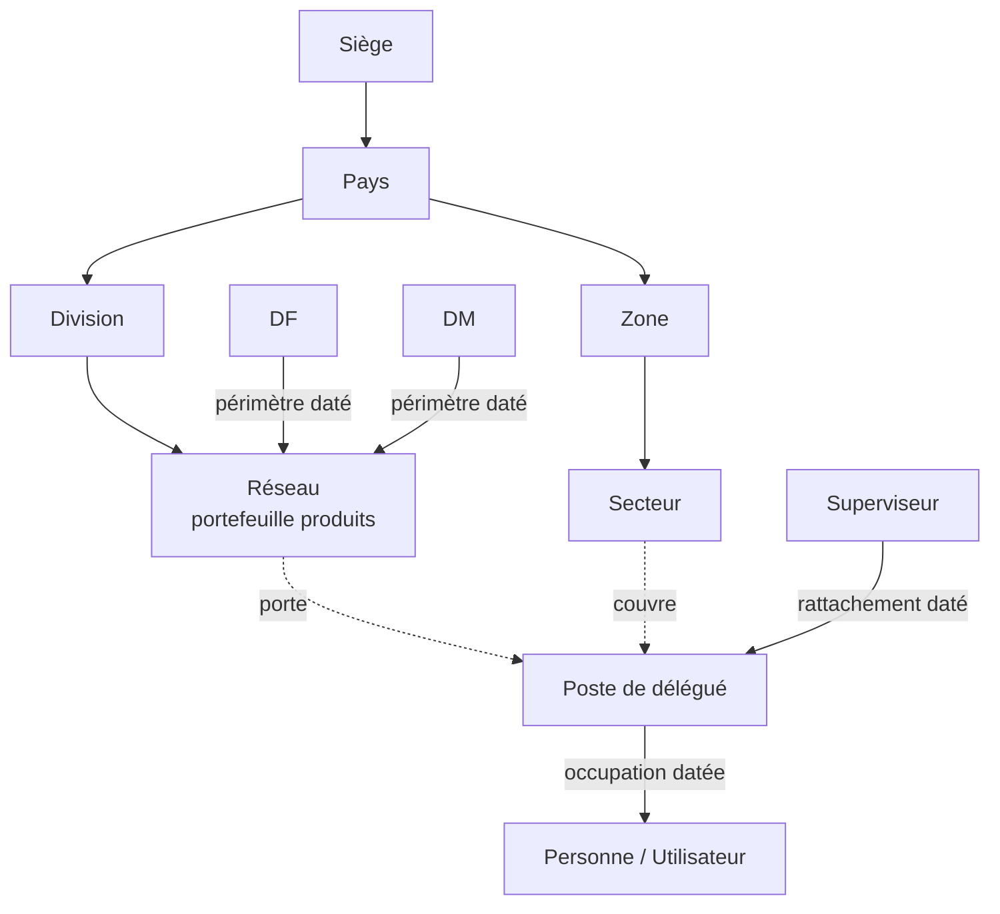
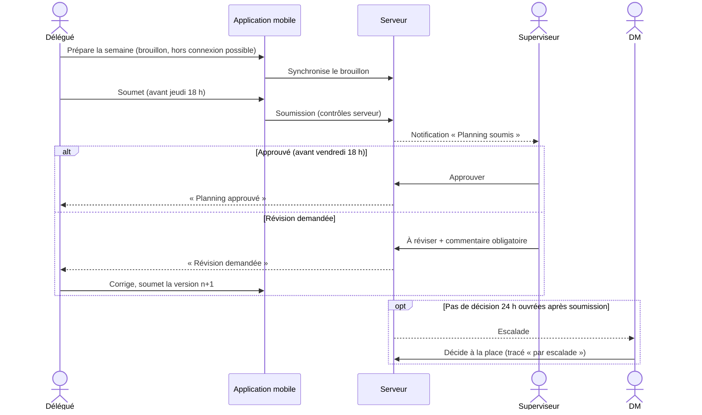
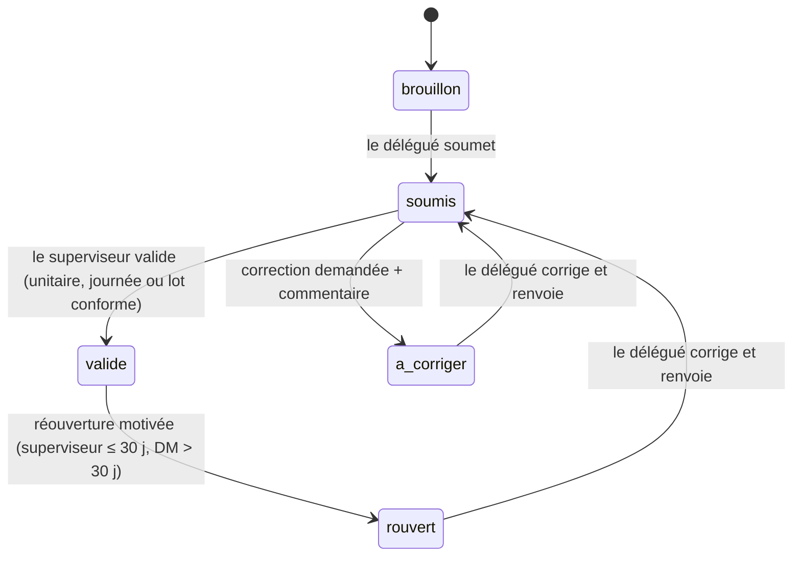

# INNOV CRM — Document de référence produit (PRD)

| Élément | Valeur |
|---|---|
| Produit | INNOV CRM — CRM multi-pays des délégués médicaux |
| Remplace | BirdNotes (outil utilisé pendant la phase test de septembre 2026) |
| Version du document | 1.0 |
| Version produit visée | `1.0.0` (première version stable) |
| Statut | Cadrage validé le 4 octobre 2026 |
| Sources | Cahier des charges CRM multi-pays v1.0 · fichier `ORGANISATION_GHPL_2026_v1_3.xlsx` (Sénégal) · maquette « INNOV CRM » · entretien de cadrage |
| Documents liés | [`architecture.md`](architecture.md) · [`architecture-essentials.md`](architecture-essentials.md) |

**Conventions de ce document**

- **[D]** : décision confirmée pendant le cadrage. **[H]** : hypothèse à confirmer, à traiter comme vraie tant qu'elle n'est pas remplacée. **[O]** : question ouverte.
- Les identifiants d'exigence (`ORG-001`, `PLN-004`…) et de règle (`RG-001`…) sont **stables** : on ne les renumérote jamais. Une exigence supprimée garde son numéro avec la mention « retirée ».
- Les noms de rôles, d'entités et de statuts de la section 26 (glossaire) sont les seuls autorisés, ici comme dans le code et l'interface.
- Aucun nom de personne réelle n'apparaît dans ce document ; les exemples sont fictifs.

---

## Sommaire

1. Résumé exécutif
2. Vision du produit
3. Problèmes à résoudre
4. Objectifs métier
5. Indicateurs de succès
6. Utilisateurs et rôles
7. Organisation multi-pays
8. Périmètre de la version 1.0.0
9. Fonctionnalités exclues ou reportées
10. Parcours utilisateurs
11. Workflow du planning
12. Workflow des visites
13. Workflow des rapports
14. Gestion des prospects et établissements
15. Exigences fonctionnelles
16. Règles de gestion
17. États et transitions
18. Notifications
19. Tableaux de bord
20. Exigences non fonctionnelles
21. Critères d'acceptation de la version 1.0.0
22. Risques et dépendances
23. Feuille de route de 0.0.1 à 1.0.0
24. Questions ou décisions encore ouvertes
25. Registre des décisions de cadrage
26. Glossaire

---

## 1. Résumé exécutif

INNOV CRM est l'outil unique de planification, d'exécution et de contrôle des visites des délégués médicaux de Generic Healthcare dans ses filiales africaines. Le siège, situé au Sénégal, administre les pays. Chaque pays gère sa propre organisation, ses utilisateurs, ses prospects et ses données.

Le délégué prépare sa semaine sur une application mobile, la soumet à son superviseur, réalise ses visites même sans réseau, et rédige un rapport après chaque visite. Le superviseur approuve les plannings et valide les rapports depuis un portail web. Le DM, le DF, le responsable pays et le siège suivent l'activité sans intervenir dans les décisions.

La priorité absolue du produit est de **prouver l'activité terrain** : chaque visite validée doit pouvoir être reliée à un planning approuvé, à des heures réelles, à une position GPS et à un rapport validé. La simplicité pour le délégué vient immédiatement après, car un outil contourné ne prouve rien.

Le premier déploiement a lieu au **Sénégal** (pays distinct du siège), par réseau et par petits groupes de délégués, puis s'étend selon les résultats. Le système est dimensionné dès le départ pour **au moins 500 délégués par pays**.

## 2. Vision du produit

> Chaque visite d'un délégué médical, dans chaque pays, est planifiée, approuvée, réalisée, rapportée et validée dans un seul outil, avec une preuve exploitable et sans exposer les données d'un pays, d'un réseau ou d'un délégué à qui n'a pas à les voir.

Principes produit :

1. **La preuve avant le volume** : une visite non prouvée ne compte pas dans les indicateurs de réalisation.
2. **Trois gestes pour une visite** sur mobile : démarrer, renseigner, envoyer.
3. **Le terrain ne dépend pas du réseau** : tout ce dont le délégué a besoin pour sa semaine est sur son téléphone.
4. **Une décision humaine, toujours tracée** : aucune validation automatique d'un planning ou d'un rapport.
5. **Le pays est une frontière** : aucune donnée ne la traverse sans autorisation explicite, datée et auditée.
6. **Démontrable à tout moment** : chaque version livrée peut être présentée à la direction avec des données fictives réalistes.

## 3. Problèmes à résoudre

| # | Problème constaté | Conséquence | Réponse d'INNOV CRM |
|---|---|---|---|
| P1 | Plannings et rapports dispersés (fichiers, messages, BirdNotes) | Pas de vision fiable de l'activité prévue et réalisée | Processus unique planning → visite → rapport |
| P2 | Activité terrain difficile à prouver | Doute sur la réalité des visites | Heures réelles, GPS au début et à la fin, contrôles de conformité, validation tracée |
| P3 | Validation lente ou absente des superviseurs | Plannings bloqués, rapports non relus | Échéances, rappels, validation par journée et par lot, remplaçant, escalade vers le DM |
| P4 | Organisation matricielle complexe (division, réseau, secteur, superviseur multi-réseaux) | Outils inadaptés, affectations erronées | Modèle organisationnel natif : postes, réseaux, secteurs, périmètres datés |
| P5 | Doublons de prospects (un même médecin vu par jusqu'à 12 réseaux) | Indicateurs faussés, historique éclaté | Fiche commune, détecteur de doublons, fusion contrôlée et réversible |
| P6 | Connexion mobile faible ou absente | Rapports perdus ou saisis en retard | Fonctionnement hors connexion 7 jours, synchronisation sans perte ni doublon |
| P7 | Pilotage multi-pays impossible sans mélanger les données | Pas de consolidation fiable | Isolation par pays, consolidation agrégée au siège, Grafana |

## 4. Objectifs métier

| ID | Objectif | Statut |
|---|---|---|
| OBJ-01 | Remplacer BirdNotes et les fichiers dispersés par un processus unique et traçable au Sénégal avant extension | [D] |
| OBJ-02 | Donner au superviseur une vue claire et actionnable de l'activité prévue et réalisée de ses délégués | [D] |
| OBJ-03 | Permettre au siège de piloter chaque pays sans exposer les données d'un pays à un autre | [D] |
| OBJ-04 | Améliorer la qualité des comptes rendus (produits présentés, retour du prescripteur, prochaine action) | [D] |
| OBJ-05 | Conserver l'historique complet des soumissions, révisions, corrections, validations et réouvertures | [D] |
| OBJ-06 | Fonctionner dans les zones où la connexion mobile est faible ou intermittente | [D] |
| OBJ-07 | Mesurer la couverture des prospects cibles par rapport aux fréquences et aux objectifs par réseau | [D] |

## 5. Indicateurs de succès

Mesurés pendant le pilote au Sénégal (version `0.9.7` à `0.9.9`), puis chaque mois après la version `1.0.0`. **Les valeurs cibles sont des hypothèses** [H] à ajuster par la direction métier ; les définitions sont confirmées [D].

| ID | Indicateur | Définition | Cible [H] |
|---|---|---|---|
| KPI-01 | Plannings soumis à l'heure | Plannings soumis avant l'échéance (jeudi 18 h par défaut) / plannings attendus | ≥ 90 % |
| KPI-02 | Délai de validation des plannings | Médiane entre soumission et décision du superviseur, en heures ouvrées | < 1 jour ouvré |
| KPI-03 | Taux de réalisation (DC-50) | Visites approuvées au statut `effectuee` / visites approuvées ; publié avec un second chiffre, la part des écarts justifiés (`annulee`, `reportee`, `prospect_absent`, `non_realisee` avec motif) | ≥ 85 % |
| KPI-04 | Rapports dans le délai | Rapports soumis le jour de la visite avant 23 h 59 (heure du pays) / visites effectuées | ≥ 90 % |
| KPI-05 | Adoption | Délégués du pilote ayant synchronisé au moins 3 jours dans la semaine / délégués du pilote | ≥ 80 % |
| KPI-06 | Isolation | Données exposées hors périmètre (pays, réseau, délégué) lors des tests d'isolation automatisés et de recette | 0 |
| KPI-07 | Fiabilité de synchronisation | Rapports créés hors connexion et jamais reçus par le serveur | 0 |
| KPI-08 | Couverture A/B | Prospects de potentiel A ou B de la liste cible vus au moins à la fréquence cible sur la période / prospects A et B de la liste cible | Suivi sans cible en 1.0.0 [H] |
| KPI-09 | Délai de validation des rapports | Médiane entre soumission du rapport et décision | < 1 jour ouvré [H] |

Indicateurs techniques de suivi : synchronisations en erreur et temps moyen de résolution, incidents critiques par version, taux d'utilisateurs actifs par pays et par semaine.

## 6. Utilisateurs et rôles

### 6.1 Rôles [D]

| Code | Rôle | Niveau | Canal principal | Responsabilités |
|---|---|---|---|---|
| `admin_siege` | Administrateur du siège | Siège | Portail | Crée, active, suspend et archive les pays ; désigne responsables et administrateurs pays ; accorde les affectations multi-pays et les transferts ; gère les règles globales ; consulte l'audit |
| `direction_siege` | Direction du siège | Siège | Portail | Consulte les consolidations, les tableaux de bord et l'audit, **sans rien modifier** |
| `responsable_pays` | Responsable pays (directeur général du pays) | Pays | Portail | Consulte toute l'activité de son pays ; ne gère pas les comptes |
| `admin_pays` | Administrateur pays | Pays | Portail | Gère les utilisateurs, l'organisation (zones, secteurs, réseaux, postes, rattachements), les référentiels, les paramètres du pays, les doublons, les imports, les jours fériés |
| `df` | DF | Pays (division) | Portail | Consulte plannings, visites, rapports et indicateurs des réseaux de son périmètre ; ne décide pas |
| `dm` | DM | Pays (réseaux) | Portail | Consulte les réseaux de son périmètre ; fixe les objectifs de ses réseaux ; décide **par escalade** ou en remplacement ; approuve le planning d'un superviseur qui visite lui-même ; autorise les réouvertures au-delà de 30 jours |
| `superviseur` | Superviseur | Pays (secteurs) | Portail (+ mobile s'il visite) | Approuve les plannings, valide les rapports, tient les listes cibles de ses délégués, traite les demandes de correction |
| `delegue` | Délégué | Pays (poste) | Mobile | Prépare et soumet son planning, réalise ses visites, rédige ses rapports, propose des prospects |
| `admin_technique` | Administrateur technique | Plateforme | Outils d'exploitation | Exploite la plateforme, surveille, restaure les sauvegardes ; **n'intervient jamais sur une décision métier** |

Les intitulés complets de « DF » et « DM » sont ceux de l'organisation GHPL ; leur libellé exact reste à confirmer [O-05]. Le code `df` / `dm` ne change pas.

### 6.2 Types de poste du délégué [D]

| Code | Libellé | Prospects visités (principalement) |
|---|---|---|
| `vm` | Visiteur médical | Médecins, sages-femmes, infirmiers, chirurgiens-dentistes |
| `vm_otc` | Visiteur médical OTC | Pharmacies, pharmaciens |
| `kam` | Key Account Manager | Établissements (hôpitaux, cliniques), grossistes, décideurs |
| `dermo` | Dermo-conseillère | Pharmacies, dermatologues |

Tous les types de poste suivent **le même workflow** planning → visite → rapport. Un superviseur qui assure lui-même une activité terrain (KAM, OTC) occupe aussi un poste de délégué ; son planning est alors approuvé par son DM.

### 6.3 Matrice des autorisations [D]

« Périm. » = limité au périmètre de l'utilisateur (pays, réseaux, secteurs ou délégués rattachés).

| Action | admin_siege | direction_siege | responsable_pays | admin_pays | df | dm | superviseur | delegue |
|---|---|---|---|---|---|---|---|---|
| Créer, suspendre, archiver un pays | Oui | Non | Non | Non | Non | Non | Non | Non |
| Désigner responsable / admin pays | Oui | Non | Non | Non | Non | Non | Non | Non |
| Accorder une affectation multi-pays ou un transfert | Oui | Non | Non | Non | Non | Non | Non | Non |
| Gérer les utilisateurs d'un pays | Oui | Non | Non | Oui (son pays) | Non | Non | Non | Non |
| Gérer l'organisation (zones, secteurs, réseaux, postes) | Oui | Non | Non | Oui | Non | Non | Non | Non |
| Gérer les référentiels (produits, spécialités, types) | Oui | Non | Non | Oui | Non | Non | Non | Non |
| Créer un prospect ou un établissement | Non | Non | Non | Oui | Non | Non | Selon délégation de l'administrateur pays [H] | Oui (statut `a_valider`) |
| Trancher un doublon, fusionner, défusionner | Non | Non | Non | Oui | Non | Non | Non | Non |
| Proposer une modification d'une fiche commune (PRP-014) | Non | Non | Non | Non | Non | Non | Non | Oui |
| Accepter ou refuser une proposition (PRP-014) | Non | Non | Non | Oui | Non | Non | Oui (périm.) | Non |
| Tenir une liste cible | Non | Non | Non | Oui | Non | Non | Oui (périm.) | Non |
| Fixer les objectifs d'un réseau | Non | Non | Non | Oui | Non | Oui (périm.) | Non | Non |
| Tenir le calendrier des jours fériés (ORG-012) | Non | Non | Non | Oui | Non | Non | Non | Non |
| Créer et soumettre un planning | Non | Non | Non | Non | Non | Non | Oui (s'il occupe un poste) | Oui (le sien) |
| Approuver ou faire réviser un planning | Non | Non | Non | Non | Non | Escalade / remplacement / superviseur-visiteur | Oui (périm.) | Non |
| Réaliser une visite, rédiger un rapport | Non | Non | Non | Non | Non | Non | Oui (s'il occupe un poste) | Oui |
| Lire les rapports de visite (RPT-011) [H] | Non | Non | Oui (pays) | Non | Oui (périm.) | Oui (périm.) | Oui (périm.) | Les siens |
| Valider un rapport ou demander une correction | Non | Non | Non | Non | Non | Escalade / remplacement | Oui (périm.) | Non |
| Rouvrir un rapport validé | Non | Non | Non | Non | Non | Oui (> 30 jours, périm.) | Oui (≤ 30 jours, périm.) | Non |
| Désigner un remplaçant de superviseur | Non | Non | Non | Oui | Non | Oui (périm.) | Oui (pour lui-même) | Non |
| Consulter les indicateurs | Global agrégé, nominatif audité | Global agrégé, nominatif audité | Pays nominatif | Non (§14.76) | Réseaux nominatif | Réseaux nominatif | Délégués rattachés | Personnels |
| Consulter le journal d'audit | Oui | Oui | Son pays | Son pays | Non | Non | Non | Non |
| Exporter | Oui (audité) | Oui (audité) | Oui (audité) | Non (§14.58) | Oui (audité) | Oui (audité) | Oui (audité) | Non |
| Effacer à distance un appareil | Oui | Non | Non | Oui | Non | Non | Non | Non |
| Recevoir et lire ses notifications (§18) | Les siennes | Les siennes | Les siennes | Les siennes | Les siennes | Les siennes | Les siennes | Les siennes |

## 7. Organisation multi-pays

### 7.1 Hiérarchie et modèle matriciel [D]

Le siège est une entité **distincte** de tout pays, même s'il est installé au Sénégal. Le pays « Sénégal » est un pays opérationnel comme les autres.

L'organisation d'un pays est **matricielle** :

- **Ligne produit** : Division → Réseau → DF → DM. Un réseau porte un **portefeuille de produits**.
- **Ligne terrain** : Zone → Secteur → Superviseur → Poste de délégué.

Constats issus du fichier d'organisation du Sénégal (2026), utilisés pour concevoir le modèle :

| Constat | Ordre de grandeur (Sénégal) | Conséquence |
|---|---|---|
| Divisions | 4 | Entité `Division` |
| Réseaux | 19 | Entité `Reseau` avec portefeuille de 6 à 25 produits |
| Produits | ~156 distincts (308 au référentiel de la phase test), dont la moitié sur plusieurs réseaux | Référentiel produits par pays, relation n–n avec les réseaux |
| Zones / secteurs | 2 zones, 48 secteurs | Entités `Zone`, `Secteur` |
| Superviseurs | 24, dont certains encadrent jusqu'à 14 réseaux | Le superviseur est rattaché à des **postes**, pas à un réseau |
| Postes / personnes | 227 postes pour 207 personnes ; postes vacants | Le **poste** est distinct de la **personne** qui l'occupe |
| Secteurs partagés | 25 secteurs sur 48 couverts par plusieurs réseaux | Un même prospect est visité par plusieurs délégués |

### 7.2 Exigences d'organisation

Voir `ORG-001` à `ORG-014` (section 15.1).

### 7.3 Appartenance à plusieurs pays et transferts [D]

- Chaque utilisateur (hors siège) a **un pays principal**.
- Le siège peut lui accorder des **affectations supplémentaires** dans d'autres pays, avec une date de début, une date de fin facultative, un motif et un rôle par pays. Exemple : un DF couvrant deux pays, un intérim.
- L'utilisateur choisit son **pays actif** ; il ne voit jamais deux pays à la fois, sauf au siège.
- Un **transfert** change le pays principal, exige l'autorisation du siège et laisse tout l'historique dans le pays d'origine.

### 7.4 Séparation et consolidation des données [D]

- Toute donnée métier appartient à un pays (`RG-001`).
- Le siège voit des agrégats par pays, division, réseau et période ; il peut descendre au détail nominatif, **chaque consultation nominative étant auditée**.
- Responsable pays, administrateur pays, DF, DM et superviseur voient le détail nominatif de leur périmètre.
- Toute exception de visibilité est explicite, datée, limitée dans le temps et auditée.

### 7.5 Paramètres configurables par pays [D]

| Paramètre | Valeur par défaut |
|---|---|
| Langue par défaut | Français (`fr`) ; anglais (`en`) disponible |
| Fuseau horaire | Celui du pays (Sénégal : `Africa/Dakar`) |
| Format de date et d'heure | `JJ/MM/AAAA`, 24 h |
| Devise (affichage futur) | XOF (FCFA) pour les pays UEMOA |
| Jours ouvrés | Lundi à vendredi |
| Jours fériés | Calendrier annuel tenu par l'administrateur pays, fêtes religieuses à date variable comprises |
| Échéance de soumission du planning | Jeudi 18 h de la semaine précédente |
| Délai de rapport | Jour de la visite, 23 h 59 |
| Seuils de visites par jour | Par type de poste (ex. `vm` 6 à 10, `kam` 3 à 6) [H] |
| Contrôles de conformité | Plage horaire 8 h–20 h ; visites sans GPS tolérées par journée : 3 [H] ; distance de pointage 100 m (pratique relevée dans BirdNotes, 4 octobre 2026), au-delà de laquelle une position imprécise est « imprécise » et non « loin du lieu » ; rayon propre possible par établissement (DC-55) |
| Cycle de visite | 4 semaines (pratique relevée dans BirdNotes) |
| Géolocalisation | Activée ou désactivée par pays |
| Champs supplémentaires du rapport | Aucun |
| Libellés (division, réseau, zone, secteur) | Libellés standard, modifiables |
| Durées de conservation | 5 ans (activité, audit), 12 mois (positions GPS), 3 ans (pièces jointes) |
| Délai d'escalade | 24 heures ouvrées |

## 8. Périmètre de la version 1.0.0

| Domaine | Inclus en 1.0.0 [D] |
|---|---|
| Organisation | Siège, pays, divisions, réseaux, zones, secteurs, postes, occupations, rattachements, périmètres DF/DM, affectations multi-pays, transferts |
| Comptes | Comptes nominatifs, 9 rôles, mot de passe, double authentification pour les rôles sensibles, gestion des appareils |
| Référentiel | Prospects, établissements, exercices datés, spécialités, catégories, potentiel A/B/C, classes thérapeutiques, produits, portefeuilles |
| Qualité des données | Détecteur de doublons, fusion automatique certaine, file des doublons probables, défusion |
| Imports | Organisation (format du fichier d'organisation), référentiel produits, prospects et établissements depuis BirdNotes, rapport d'erreurs |
| Ciblage | Liste cible par délégué, fréquence de visite par prospect, couverture |
| Planning | Semaine lundi–vendredi, passages, absences, jours fériés, contrôles, kilométrage estimé, soumission, révision, approbation, versions, modifications mineures et majeures |
| Visites | Programme du jour, GPS début/fin, statuts, report lié, visite imprévue, contrôles de conformité |
| Rapports | Socle commun + champs par pays, produits présentés dans l'ordre, retour du prescripteur, échantillons et cadeaux remis, prochaine action, pièce jointe, brouillon, correction, validation par journée et par lot, réouverture, versions |
| Supervision | Remplaçant daté, escalade vers le DM |
| Notifications | Push qui ouvre l'action, centre de notifications, courriel de sécurité |
| Pilotage | Tableaux de bord délégué, superviseur, DM/DF, pays, siège ; objectifs par réseau ; exports audités ; Grafana |
| Mobile | Android et iOS, hors connexion 7 jours, chiffrement local, effacement à distance |
| Exploitation | Audit, sauvegardes, supervision, environnements, instance de démonstration |
| Langues | Français et anglais |

## 9. Fonctionnalités exclues ou reportées

| Élément | Décision | Remarque |
|---|---|---|
| Notes de frais et remboursements, montant des frais | Exclu de 1.0.0 [D] | Seul le kilométrage estimé est affiché |
| Gestion de stock d'échantillons (dotations, soldes, inventaires) | Exclu de 1.0.0 [D] | La **remise** d'échantillons est saisie dans le rapport |
| Commandes, livraisons, facturation, comptabilité, paie | Exclu [D] | — |
| Campagnes marketing, envois massifs, segmentation avancée | Exclu [D] | — |
| SMS | Exclu [D] | — |
| WhatsApp | Après 1.0.0 [D] | Canal d'escalade uniquement |
| Suivi GPS en continu | Exclu [D] | GPS au début et à la fin de visite seulement |
| Signature électronique du prospect | Exclu [D] | — |
| Gestion RH des congés, intégration à un outil RH | Exclu [D] | Les absences sont déclarées dans le planning |
| Intégration ERP | Après 1.0.0 | Champ « non connecté » de la maquette |
| Langues autres que français et anglais | Après 1.0.0 | Textes externalisés dès `0.0.1` |
| Application de bureau, mode tablette dédié | Après 1.0.0 | Le portail fonctionne sur tablette en navigateur |

## 10. Parcours utilisateurs

### 10.1 Délégué — une semaine type

1. **Jeudi** : ouvre « Semaine » sur son téléphone, glisse des prospects de sa liste cible dans les jours de la semaine suivante, regroupe trois médecins d'un hôpital en un passage, déclare une demi-journée de formation, voit le kilométrage estimé et les alertes (seuils, conflits, prospect A non planifié). Soumet avant 18 h.
2. **Vendredi** : reçoit une notification « Révision demandée » ; l'ouvre, lit le commentaire, déplace deux visites, soumet la version 2. Reçoit « Planning approuvé ».
3. **Lundi** : ouvre « Tournée » sans réseau ; démarre la première visite (GPS capturé, distance au cabinet affichée), coche les produits présentés dans l'ordre, note le retour du prescripteur, les échantillons remis, la prochaine action. Envoie : le rapport part dans la file d'attente locale (orange) et se synchronise seul au retour du réseau.
4. **Mardi** : un médecin est absent : statut `prospect_absent` avec motif. Un autre demande un report : statut `reportee`, une nouvelle visite liée est créée. Il rencontre un prescripteur non prévu : visite imprévue justifiée.
5. **Mercredi** : reçoit « Correction demandée » sur une visite ; corrige et renvoie.
6. Consulte « Mes chiffres » : visites, couverture, rapports validés.

### 10.2 Superviseur — une journée type

1. Ouvre l'accueil du portail : rapports à valider, plannings en attente, délégués non synchronisés depuis plus de 48 h, demandes de prospect.
2. Valide en un clic les journées « conformes » (horaires, GPS, distance) ; ouvre une journée « à vérifier », consulte la chronologie des visites, demande une correction motivée sur une visite précise.
3. Ouvre un planning soumis, voit les alertes (prospect hors liste cible, seuil dépassé, kilométrage), approuve ou demande une révision avec commentaire.
4. Met à jour la liste cible d'un délégué. Avant ses congés, désigne un autre superviseur comme remplaçant du 12 au 23.

### 10.3 DM / DF

Consultent les tableaux de bord de leurs réseaux, fixent les objectifs trimestriels (DM), reçoivent les escalades (DM) et décident à la place d'un superviseur défaillant, approuvent le planning d'un superviseur qui visite (DM).

### 10.4 Administrateur pays

Importe l'organisation et le référentiel, crée les comptes et les postes, rattache les postes aux superviseurs, tient le calendrier des jours fériés, configure les seuils et les champs du rapport, tranche la file des doublons probables, désactive le compte et efface à distance le téléphone d'un délégué qui quitte l'entreprise.

### 10.5 Responsable pays et siège

Le responsable pays consulte l'activité nationale. L'administrateur du siège crée un pays, désigne son responsable et son administrateur, accorde une affectation multi-pays. La direction du siège compare les pays dans les tableaux de bord et Grafana.

## 11. Workflow du planning

Règles principales : `RG-010` à `RG-024`. Points clés :

- Une semaine = un planning par délégué, avec des **versions** successives (`RG-012`).
- Le planning se soumet avant le lundi 0 h de sa semaine ; à cette heure, tout planning non validé est fermé et seul le superviseur en rouvre la rédaction ; paramétrable par pays (`RG-013`, décision du 6 octobre 2026, §14.21).
- Contrôles **bloquants** à la soumission : champs obligatoires, prospect et établissement actifs du même pays, conflit horaire exact, doublon de visite (même prospect, même jour) (`RG-015`).
- Contrôles **signalés** au superviseur, non bloquants : seuils de visites par jour, prospect hors liste cible, prospect hors secteur, prospect A non planifié sur le mois, soumission en retard (`RG-016`).
- Après approbation : modification **mineure** libre et tracée (heure, même jour) ; modification **majeure** (jour, prospect, ajout, retrait) = nouvelle version soumise ; les visites non concernées restent exécutables (`RG-018`).

## 12. Workflow des visites

1. Le programme du jour liste les visites approuvées, ordonnées, avec la prochaine visite en tête et la distance au lieu (si le GPS est actif).
2. **Démarrer** : statut `en_cours`, heure réelle de début et position GPS capturées automatiquement, même hors connexion.
3. **Terminer** : statut `effectuee`, heure réelle de fin et position GPS capturées ; ouverture du rapport.
4. **Écarts** : `annulee`, `reportee` (crée une nouvelle visite liée), `prospect_absent`, `non_realisee` — chacun exige un motif choisi dans une liste du pays et un commentaire facultatif.
5. **Visite imprévue** : ajoutée le jour même, rattachée au jour réel, avec justification obligatoire ; elle ne nécessite pas d'approbation préalable mais apparaît comme « imprévue » au superviseur.
6. **Contrôles de conformité** calculés par le serveur à la réception : hors plage horaire, sans GPS, distance supérieure au seuil, durée anormale [H : durée < 3 min ou > 3 h], visite non planifiée. Ils ne bloquent pas la saisie ; ils classent la journée « conforme » ou « à vérifier ».

## 13. Workflow des rapports

- Un rapport par visite au statut `effectuee` (`RG-030`).
- Attendu le jour même avant 23 h 59, heure du pays ; au-delà, marqué `en_retard` ; alerte au superviseur à 48 h (`RG-032`).
- Le superviseur valide **visite par visite**, **par journée** d'un délégué, ou **par lot** de journées conformes ; chaque rapport validé porte l'identité du validateur et le mode (`unitaire`, `journee`, `lot`, `escalade`, `remplacement`) (`RG-034`).
- Aucune validation automatique (`RG-035`).
- Chaque soumission crée une version figée ; les versions sont consultables par le superviseur et au-dessus (`RG-037`).

## 14. Gestion des prospects et établissements

### 14.1 Prospect

| Champ | Obligatoire | Remarque |
|---|---|---|
| Civilité, nom, prénom | Nom obligatoire | NOM en majuscules, Prénom avec sa majuscule (règle imposée à la saisie, 4 octobre 2026) ; le titre (Dr, Pr, Mme, M.) va dans la civilité, jamais dans le nom ; normalisés pour la détection de doublons |
| Type de prospect | Oui | Liste fermée `medecin`, `paramedical`, `pharmacie`, `grossiste` (liste par pays). Révisé le 4 octobre 2026 sur la pratique relevée dans BirdNotes : sage-femme et infirmier sont des spécialités paramédicales, l'officine une spécialité de la pharmacie |
| Spécialité | Selon le type | Référentiel par pays, chaque spécialité rattachée à son type (médecine générale, cardiologie… ; sage-femme, infirmier… ; officine, parapharmacie) |
| Grade | Non | `docteur`, `professeur`, `professeur_agrege`, `chef_service`, `assistant`, `resident` (liste par pays) |
| Exercice | Non | `hospitalier` ou `prive` (H/P) |
| Secteur, localité | Non | La localité appartient à un secteur ; elle en donne le secteur |
| Numéro d'ordre professionnel | Non | Identifiant fort pour la fusion automatique |
| Téléphone mobile personnel, téléphone professionnel, courriel | Non | Normalisés au format international ; le mobile personnel ne s'affiche qu'aux délégués qui ont le prospect dans leur liste cible, et seulement si « accepte d'être contacté sur ce numéro » est coché (DC-58) |
| Potentiel | Oui | `A`, `B`, `C` |
| Pays | Oui | Ne change jamais (`RG-001`) |
| Statut | Oui | `a_valider`, `actif`, `archive`, `fusionne` |

### 14.2 Établissement

Nom, type (`cabinet`, `hopital`, `clinique`, `centre_sante`, `poste_sante`, `pharmacie`, `grossiste`, `autre` — liste par pays), adresse, secteur, localité (référentiel des localités de chaque secteur, tenu dans Organisation), exercice `hospitalier` ou `prive`, coordonnées GPS de référence, téléphone, statut (`a_valider`, `actif`, `archive`, `fusionne`).

### 14.3 Exercice (relation prospect ↔ établissement)

Un prospect exerce dans **un ou plusieurs** établissements. Chaque exercice est daté (début, fin facultative) et peut porter des jours et horaires de présence [H]. Une visite référence toujours un prospect et un établissement liés par un exercice actif à la date de la visite.

### 14.4 Fiche commune, visites privées [D]

- La fiche d'un prospect est **commune** à tous les réseaux du pays.
- Un délégué ne voit que **ses propres** visites et rapports sur ce prospect.
- Le superviseur voit les visites des délégués rattachés ; DM et DF celles de leurs réseaux ; le responsable et l'administrateur pays tout le pays.

### 14.5 Ciblage [D]

- Chaque délégué (poste) a une **liste cible** tenue par son superviseur (ou l'administrateur pays), avec une **fréquence cible** par prospect (ex. 2 visites par mois).
- Le délégué peut planifier un prospect de son secteur hors liste cible ; c'est signalé au superviseur.
- La couverture se calcule sur la liste cible et les fréquences.

### 14.6 Création et doublons [D]

- Un délégué peut créer un prospect ou un établissement. La fiche est au statut `a_valider` et **utilisable immédiatement par lui seul**.
- À la saisie, le système affiche les fiches ressemblantes (nom approchant, phonétique, téléphone, établissement, spécialité) et invite à réutiliser une fiche existante.
- À l'enregistrement, le détecteur calcule un score :
  - **certain** → fusion automatique dans la fiche existante. « Certain » signifie : même numéro d'ordre dans le même pays, ou même téléphone mobile personnel **avec** un nom similaire au-dessus du seuil [H : la condition sur le nom évite de fusionner deux médecins partageant le standard d'une clinique] ;
  - **probable** → la fiche entre dans la **file des doublons probables**, tranchée par l'administrateur pays ;
  - **aucun** → la fiche devient `actif` et commune.
- Toute fusion est **réversible** (défusion) et auditée ; les visites, rapports, exercices et listes cibles suivent la fiche conservée.
- Mise en œuvre 0.1.8 [H] : le score va de 0 à 100 (similarité des noms normalisés jusqu'à 60, même numéro d'ordre 40, même mobile 25, même fixe avec nom similaire 10, même spécialité ou type et même secteur 5 chacun) ; deux noms sont « similaires » au-dessus de 0,85 (rapport de ressemblance insensible à l'ordre des mots). Le même téléphone fixe seul ne rend jamais deux fiches probables. La fiche conservée garde ses valeurs ; ses champs vides sont complétés par ceux de la fiche absorbée, et la défusion les rend. Une fiche défusionnée qui partageait le numéro d'ordre de l'autre le perd (deux personnes n'en partagent pas) et l'historique le garde. Une défusion déclare la paire distincte : elle ne refusionne plus automatiquement.
- Le délégué ne modifie pas une fiche commune : il **propose** (téléphones, courriel, numéro d'ordre, adresse, nouvel exercice) ; le superviseur des postes de l'auteur ou l'administrateur pays tranche (PRP-014). Chaque champ changé est historisé : champ, ancienne et nouvelle valeur, auteur, date, origine (saisie, proposition, fusion, défusion) (PRP-012).

### 14.7 Import initial depuis BirdNotes [D, format O-01 tranché le 4 octobre 2026]

Les prospects, établissements, secteurs, localités et produits viennent de BirdNotes, le CRM en place au Sénégal. L'administrateur pays téléverse **l'export JSON de BirdNotes tel quel** (ou son archive ZIP) : le fichier est lu à l'exécution, jamais conservé ni versionné (données réelles). L'import :

- se **simule** d'abord : tout est calculé puis annulé ; seuls le bilan et le rapport restent ;
- produit un **rapport d'anomalies** téléchargeable (CSV), un motif par ligne écartée ou corrigée ;
- reprend dans l'ordre secteurs et localités (les secteurs nouveaux vont dans une zone « À répartir »), gammes (divisions et réseaux), produits et portefeuilles, établissements (type déduit du nom, à préciser sinon ; secteur déduit de leurs prospects quand BirdNotes n'en donne pas), prospects validés (`actif`) et demandes de création (`a_valider`) ;
- applique les règles de nettoyage validées le 4 octobre 2026 : titre sorti du nom ou du prénom vers la civilité (prénom et nom collés signalés, à séparer à la main), NOM en majuscules, libellés de spécialité et de secteur unifiés, localités « INTERMEDIARE » non reprises (secteur gardé, localité à préciser) ;
- verse les **groupes de doublons** signalés par BirdNotes et les **fiches au même nom** dans la file des doublons, que tranche l'administrateur pays (§6.3, PRP-009 ; [D] confirmé le 4 octobre 2026, et non le superviseur) ; rien n'est fusionné à l'import ; les demandes de modification en attente dans BirdNotes ne sont pas reprises, leur auteur n'ayant pas de compte [H] : elles se reproposent depuis INNOV CRM (PRP-014) ;
- garde la **référence BirdNotes** de chaque fiche reprise : un réimport la retrouve et ne crée rien.

Les comptes, l'organisation (postes, affectations) et l'historique des visites ne sont pas repris en 0.1.4 : l'organisation vient du fichier d'organisation (ORG-014).

### 14.8 Calendrier et semaine (mise en œuvre 0.2.1)

- Une semaine se désigne par son lundi ; ses jours sont les jours ouvrés du pays (RG-014). Un jour férié y figure, marqué et non planifiable (PLN-001 CA2), et sort des jours comptés par les contrôles de la semaine (ORG-012 CA1, RG-022).
- Un jour férié se modifie ou se retire jusqu'à la veille ; à partir du jour même, il est acquis (ORG-012 CA2) [H]. La mention « date variable » signale une fête dont la date s'annonce peu avant ; la règle est la même pour toutes les dates.
- Le planning se crée pour la semaine en cours ou une semaine à venir, jamais une semaine passée [H], par qui occupe un poste cette semaine-là (§6.3).
- La démonstration ne contient que les jours fériés à date certaine (fixes ou calculés depuis Pâques) ; les fêtes à date variable restent à saisir par l'administrateur pays.

### 14.9 Visites planifiées (mise en œuvre 0.2.2)

- Une visite planifiée porte le jour, l'heure, le prospect, le lieu (établissement), le réseau et l'objectif ; la note est facultative (PLN-002). L'heure et la note, prévues en 0.2.3, arrivent dès 0.2.2 puisque PLN-002 les exige.
- L'objectif est un texte libre de 200 caractères au plus [H] ; une liste d'objectifs types pourra le remplacer si les pays la demandent.
- Le réseau se choisit parmi ceux des postes que le délégué occupe cette semaine-là ; s'il n'y en a qu'un, il est retenu d'office [H].
- Pendant la préparation, une visite peut rester incomplète [H] : elle s'enregistre et montre « À compléter » avec les champs manquants. Le refus avec la liste des champs manquants (PLN-002 CA1) s'applique à la soumission (PLN-008, 0.2.8), parmi les contrôles bloquants (`planning_bloque`).
- Le prospect et le lieu doivent être actifs dans le pays (RG-025) ; une fiche « à valider » n'est acceptée que pour le délégué qui l'a créée. Le contrôle que le prospect exerce bien dans ce lieu viendra avec les contrôles de 0.2.4 [H].
- Une visite se modifie ou se retire tant que le planning est « en préparation » ou « à réviser » ; le retrait est un archivage audité, jamais une suppression. Déplacer, copier et la pose depuis la liste cible arrivent en 0.2.5 (PLN-005, §14.12).
- La démonstration prépare la semaine en cours du premier délégué de chaque pays : trois visites complètes et une à compléter.

### 14.10 Ordre, passages et absences (mise en œuvre 0.2.3)

- **Ordre de la journée** [H] : les visites à heure fixe se rangent d'elles-mêmes dans l'ordre chronologique ; le délégué place à la main celles qui n'ont pas encore d'heure. L'heure garde le dernier mot : une visite qui reçoit une heure reprend sa place chronologique.
- **Passage** (PLN-003) : le délégué regroupe en un passage des visites du même jour dans le même établissement ; le passage s'affiche « Établissement · n prescripteurs » (CA1) et chaque visite garde son prospect, son objectif et, plus tard, son rapport (CA2).
  - Le passage a une seule heure, celle de toutes ses visites [H] ; à sa création, c'est la plus matinale. La changer sur une visite la change pour toutes.
  - Une visite ajoutée dans ce lieu ce jour-là rejoint d'office le passage ; une visite déplacée à un autre jour ou un autre lieu le quitte ; un passage réduit à une visite se défait [H].
  - « Dissocier » rend les visites indépendantes ; elles gardent l'heure du passage.
- **Absence** (PLN-009) : congé, formation, réunion, maladie ou autre, sur la journée, le matin ou l'après-midi.
  - Une absence « autre » exige un motif [H] (comme les écarts de visite, RG-031).
  - Une journée entière d'absence ne reçoit pas de visite, et ne se déclare pas tant que des visites y sont prévues [H] ; une demi-journée laisse planifier le reste du jour. Le matin et l'après-midi déclarés ensemble valent une journée entière (0.2.9) [H].
  - Une demi-journée compte pour moitié dans la part travaillée du jour (CA1, RG-022) ; les seuils qui l'utilisent arrivent avec les contrôles de 0.2.4. La validation avec le planning (CA2) vient avec le cycle 0.3.
- La démonstration ajoute à la semaine du premier délégué un passage de deux confrères et une demi-journée de formation.

### 14.11 Contrôles du planning (mise en œuvre 0.2.4)

- Le délégué voit les contrôles **pendant la préparation**, pas seulement à la soumission : une carte « À vérifier » sépare ce qu'il faut corriger avant de soumettre (RG-015) de ce qui sera signalé au superviseur (RG-016) ; chaque visite concernée porte sa marque et chaque jour montre son nombre de visites face au seuil.
- **Bloquants** (RG-015) : visite incomplète ; fiche du prospect ou du lieu devenue inactive (une fiche « à valider » reste permise à son auteur, PRP-006) ; prospect sans exercice actif dans ce lieu à la date de la visite ; deux visites à la même heure (PLN-004 CA1) — les visites d'un même passage partagent la leur et ne se gênent pas ; le même prospect deux fois le même jour ; une visite restée sur un jour devenu férié ou d'absence toute la journée après sa pose (0.2.9). La soumission (0.2.8) les refuse avec la liste et le détail de chaque point, champs manquants compris (`planning_bloque`).
- **Signalements** (RG-016), qui n'empêchent pas la soumission (CA2) :
  - seuil de visites par jour selon le type de poste (`seuils_visites_jour`), au prorata de la part travaillée : minimum arrondi à l'entier inférieur, maximum à l'entier supérieur [H] ; jours fériés et journées d'absence exclus (RG-022) ; pour qui occupe des postes de types différents, la fourchette la plus large [H] ;
  - prospect hors de la liste cible des postes occupés ; lieu (ou, sans lieu, prospect) hors des secteurs de ces postes (RG-024) ;
  - prospects A de la liste cible sans aucune visite planifiée dans le mois, signalés sur la semaine qui contient le dernier jour ouvré du mois [H] ;
  - l'échéance de soumission dépassée, tant que le planning se prépare, puis la soumission en retard (0.2.8).

### 14.12 Déplacer, copier, supprimer, poser depuis la liste cible (mise en œuvre 0.2.5)

- **Déplacer** une visite, c'est changer son jour dans sa fiche ; **supprimer**, c'est la retirer (archivage audité) ; les deux existent depuis 0.2.2 et restent permis tant que le planning est en préparation ou à réviser.
- **Copier** une visite la reproduit, telle qu'enregistrée (prospect, lieu, heure, réseau, objectif, note), sur un autre jour de la semaine ; les règles d'un ajout s'appliquent (jour planifiable, passage du lieu).
- **Depuis la liste cible** (CA1) : le délégué coche des prospects de sa liste, choisit un jour, et chacun devient une visite pré-remplie — prospect et établissement principal (sinon son plus ancien lieu actif), réseau d'office s'il n'y en a qu'un. Sur téléphone, cocher puis poser remplace le glisser-déposer, malcommode sur une liste longue et une semaine qui défile [H] ; le glisser-déposer viendra sur la vue semaine du portail (PLN-006, 0.2.6). La liste propose d'abord les prospects pas encore prévus dans la semaine, et dit le jour de ceux qui le sont.
- **Reprendre la semaine précédente** (CA2) : sur une semaine encore vide, les visites de la semaine d'avant sont recopiées jour pour jour, passages compris. Un jour devenu férié ou d'absence toute la journée est sauté, et le délégué en est informé ; un réseau qui n'est plus celui d'un poste occupé reste à choisir. Les absences ne sont pas reprises [H]. Une semaine qui a déjà des visites ne se reprend pas, pour éviter les doublons [H].

### 14.13 Vues du planning et kilométrage (mise en œuvre 0.2.6)

- **Téléphone** (PLN-006) : la **semaine** affiche le statut du planning et, pour chaque jour, le nombre de visites face à son seuil (CA1) ; toucher un jour ouvre la **journée** : l'itinéraire numéroté dans l'ordre de la journée, avec la distance d'un arrêt à l'autre ; toucher une visite ouvre son **détail** (quand, lieu, objectif, réseau, statut, ce qui reste à compléter), avec ses fiches prospect et lieu. Un planning soumis s'ouvre en détail, plus en saisie.
- **Portail** (PLN-006) : la rubrique « Planning » montre la semaine en colonnes, le résumé, les contrôles et le kilométrage. En préparation, on glisse un prospect de sa liste cible sur un jour pour y poser une visite pré-remplie (PLN-005 CA1), ou une visite d'un jour à l'autre pour la déplacer ; le bouton « Poser » fait la même chose au clavier. Heure, objectif et passages se saisissent sur le téléphone [H].
- **Kilométrage estimé** (PLN-010) : à vol d'oiseau entre les établissements, dans l'ordre de la journée ; un passage compte pour un arrêt ; le trajet commence au premier lieu, faute de point de départ connu [H] ; un lieu sans coordonnées est sauté et signalé (« estimation partielle »). Aucun montant n'est calculé ni affiché (CA2). Un calcul par itinéraire routier pourra remplacer le vol d'oiseau si un pays le demande [H].

### 14.14 Brouillons et hors connexion de base (mise en œuvre 0.2.7)

- **Brouillon de saisie** (PLN-007 CA1) : la fiche d'une visite ou d'une absence en cours est gardée dans la base locale chiffrée à chaque changement. Si l'application se ferme (appel, batterie, système), la semaine propose à la réouverture de reprendre la saisie telle qu'elle était, ou de l'abandonner. Un seul brouillon à la fois [H] : le dernier formulaire ouvert.
- **Envoi en attente** : sans réseau, une visite ou une absence enregistrée reste sur le téléphone, dans une file visible (« 1 envoi en attente »), et part d'elle-même à la relecture suivante de la semaine, ou à la demande. L'identifiant de chaque nouvel objet est tiré sur le téléphone (anticipe OFF-002 CA1) : un envoi rejoué après une coupure ne crée pas de doublon (anticipe OFF-003 CA2). Un refus du serveur (jour férié, fiche inactive…) n'est pas mis en attente : il s'affiche, et un envoi refusé au rejeu garde son message jusqu'à ce que le délégué l'abandonne.
- **Semaine hors ligne** : la dernière semaine lue est gardée sur le téléphone et s'affiche sans réseau, avec l'heure de sa dernière mise à jour ; la journée et le détail d'une visite aussi (0.2.9).
- La synchronisation complète (7 jours hors ligne, conflits, pièces jointes) reste au cycle 0.8 (OFF-001 à OFF-007).

### 14.15 Soumission du planning et builds de test (mise en œuvre 0.2.8)

- **Échéance** (RG-013) : le paramètre pays `echeance_soumission_planning` (jour et heure, jeudi 18 h par défaut) s'applique à la semaine qui précède celle du planning, à l'heure du pays. Elle s'affiche sur le planning tant qu'il se prépare (« À soumettre avant le jeudi 8 octobre à 18:00 », puis « Échéance passée : … »).
- **Soumettre** (PLN-008) : depuis la fin de la semaine sur le téléphone, ou le résumé de la semaine sur le portail, avec une confirmation sur place (« Vous ne pourrez plus le modifier »). Le serveur refait le contrôle final :
  - ORG-007 CA1 : un poste occupé sans superviseur rattaché cette semaine-là empêche la soumission, avec un message qui dit de prévenir l'administrateur pays (`sans_superviseur`) ;
  - un planning sans aucune visite est refusé (`planning_vide`), sauf une semaine entièrement couverte par les jours fériés et les absences [H] ;
  - les contrôles bloquants (RG-015) le refusent avec leur liste (`planning_bloque`). Tant qu'il en reste, le téléphone remplace le bouton par ce qu'il faut corriger et ouvre la première visite concernée ; le portail grise le bouton et renvoie à « À vérifier ».
- **En retard** (CA1, RG-016) : après l'échéance, la soumission est acceptée et marquée « en retard » ; le planning le garde (`en_retard`, `soumis_le`) et le signalement « Soumis après l'échéance » remplace « Échéance de soumission dépassée ». La soumission est auditée.
- La soumission demande le réseau : elle ne part pas dans la file d'attente du téléphone [H], pour que le délégué sache tout de suite si elle est acceptée.
- **Builds de test** : profils EAS `apercu` (installation directe : `.apk`, iPhone déclarés), `simulateur` (simulateur iOS, sans compte Apple payant) et `recette` (TestFlight, piste de test interne de Google Play). Ils demandent les comptes Expo, Apple Developer et Google Play du titulaire ; aucun identifiant de compte n'est versionné (README, « Builds de test »).

### 14.16 Stabilisation et démonstration du cycle (mise en œuvre 0.2.9)

- **Recette** : [`recette-0.2.md`](recette-0.2.md) relie chaque critère d'acceptation du cycle au test qui le prouve ; scénario de démonstration : [`demonstration-0.2.md`](demonstration-0.2.md).
- **Robustesse** : les commandes sur un planning relisent son statut sous verrou (une soumission ne se croise pas avec le rejeu de la file du téléphone, ni deux reprises avec un double clic) ; la file d'attente du téléphone ne rejoue qu'une fois à la fois et ne perd pas un envoi ajouté pendant un rejeu ; une saisie interrompue ne se reprend pas si ce qu'elle modifiait a été retiré, ou si le planning n'est plus modifiable.
- **Heure du pays** : l'échéance et la date de soumission s'affichent dans le fuseau du pays, quel que soit le réglage de l'appareil.
- **Démonstration** : la semaine en cours du premier délégué est déjà soumise à temps ; la suivante est en préparation.
- **Poste de la semaine** [D, 5 octobre 2026] : le délégué planifie et visite du lundi au vendredi sur son poste ; l'occupation se lit au lundi de la semaine, sans cas particulier pour un changement de poste en cours de semaine.

### 14.17 Activités connexes et cas spéciaux (prévu en 0.3.1)

Décisions du 5 octobre 2026 [D] :
- L'activité principale et obligatoire du délégué, ce sont les **visites aux prospects** ; un planning rédigé doit être visité, tout écart se justifie (RG-031, VIS-009).
- Pas de déplacement hors de son secteur sauf s'il est **justifié** ou **demandé par le superviseur**.
- Cas spéciaux : congé, maladie, jour férié, **commandos** (à renseigner en détail), déplacements pour aider ou accompagner un collègue, accompagnement du superviseur.
- Une visite faite en binôme ou pour aider un collègue **compte à celui qui la fait**.
- Un commando est renseigné et expliqué par le délégué qui y participe, qu'il vienne de lui ou de sa hiérarchie.

Mise en œuvre [D, 5 octobre 2026, livrée en 0.3.1, PLN-018] :
- Les absences (PLN-009) deviennent des **activités connexes**, sur la journée, le matin ou l'après-midi :
  - **sans visite** : congé, maladie, formation, réunion, autre — elles réduisent l'objectif du jour ; une journée entière ne reçoit pas de visite (comportement actuel) ;
  - **avec visites** : commando, déplacement (aide ou accompagnement d'un collègue), accompagnement du superviseur — explication obligatoire (où, avec qui, pourquoi) ; pour un déplacement, « demandé par le superviseur » ou non.
- Les visites de ces journées, hors secteur ou hors liste cible, ne sont plus des signalements d'anomalie : le superviseur voit l'activité et son explication. Hors de ces journées, une visite hors secteur reste signalée (RG-024).

### 14.19 Planning approuvé : verrouillage et modifications (mise en œuvre 0.3.7)

- **Verrouillage** (PLN-015, RG-018) : approuvé, le planning ne se modifie plus librement ; une journée passée ne change plus du tout (`jour_passe`), ni ce qu'on voudrait y déplacer. Depuis 0.3.9 (§14.21), plus rien ne change dès le lundi 0 h de la semaine (`semaine_commencee`).
- **Mineure** (CA1) : seule l'heure d'une visite change, dans sa journée (avec les autres visites du même passage). Le planning reste approuvé ; le changement est tracé au journal d'audit et sur la version approuvée, où le superviseur le lit (« Heure changée depuis l'approbation »). Changer l'ordre d'une journée à venir reste libre aussi.
- **Majeure** (CA2) : tout autre changement — jour, prospect, lieu, réseau, objectif, note, ajout, retrait, activité connexe — refait le contrôle final et devient aussitôt une nouvelle version soumise (« Version n · modification après approbation ») ; s'il ne passe pas le contrôle final, il est refusé et rien ne change. Le superviseur voit ce qui attend (« À décider : … », retraits) ; les autres visites restent prévues selon la version approuvée. Une modification après approbation n'est jamais en retard.
- Hypothèses [H] à confirmer :
  - l'objectif et la note d'une visite comptent comme un changement majeur (RG-018 ne cite que l'heure comme mineure) ;
  - tant qu'une modification attend la décision, le planning ne change plus (`modification_en_attente`) ;
  - poser des prospects de la liste cible n'est pas possible sur un planning approuvé (`ajout_incomplet`) : chaque ajout se fait complet, une visite à la fois ; la copie d'une visite non plus, depuis le téléphone ;
  - au portail, le délégué lit son planning approuvé mais le modifie depuis le téléphone ;
  - le passage automatique « approuvé → en cours » le premier jour, et « en cours → terminé », est livré en 0.4.1 (§14.22).

### 14.20 Centre de notifications, rappels et escalade (mise en œuvre 0.3.8)

- **Centre** (NOT-001) : une cloche avec le nombre de non lues dans la barre du portail ; « Toutes les notifications » sur l'accueil du téléphone. Les 100 plus récentes, lues et non lues ; chacune ouvre l'écran de l'action attendue (planning à décider, file, semaine du délégué) et passe en lue.
- **Rappel** (NOT-006) : le mercredi à 9 h (heure du pays, paramètre `rappel_planning_non_soumis`), au délégué dont la semaine suivante n'est pas soumise (absente, en préparation ou à réviser), jusqu'à l'échéance ; un jour férié le reporte au jour ouvré suivant ; une seule fois par semaine.
- **Escalade** (PLN-016, RG-019) : un planning soumis sans décision depuis 24 heures ouvrées (`delai_escalade_heures_ouvrees`) est escaladé au DM dont le périmètre couvre les réseaux du poste ; il le trouve dans sa file (« Escaladé : sans décision de … depuis … ») et décide en mode `escalade`. Le superviseur garde la main.
- **Alerte du lundi** (RG-019) : à 9 h le lundi (`alerte_planning_non_approuve`), chaque DM apprend combien de plannings de la semaine ne sont pas approuvés dans ses réseaux, plannings absents compris.
- **Tâche périodique** : toutes les 15 minutes (Celery beat), à l'heure de chaque pays ; chaque envoi est idempotent. Commande `executer_echeances` pour la rejouer sans worker.
- Hypothèses [H] à confirmer :
  - l'alerte du lundi passe à 0 h, à la fermeture, et le rappel au vendredi 9 h (§14.21, livrés en 0.3.9) ;
  - heures ouvrées de l'escalade : du lundi au vendredi, sans les jours fériés [D, 6 octobre 2026] ;
  - une notification d'escalade par planning, plutôt que « n décisions en attente » regroupées (le regroupement arrive avec le push, NOT-003) ;
  - rappels « visite proche », « rapport non soumis » et « délégué non synchronisé depuis 48 h » : avec le push sur le téléphone (0.8.5), les rapports (cycle 0.5) et la synchronisation (cycle 0.8).

### 14.21 Fermeture de la semaine (décisions du 6 octobre 2026, livrées en 0.3.9)

Décisions [D] du 6 octobre 2026, qui modifient RG-013, PLN-008 CA1 et RG-018 :
- **Date limite** : le délégué soumet le planning de sa semaine avant le **lundi 0 h** de cette semaine (heure du pays). L'échéance du jeudi 18 h est supprimée.
- **Fermeture** : le lundi à 0 h, tout planning de la semaine qui n'est pas validé — en préparation, à réviser ou soumis — est fermé : plus de soumission, de décision ni de modification.
- **Réouverture** : seul le superviseur peut rouvrir la rédaction d'un planning fermé ; le délégué rédige et soumet, le superviseur valide. La réouverture reste inscrite : on sait que le planning n'a pas été fait à temps.
- **Planning validé** : modifiable selon RG-018 jusqu'au lundi 0 h ; plus du tout ensuite.
- **Rappel** (NOT-006) : le **vendredi à 9 h**, au délégué dont le planning de la semaine suivante n'est pas soumis.
- **Escalade** (RG-019) : inchangée ; les 24 heures ouvrées se comptent du lundi au vendredi, sans les jours fériés. Le délégué peut déclarer une activité connexe d'une journée ; les écarts se règlent hors de l'application.

Mise en œuvre (0.3.9) :
- Le paramètre pays `echeance_soumission_planning` (« Fermeture de la semaine », lundi 0 h par défaut) se lit désormais dans la semaine du planning ; les valeurs de l'ancienne règle (jeudi de la semaine précédente) sont effacées à la migration.
- **Délégué** : sur sa semaine fermée, le téléphone et le portail disent « La semaine a commencé lundi à 0 h sans planning validé : elle est fermée » et proposent « Demander la réouverture » ; la demande part une fois, au superviseur du poste et à son remplaçant (notification « … demande la réouverture de son planning »). Sans planning, la semaine ne se crée plus (`semaine_fermee`).
- **Superviseur** : sous sa file, « Semaines fermées » liste ses délégués sans planning validé pour la semaine en cours, avec « Réouverture demandée » ; « Rouvrir la rédaction », après confirmation, crée le planning s'il n'existait pas, inscrit la date et l'auteur de la réouverture (journal d'audit `planning.reouverture`) et prévient le délégué. Un planning fermé consulté ne propose plus que la réouverture. Seul le responsable du poste (ou son remplaçant) rouvre ; seule la semaine en cours se rouvre.
- Après la réouverture, le délégué prépare et soumet : la soumission est marquée « en retard » ; le superviseur décide normalement.
- Un planning soumis et fermé quitte la file et n'est plus escaladé, sauf après sa réouverture.
- **Démonstration** : la semaine en cours du premier délégué est validée, la suivante en préparation ; un second délégué a sa semaine suivante soumise et sa semaine en cours fermée, avec une demande de réouverture.
- Décisions [D] du 6 octobre 2026, après la livraison :
  - une semaine passée ne se rouvre pas : elle s'analyse telle quelle, et une semaine sans rien de fait reste une semaine où rien n'a été fait ;
  - le paramètre `echeance_approbation_planning` est retiré en 0.5.9 (DC-61) : il n'agissait plus depuis la fermeture du lundi.

### 14.22 Programme du jour (mise en œuvre 0.4.1)

- **Programme** (VIS-001) : sur l'accueil du téléphone (« Tournée »), le délégué voit le programme du jour : les visites de la **version approuvée** de son planning, dans l'ordre de la journée, avec la **prochaine visite** en tête (la première qui n'est pas encore faite), son lieu et son objectif ; puis le reste de la semaine, jour par jour (nombre de visites, activités, jours fériés). Une visite s'ouvre sur son détail.
- **Version approuvée** (RG-018) : les heures changées depuis l'approbation sont suivies ; une modification majeure qui attend la décision du superviseur n'entre pas au programme, et la visite qu'elle touche reste à sa place approuvée, marquée « Modification en attente ».
- **Sans version approuvée** : le programme le dit (« pas encore approuvé », « aucun planning cette semaine ») ; rien à exécuter.
- **Hors connexion** (CA1) : le téléphone garde le dernier programme lu, et la semaine pour ouvrir le détail d'une visite ; sans réseau, il les affiche avec « Hors ligne : programme tel qu'au … ».
- **États du planning** (prd.md §17.1) : le premier jour de sa semaine, un planning approuvé passe « en cours » ; la semaine finie, « terminé » (tâche périodique, journal d'audit).
- Décisions [D] du 6 octobre 2026 : la prochaine visite est la première non faite dans l'ordre de la journée, même si son heure est passée ; le programme vit sur le téléphone, le portail garde la vue semaine.
- La distance au lieu s'affichera avec le démarrage de la visite et la position (VIS-003, 0.4.3).

### 14.23 Détail d'une visite (mise en œuvre 0.4.2)

- **Détail** (VIS-002) : depuis le programme ou la semaine, le détail d'une visite dit le prospect, le lieu, l'objectif, puis les **coordonnées** — téléphones du prospect (mobile, professionnel) et du lieu, qu'un appui appelle, courriel, adresse et localité du lieu — et les **trois dernières visites** du délégué chez ce prospect, de la plus récente : date, heure, lieu, objectif, et leur résultat dès qu'il existe (cycle 0.4).
- **CA1** : l'historique ne compte que les visites du délégué connecté, dans des plannings validés (approuvés, en cours ou terminés) ; jamais celles d'un collègue, ni une visite d'un planning resté en préparation.
- **Hors connexion** : le programme du jour prépare le détail de chaque visite de la journée ; sans réseau, il s'affiche tel qu'au dernier passage.
- **Démonstration** : le premier délégué a ses deux semaines précédentes terminées, chez les mêmes prospects : l'historique se lit.
- Décision [D] du 6 octobre 2026 : « Prévue » n'est pas affiché pour une visite passée ; seul un résultat (effectuée, prospect absent…) se dit, dès 0.4.3.

### 14.24 Démarrer une visite (mise en œuvre 0.4.3)

- **Démarrer** (VIS-003) : sur la prochaine visite du programme, ou depuis son détail, le jour prévu par le planning approuvé, « Démarrer la visite » la passe « en cours ». Le téléphone prend l'heure réelle et, si le pays active la géolocalisation (RG-028, `geolocalisation_active`), la position du moment.
- **CA1 — hors connexion** : sans réseau, la position et l'heure sont prises quand même ; le démarrage attend dans la file du téléphone (« Démarrée sans réseau : l'envoi partira dès le retour du réseau ») et part au retour du réseau ; le rejouer ne change rien (OFF-003).
- **CA2 — sans GPS** : position refusée, introuvable ou trop longue à venir (paramètre du pays `attente_gps_secondes`, 1 minute par défaut, demande d'autorisation comprise) : la visite démarre quand même, marquée « sans GPS ». Un pays qui n'active pas la géolocalisation ne garde aucune position, sans rien signaler.
- **CA3 — distance** : « En cours depuis 09:02 · À 110 m du lieu », calculée à vol d'oiseau depuis la position de référence du lieu ; le serveur la garde (`distance_debut_m`) pour les contrôles de conformité (VIS-010, 0.4.9). Un lieu sans position : distance inconnue.
- **Règles** : seule une visite de la version approuvée se démarre, le jour où elle est prévue, et une seule fois ; l'heure de début ne peut être dans le futur (5 minutes de tolérance pour l'horloge du téléphone). Le démarrage est inscrit au journal d'audit.
- Décisions [D] du 6 octobre 2026 : plusieurs visites peuvent être « en cours » en même temps (un passage) ; l'attente de la position est de 1 minute, paramètre du pays ; une visite démarrée sans réseau garde sa date et son heure réelles, même si l'envoi arrive le lendemain.

### 14.25 Terminer une visite (mise en œuvre 0.4.4)

- **Terminer** (VIS-004) : une visite en cours se termine depuis le programme ou son détail : « effectuée », heure réelle de fin et position du moment, aux mêmes règles qu'au début (géolocalisation du pays, attente, « sans GPS » à la fin, distance au lieu).
- **CA1** : la fin suit le début ; une heure de fin antérieure ou égale au début est refusée (`fin_avant_debut`), une heure dans le futur aussi.
- **Hors connexion** : terminée sans réseau, la fin attend dans la file derrière le démarrage, et les deux partent dans l'ordre au retour du réseau.
- **Programme** : la visite terminée laisse la place à la suivante (« Visite de … terminée : 09:02 – 09:27 · 25 min ») et se lit « Effectuée » dans la journée ; quand tout est fait, « Plus de visite à faire aujourd'hui ». La durée est inscrite au journal.
- L'ouverture du rapport à la fin de la visite arrive avec les rapports (cycle 0.5).

### 14.26 Prospect absent (mise en œuvre 0.4.5)

- **Prospect absent** (VIS-005) : une visite prévue du jour, ou déjà en cours, se déclare « prospect absent » depuis le programme ou son détail. Le délégué choisit un motif dans la liste des motifs d'écart du pays (référentiel PRP-001, ajusté par l'administrateur pays) et peut ajouter un commentaire (500 caractères au plus).
- **CA1** : sans motif, l'absence ne se confirme pas : le bouton reste inactif sur le téléphone et le serveur refuse (`motif_requis`) ; un motif archivé ou d'une autre liste est refusé aussi.
- **Règles** : comme au démarrage, seule une visite de la version approuvée se déclare, le jour prévu, à une heure qui n'est pas dans le futur. Une visite effectuée ou déjà absente ne change plus. La déclaration est inscrite au journal d'audit avec le code du motif.
- **Hors connexion** : sans réseau, la déclaration attend dans la file du téléphone (derrière un démarrage en attente) ; la visite se lit déjà « Prospect absent » dans le programme.
- **Programme** : la visite absente laisse la place à la suivante (« Prospect absent noté pour … : motif ») et se lit « Prospect absent · motif » dans la journée ; le détail montre le motif et le commentaire.

### 14.27 Annuler une visite, visite non réalisée (mise en œuvre 0.4.6)

- **Annuler** (VIS-006) : une visite prévue s'annule le jour même ou à l'avance (depuis son détail pour un autre jour de la semaine), une visite en cours aussi ; motif de la liste du pays, commentaire facultatif. Une journée passée ne s'annule plus (`journee_passee`) : la visite se justifie « non réalisée ».
- **Non réalisée** (VIS-009) : une visite approuvée restée « prévue » après la fin de sa journée apparaît **« À justifier »** en tête de l'accueil du délégué (CA1), sur la semaine en cours et la précédente ; depuis son détail, « Justifier : non réalisée » avec un motif. Une journée pas finie ne se déclare pas non réalisée (`journee_pas_finie`), ni une visite en cours.
- **CA1** (VIS-006, VIS-009) : sans motif, impossible (`motif_requis`), comme pour l'absence du prospect (RG-031).
- **Hors connexion** : comme les autres écarts, la déclaration attend dans la file du téléphone et la visite change déjà de statut.
- **Affichage** : « Annulée · motif », « Non réalisée · motif » dans la journée ; le détail donne le statut à jour, le motif (« Motif de l'annulation », « Motif de la non-réalisation ») et le commentaire. Les écarts s'annoncent sur un ton neutre, l'effectuée en vert.
- Hypothèses [H] : annulation possible à l'avance sur toute la semaine approuvée ; « à justifier » limité à la semaine en cours et à la précédente.

### 14.28 Reporter une visite (mise en œuvre 0.4.7)

- **Reporter** (VIS-007) : une visite prévue, le jour même ou à l'avance, passe « reportée » avec un motif de la liste du pays et un commentaire facultatif. Le délégué choisit le nouveau jour parmi les prochains jours ouvrés, après le jour prévu, et l'heure (reprise de la visite, modifiable). Changer seulement l'heure dans la journée n'est pas un report (`report_avant`) : c'est une modification mineure (PLN-015).
- **CA1** : la nouvelle visite reprend le prospect, le lieu, le réseau et l'objectif et référence la visite d'origine (`reportee_de`) ; la visite reportée indique « Reportée au jeudi 8 octobre · 10:30 ».
- **CA2** : dans une semaine déjà approuvée, même commencée, la nouvelle visite est une modification majeure : une nouvelle version est soumise au superviseur et la visite n'entre au programme qu'une fois approuvée. La semaine commencée ne ferme pas cette modification : elle est dans la file du superviseur (corrigé en 0.4.9). Dans une semaine en préparation, elle s'ajoute au planning (créé au besoin, avant sa fermeture).
- **Règles** : sans motif, impossible (RG-031) ; une visite en cours ne se reporte pas ; une visite ne se reporte qu'une fois. Hors connexion, le report attend dans la file avec l'identifiant de la nouvelle visite, donné par le téléphone : rejoué, il ne crée rien de plus.
- Une modification soumise (dont un report) garde la version approuvée comme référence : visites « à justifier » et historique restent lisibles.
- Hypothèses [H] : un report dans la semaine commencée est permis malgré la fermeture du lundi (exception au verrouillage de la 0.3.9) ; pendant qu'une modification attend la décision du superviseur, un second report de la même semaine est refusé (`modification_en_attente`).

### 14.29 Visite imprévue (mise en œuvre 0.4.8)

- **Visite imprévue** (VIS-008, RG-027) : sous le programme du jour, « Visite imprévue » : le délégué choisit le prospect (liste cible d'abord, puis toutes les fiches du pays), son lieu, et écrit pourquoi la visite n'était pas prévue. La visite démarre aussitôt, rattachée au jour réel, avec l'heure et la position du moment (mêmes règles qu'un démarrage) ; elle se termine ou s'écarte (absent, annulée) comme les autres.
- **CA1** : sans justification, elle ne démarre pas (`justification_requise`).
- **CA2** : « Imprévue » sur le programme du jour, la semaine et le détail du délégué (avec la justification) et sur la semaine du planning au portail (justification au survol).
- **Sans approbation** : elle ne passe pas par le superviseur et n'entre dans aucune version, aucun contrôle de préparation, aucun kilométrage estimé, aucune reprise de semaine ; elle ne compte pas parmi les visites planifiées et n'a rien « à compléter ».
- **Hors connexion** : elle démarre sur le téléphone avec un identifiant donné par celui-ci et attend dans la file ; rejouée, elle n'est créée qu'une fois.
- La visite en cours la plus récemment démarrée passe en tête du programme (« Prochaine visite »).
- Hypothèse [H] : une visite imprévue exige un planning approuvé pour la semaine (`semaine_non_approuvee` sinon).

### 14.30 Contrôles de conformité (mise en œuvre 0.4.9)

- **Contrôles** (VIS-010, RG-029) : calculés par le serveur à chaque réception (démarrage, fin, écart, report, visite imprévue) et relus à chaque consultation ; ils ne bloquent rien et classent chaque journée passée ou du jour du délégué « conforme » ou « à vérifier ».
- **Écarts relevés**, visite par visite : début ou fin **hors de la plage horaire** ; début ou fin **plus loin du lieu** que la distance de pointage ; durée d'une visite effectuée **trop courte ou trop longue** ; **visite imprévue** (avec sa justification) ; visite **restée prévue** après sa journée (à justifier). Pour la journée : visites **sans GPS au-delà de la tolérance**. Une visite déclarée en écart sans avoir démarré (absent, annulée, reportée, non réalisée) n'a que son motif.
- **CA1** : une journée sans aucun écart est « conforme ». La journée du jour se lit « Journée en cours : aucun écart pour l'instant » tant qu'elle n'est pas finie.
- **CA2** : seuils du pays, modifiables dans « Paramètres » : plage horaire (8 h – 20 h), visites sans GPS tolérées par journée (3) [H], distance de pointage (100 m), durée d'une visite (3 à 180 minutes) [H].
- **CA3** : tant que la journée n'est pas validée, elle est recalculée avec les paramètres du moment ; validée (cycle 0.6), elle est figée avec les seuils appliqués et ne change plus.
- **Portail** : sur le planning consulté par le superviseur, la carte « Conformité des journées » résume (« 4 journées contrôlées, 2 à vérifier ») et détaille chaque écart (« 11:00 · prospect : pointée à 130 m du lieu (seuil 100 m) »). La file de travail des journées et la validation par lot arrivent avec les rapports (RPT-012, RPT-013, cycle 0.6).
- Hypothèses [H] : la tolérance « sans GPS » s'entend par journée, au-delà de 3 visites ; la durée anormale est en deçà de 3 minutes ou au-delà de 3 heures ; une visite restée prévue après sa journée compte comme écart.

### 14.31 Rapport de visite (mise en œuvre 0.5.1)

- **Ouverture** (RPT-001, RG-030) : une visite effectuée a un seul rapport, ouvert en **brouillon** à la première lecture. Avant la fin de la visite, il ne s'ouvre pas (« Le rapport s'écrit une fois la visite terminée »). Sur le téléphone, « Rédiger le rapport » apparaît sous l'annonce de la visite terminée et sous la visite effectuée ; « Reprendre le rapport » pour un brouillon, « Voir le rapport » une fois soumis.
- **CA1 (RPT-001)** : tant qu'il n'est pas soumis, la visite se lit « Rapport à rédiger » ou « Rapport en brouillon » dans le programme du jour ; l'API donne `rapport_statut` pour chaque visite (`attendu`, `brouillon`, `soumis`…).
- **Socle** (RPT-002) : produits présentés, touchés **dans l'ordre de présentation** (le rang s'affiche sur chaque produit) ; résultat de la visite, liste courte du pays ; résumé de l'échange ; prochaine action. Seuls les produits du **portefeuille du réseau de la visite, au jour de la visite**, sont proposés (RG-033) ; au-delà de 8 produits, un champ les filtre.
- **CA1 (RPT-002)** : sans le socle complet et les champs obligatoires du pays, « Soumettre le rapport » reste inactif et l'écran dit ce qui manque (« À compléter avant de soumettre : résultat, prochaine action. ») ; le serveur refuse aussi (`rapport_incomplet`). Soumis, le rapport se lit sans se modifier.
- **Champs du pays** (RPT-008) : texte libre, nombre, liste de choix (au moins deux), oui / non ; obligatoires ou facultatifs. Ils se gèrent dans « Paramètres », carte « Champs du rapport », par qui modifie les paramètres du pays (administrateur pays, siège) ; le type ne change plus une fois le champ créé ; « Retirer » l'ôte des rapports suivants.
- **CA1 (RPT-008)** : un rapport garde les champs du pays tels qu'à son ouverture ; un champ ajouté, modifié ou retiré ne vaut que pour les rapports ouverts ensuite.
- **Résultats de visite** : nouvelle liste de référence du pays, modifiable dans « Référentiels » ; valeurs initiales [H] : objectif atteint, objectif partiellement atteint, objectif non atteint, à relancer.
- **Hors connexion** [H] : en 0.5.1, le rapport s'ouvre et s'envoie avec du réseau ; sans réseau, l'écran le dit et la visite reste gardée sur le téléphone. Le brouillon gardé sur le téléphone arrive en 0.5.6, la soumission hors connexion et le marquage en retard en 0.5.7 (RPT-010).
- Hors de 0.5.1 : objectif rappelé en tête (RPT-003, livré en 0.5.2, §14.32), retour du prescripteur par produit, échantillons et cadeaux (RPT-004, RPT-005, livrés en 0.5.3, §14.33), prochaine action typée avec échéance (RPT-006, livrée en 0.5.4, §14.34).

### 14.32 Objectif prévu et résultat obtenu (mise en œuvre 0.5.2)

- **CA1 (RPT-003)** : le rapport s'ouvre sur l'**objectif prévu** de la visite, tel que planifié, dans un cadre en tête. Il est relevé à l'ouverture du rapport et ne change plus ensuite, même si la visite est modifiée.
- Une **visite imprévue** n'a pas d'objectif planifié : sa justification s'affiche à la place. Une visite planifiée sans objectif affiche « Aucun objectif n'était prévu pour cette visite ».
- **Résultat obtenu**, juste sous l'objectif : le choix de la liste courte (obligatoire, RPT-002) et, en option, une phrase « Précisez ce qui a été obtenu » (1 000 caractères au plus).
- Ordre du formulaire : objectif prévu, résultat obtenu, produits présentés, résumé, prochaine action, champs du pays. Le rapport soumis se lit dans le même ordre.
- Hypothèse [H] : la précision du résultat reste facultative, quel que soit le résultat choisi.

### 14.33 Produits présentés, retour du prescripteur, échantillons et cadeaux (mise en œuvre 0.5.3)

- **Produits présentés** (RPT-004) : le délégué touche les produits du portefeuille dans l'ordre où il les a présentés ; le rang s'affiche sur chacun. **CA1** : l'ordre saisi est conservé, jusque dans le rapport soumis. Un produit ne se présente qu'une fois par visite.
- **Retour du prescripteur**, produit par produit, sur une rangée de quatre cases : « Ne prescrit pas », « Peu », « Prescrit », « Très bien ». Il est **obligatoire pour chaque produit présenté** : sans lui, le rapport ne se soumet pas (« retour du prescripteur sur chaque produit »).
- **CA2** : seuls les produits du portefeuille du réseau sont proposés. Un produit « autre », saisi en clair, n'est possible que si le pays l'autorise : paramètre « Autre produit présenté (hors portefeuille) », désactivé par défaut [H].
- **Échantillons et cadeaux remis** (RPT-005, RG-038), facultatifs : « Échantillon » propose les produits du portefeuille déjà présentés à cette visite [H] ; « Cadeau » propose la liste « Articles promotionnels » du pays (stylo, bloc-notes, calendrier, agenda [H], modifiable dans « Référentiels »). Toucher un élément l'ajoute ; « − » et « + » règlent la quantité (1 à 999) ; « − » à 1 le retire.
- **CA1 (RPT-005)** : aucune notion de solde ni de dotation ; le rapport garde seulement ce qui a été remis.
- Le rapport soumis se lit : « 1. Produit — Prescrit très bien », puis « Échantillon · Produit × 2 », « Cadeau · Stylo × 1 ».

### 14.34 Prochaine action (mise en œuvre 0.5.4)

- **Prochaine action** (RPT-006) : un **type** choisi dans la liste du pays « Types de prochaine action » (revisiter le prescripteur, envoyer de la documentation, apporter des échantillons, présenter une étude, organiser une réunion, autre [H], modifiable dans « Référentiels ») et une **précision** en clair ; les deux sont obligatoires pour soumettre.
- **Échéance** facultative [H] : « Sans échéance », « Dans 1 semaine », « Dans 2 semaines », « Dans 1 mois », comptés depuis le jour de la visite ; jamais avant la visite.
- **Visite proposée** : un interrupteur « Proposer une nouvelle visite ». Depuis 0.5.9 (DC-61), la visite proposée apparaît dans la préparation de la semaine suivante, à placer d'un appui.
- **CA1** : à la visite suivante du **même prospect** par le **même délégué**, la prochaine action notée la dernière fois est rappelée dans un cadre « Action prévue à la visite du … » : sur le détail de la visite (gardé sur le téléphone, lisible sans réseau) et en tête du rapport. Seule l'action d'un rapport soumis est rappelée, jamais celle d'un collègue.

### 14.81 Démonstration gratuite sur Render (mise en œuvre 1.0.3)

- **Démonstration sans frais** [D, 11 octobre 2026, responsable produit] : faute de budget pour l'instant, une démonstration tourne sur les offres gratuites de Render (`render-demo.yaml`), avec des **données fictives seulement** (DEM-001). La production reste décrite par `render.yaml` et attend les formalités CDP et un budget.
- **Ce qui diffère de la production** : pas de Redis, de worker ni d'ordonnanceur (les tâches s'exécutent sur place, les tâches périodiques ne tournent pas) ; pas de sauvegarde ; pièces jointes sur le disque du service ; courriels dans le journal ; service endormi après un quart d'heure sans visite.
- **Remplissage automatique** : à chaque démarrage, `preparer_demo` remplit une base vide de données fictives (10 % des volumes réels, environ 20 secondes) et ne touche jamais une base remplie. Le mot de passe des comptes vient de la configuration de Render, jamais du dépôt.
- **Base chez Neon** [D, 11 octobre 2026, responsable produit ; 1.0.4] : Render n'accepte qu'une base gratuite par compte, déjà prise par un autre projet. La base de la démonstration est donc chez Neon (offre gratuite, Francfort), par son adresse directe : l'isolation par pays est réglée transaction par transaction, et les règles de sécurité des lignes s'appliquent au compte propriétaire de Neon comme ailleurs.
- **Démarrage** (1.0.5) : la commande en une ligne `sh -c "…"` était mal transmise par Render (« not found ») ; le démarrage passe par un fichier, `backend/demarrer_demo.sh`.
- **Clé secrète tirée par Render** [D, 12 octobre 2026, délégation ; 1.0.6] : Render tire `DJANGO_SECRET_KEY` au hasard en 256 bits écrits en base64, soit 44 caractères ; le serveur en exigeait 50 et refusait de démarrer. Le minimum passe à 43 caractères (256 bits), largement suffisant ; l'avertissement W009 de Django (50 caractères) est écarté et justifié dans la configuration. Le même défaut aurait bloqué la production (`render.yaml`).
- **Défauts corrigés en la préparant** : la sonde de santé était redirigée vers HTTPS ; le dossier des pièces jointes n'était pas accessible en écriture dans l'image ; l'adresse publique de Render n'était pas acceptée d'office.

### 14.80 Couverture des tests imposée (mise en œuvre 1.0.2)

- **NFR-014** : la couverture des modules permissions, synchronisation et workflows est mesurée à chaque livraison, et la CI échoue sous 90 %. Mesure à la 1.0.2 :
  - serveur, permissions et workflows (`perimetre`, `planning`, `rapports`) : 98 % ;
  - téléphone, synchronisation (file d'envoi, brouillons, base locale, conflits) : 91 % des instructions, 96 % des lignes. Elle était à 88 % : la vérification de la 1.0.0 l'a relevé, et de nouveaux tests ont comblé l'écart.
- **Périmètre retenu** [D, 10 octobre 2026, responsable produit] : côté serveur, la synchronisation passe par les routes des plannings et des rapports (identifiants fournis par le téléphone, rejeu sans doublon) ; elle est donc couverte avec ces deux modules.

### 14.79 Portail et API sur Render (mise en œuvre 1.0.1)

- **Hébergement** [D, 10 octobre 2026, responsable produit] : le portail est servi par Render, comme l'API, et non plus par Cloudflare Pages (remplace la décision du §14.73). Render publie un site statique, `innov-portail`, avec la même construction, la réécriture vers `index.html` et les mêmes en-têtes de sécurité, désormais décrits dans `render.yaml`. Cloudflare ne garde que R2, pour les pièces jointes et les sauvegardes. Les fichiers propres à Cloudflare Pages (`_headers`, `_redirects`) sont retirés.
- **Sans nom de domaine** [D, 10 octobre 2026, responsable produit] : le domaine sera acheté plus tard. En attendant, le portail et l'API ont deux adresses `…onrender.com`. Le navigateur les traite comme deux sites différents, et refuserait le cookie qui garde la session du portail ouverte. Le réglage `INNOV_COOKIE_SAMESITE=None` le permet, seulement en HTTPS :
  - la protection contre les requêtes forgées reste assurée : le cookie n'est lu qu'avec l'en-tête `X-Innov-Client`, ce qui impose une vérification préalable du navigateur ; seules les origines listées une à une passent cette vérification (test) ;
  - limite : Safari, les navigateurs de l'iPhone, Brave et la navigation privée bloquent ce cookie. Le portail s'y déconnecte à chaque rechargement. Cette phase sert aux essais, pas à la mise en service ;
  - avec le domaine (`portail.<domaine>`, `api.<domaine>`), on vide le réglage et le cookie redevient `SameSite=Strict` (`docs/exploitation.md` §2 bis).
- **L'application mobile n'est pas concernée** : elle garde ses jetons dans le magasin sécurisé du téléphone, sans cookie.

### 14.78 Version 1.0.0 : toutes les options prêtes (mise en œuvre 1.0.0)

- **Version 1.0.0 posée** [D, 9 octobre 2026, responsable produit] : sans attendre les décisions encore ouvertes, la 1.0.0 marque le logiciel complet (périmètre du §8, CI verte, toutes les options préparées). La **mise en production** au Sénégal reste soumise aux neuf conditions du §21.2, et l'autorisation finale reste celle de la direction générale (condition 9). Le §21.3 distingue donc le passage à la 1.0.0 et la mise en production. Le dossier de lancement devient le dossier de mise en production.
- **Distribution (O-06)** [D, 9 octobre 2026, responsable produit] : la question reste ouverte, et les trois voies sont prêtes :
  - installation directe sur les téléphones du pilote (profil `pilote` : APK, iPhone en distribution « ad hoc ») ;
  - magasins publics avec accès réservé aux comptes créés (hypothèse) ;
  - magasins privés (Managed Google Play, Apple Business Manager).

  Les deux dernières utilisent la même construction ; le choix se fait dans les consoles des magasins (`docs/publication-magasins.md` §1 bis).
- **Politique de confidentialité publique** (§21.2 condition 7, NFR-012) : page `/confidentialite` du portail, lisible sans compte, en français et en anglais :
  - elle reprend le dossier CDP : données, finalités, accès, lieux d'hébergement, durées, téléphone, sécurité, droits ;
  - l'adresse de contact vient de la configuration (`VITE_CONTACT_DONNEES`) ; sans elle, la page renvoie vers l'administrateur pays ;
  - l'application l'ouvre depuis la connexion et le profil, dans la langue de l'utilisateur ;
  - les compartiments R2 sont créés avec la juridiction « Union européenne », pour que la page dise vrai sur le lieu d'hébergement.
- **Défaut corrigé** : l'en-tête `X-Version-App` (0.9.6) n'était pas autorisé par le contrôle CORS. Les téléphones n'étaient pas touchés, car seuls les navigateurs appliquent ce contrôle. En revanche, l'application ouverte dans un navigateur ne pouvait plus se connecter. L'en-tête est autorisé, et le test CORS le vérifie.
- **CDP** : le dossier est prêt (`docs/dossier-cdp.md`). Le dépôt revient au responsable du traitement et conditionne toujours le pilote.

### 14.77 Candidat final : gel, publication et dossier de lancement (mise en œuvre 0.9.9)

- **Gel fonctionnel** [D, 9 octobre 2026, délégation] : à partir de la 0.9.9, aucune fonction nouvelle n'entre avant la 1.0.0. Seules entrent les corrections de défauts relevés en recette, aux essais de terrain ou pendant le pilote, livrées en 0.9.9 révisées par la procédure de mise à jour.
- **Publication** (§21.2, condition 7) : profil de construction `production` (magasins, canal de mises à jour `production`) et soumission sur la piste interne de Google Play. Le guide `docs/publication-magasins.md` donne ce que l'entreprise fournit, les étapes et le contenu des fiches, dont la déclaration des données collectées.
- **Défauts corrigés en préparant la publication** :
  - le module de mise à jour à distance (`expo-updates`, EAS Update) manquait alors que la procédure de mise à jour en dépend. Il est ajouté, avec une version d'exécution liée à la version de l'application : une mise à jour à distance ne vise que les téléphones de la même version ;
  - le texte de l'autorisation de position ne parlait que des établissements. Il dit maintenant la position au début et à la fin de chaque visite, jamais en continu, comme l'exigent les magasins ;
  - le texte de Face ID annonçait encore « 5 minutes ».
- **Dossier de lancement** (§21.2, condition 9 ; §21.3) : `docs/dossier-lancement.md` reprend les neuf conditions, avec leur état, leur preuve et ce qui reste. Il donne l'ordre conseillé jusqu'à la 1.0.0 et les risques, et se termine par la décision à signer de la direction générale.
- **Reste, hors du dépôt** : les formalités CDP, la souscription de l'hébergement, la recette en préproduction, le test d'intrusion, les essais de terrain, la reprise de BirdNotes, la publication, le pilote et la décision de la direction générale (dossier, §2).

### 14.76 Correction des défauts et recette utilisateur (mise en œuvre 0.9.8)

- **Recette utilisateur** (§21.1, §21.2 condition 1) : `docs/recette-utilisateur.md` donne une fiche par scénario REC-01 à REC-20. Chaque fiche indique :
  - les rôles et le matériel ;
  - les comptes de départ, fictifs ;
  - les étapes, avec les libellés exacts de l'interface ;
  - le résultat attendu ;
  - la preuve automatisée déjà en place ;
  - une ligne de résultat à remplir en préproduction puis pendant le pilote.

  Elle s'ouvre sur un tableau récapitulatif, et se clôt sur les critères de sortie et une zone de signature. Chaque scénario a au moins une preuve automatisée ; celle de REC-06 et de REC-14 est partielle.
- **Défauts corrigés**, relevés en rédigeant les guides :
  - l'écran de verrouillage du téléphone annonçait « 5 minutes » ; il dit maintenant le délai réel du pays (DC-59) ;
  - le délai sans synchronisation (OFF-007, DC-54) se règle désormais dans « Paramètres », carte « Téléphone », ligne « Masquage des données hors ligne (jours) », au lieu de rester accessible au seul administrateur technique.
- **Cohérence du PRD** : [D, 9 octobre 2026, délégation] la matrice des droits (§6.3) est alignée sur les décisions déjà prises et sur le code. L'administrateur pays gère le pays, mais ne consulte pas le pilotage nominatif (DSH-003, DC-62) et n'exporte pas (§14.58). §14.61 précise que le délégué ne crée pas de fiche sans réseau.
- **Limites connues, non bloquantes** :
  - le formulaire « Nouveau prospect » du téléphone n'a pas de champ « N° d'ordre » : la fusion automatique par numéro d'ordre (REC-13) se constate depuis le portail ;
  - les périmètres des DF et des DM se tiennent par l'import du fichier d'organisation, sans écran dédié.

### 14.75 Kit du pilote contrôlé au Sénégal (mise en œuvre 0.9.7)

- **Guides utilisateur** (§21.2, condition 8) : `docs/guides/guide-delegue.md` (application mobile), `guide-superviseur.md` (portail, avec ce que voit un DM en escalade) et `guide-admin-pays.md` (portail). Ils suivent la semaine de travail, citent les libellés exacts de l'interface et disent quoi faire quand ça ne marche pas. Les exemples sont fictifs.
- **Protocole du pilote** : `docs/pilote.md` donne :
  - les conditions de départ, dont les formalités CDP, l'hébergement payant, la répétition de la migration et la formation ;
  - les rôles et le déroulé (S0 à S4, points quotidiens puis hebdomadaires) ;
  - la consignation et la gravité des défauts ;
  - le questionnaire de fin ;
  - les règles de décision : extension, prolongation ou arrêt.
- **Indicateurs du pilote** (§5, §21.2 condition 4) : `rapport_pilote` calcule KPI-01 à KPI-05, KPI-07 et KPI-09 sur un pays ou un réseau et une période, avec leurs cibles [H], par les moteurs du pilotage. KPI-06 se prouve par la suite d'isolation. Pour KPI-07, le serveur donne un signal : les visites faites depuis plus de 48 h sans rapport reçu ; la file d'envoi de chaque téléphone le confirme.
- **Adoption** (KPI-05) : le serveur note désormais, une fois par jour et à la date du pays, que le téléphone d'une personne a échangé avec lui (connexion ou rafraîchissement de session, ce que fait toute synchronisation). [D, 9 octobre 2026, délégation] Seul le jour est gardé, ni l'heure ni le nombre d'échanges : c'est assez pour l'indicateur, et cela ne trace pas l'activité de la personne.
- **Reste, hors du dépôt** : le pilote lui-même (4 semaines sur le terrain, au moins un réseau complet), ses indicateurs réels et la décision d'extension.

### 14.74 Mise à jour, retour arrière et migration BirdNotes à blanc (mise en œuvre 0.9.6)

- **Procédure de mise à jour** : `docs/mise-a-jour.md` fixe les étapes :
  1. CI verte ;
  2. étiquette ;
  3. sauvegarde vérifiée ;
  4. préproduction et contrôles des parcours clés ;
  5. annonce ;
  6. production, hors des heures de tournée ;
  7. portail ;
  8. téléphones ;
  9. surveillance de 24 heures.

  Les migrations suivent la méthode « étendre puis contracter » : l'ancienne et la nouvelle version tournent sur la même base.
- **Retour arrière** : sur Render (API et portail depuis la 1.0.1) et EAS, retour au déploiement précédent sans restauration. Un test vérifie à chaque livraison que chaque migration se défait. Il défait puis rejoue réellement la dernière migration de chaque application.
- **Version minimale de l'application** (architecture §14.8) : le téléphone envoie sa version (`X-Version-App`). Quand une livraison change le protocole, l'exploitation relève `INNOV_VERSION_MIN_APP`. L'API répond alors `426` (« mise à jour requise ») à une application plus ancienne, qui garde ses données sur le téléphone. Le portail et la sonde de l'hébergeur ne sont jamais refusés. [D, 9 octobre 2026, délégation] La version minimale ne se relève que deux semaines après la publication de la version qui l'exige.
- **Migration BirdNotes à blanc** (PRP-013, §14.7) : `generer_export_birdnotes` produit un export entièrement fictif à la structure et au volume du vrai, avec ses défauts : variantes, potentiels hors A/B/C, titres, fiches sans nom, demandes en attente, doublons. `repeter_migration` enchaîne la simulation, l'import, un second import qui ne doit rien créer, puis le rapprochement table par table : chaque ligne est créée, reconnue, fusionnée ou écartée avec son motif, sinon c'est un écart. Résultats sur 6 050 prospects et 1 499 établissements :
  - import en 43 secondes ;
  - second import sans aucune création ;
  - aucun écart.

  Un test rejoue la répétition à chaque livraison. Le déroulé du jour J (gel de BirdNotes, export, sauvegarde, import, contrôles, ouverture, retour arrière) est décrit au §5 du guide.
- **Reste** : la répétition avec le vrai export, en préproduction, après les formalités CDP ; elle se lance par la même commande.

### 14.73 Hébergement de production, sauvegardes et restauration (mise en œuvre 0.9.5)

- **Plan d'hébergement** (HT-05, HT-06, DC-33) : `render.yaml` décrit toute la production Render en région Francfort, sur des offres payantes :
  - la base PostgreSQL persistante, avec la sauvegarde continue de Render (retour à un instant donné) ;
  - l'API, avec une sonde `/api/health/` et les migrations avant chaque bascule ;
  - le worker et l'ordonnanceur ;
  - la file Redis, qui ne perd aucune tâche ;
  - la sauvegarde de nuit.

  Aucun secret n'y est écrit : ils se saisissent dans Render ou y sont tirés au hasard, et un test le vérifie. Le portail part sur Cloudflare Pages avec ses en-têtes de sécurité (`portail/public/_headers`) ; il passe sur Render en 1.0.1 (§14.79). Les pièces jointes partent sur un compartiment R2 privé (`INNOV_STOCKAGE=r2`).
- **Sauvegardes** (NFR-006) : en plus de la sauvegarde continue de Render, une copie de la base part chaque nuit hors de Render. Elle est chiffrée (AES-256, phrase gardée hors de Render) et déposée dans un compartiment R2 dédié, par `scripts/sauvegarder.sh`. `scripts/restaurer.sh` la ramène dans une base neuve.
- **Test de restauration** (REC-20) : `scripts/tester_restauration.sh` sauvegarde, chiffre, restaure dans une base jetable et compare le nombre de lignes de chaque table. Il vérifie aussi :
  - que la sécurité au niveau des lignes et les protections du journal d'audit sont revenues ;
  - que les migrations sont à jour ;
  - que la durée tient dans les 4 heures.

  La CI le rejoue à chaque livraison. Le workflow « Test de restauration » le rejoue chaque mois sur la vraie sauvegarde de la nuit, une fois les secrets déclarés. Sur la base de charge (500 délégués, 400 Mo), la restauration complète prend 21 secondes. La chaîne entière, jusqu'au dépôt et à la relecture sur un stockage compatible S3, est éprouvée sur un stockage simulé.
- **Guide d'exploitation** (prd.md §21.2, condition 8) : `docs/exploitation.md` couvre l'installation, les secrets, les sauvegardes, les tâches périodiques, la supervision, les incidents et le test de restauration.
- [D, 9 octobre 2026, délégation ; **remplacée** le 10 octobre 2026, §14.79] Le portail est publié sur Cloudflare Pages, comme le prévoit l'architecture, et non sur Render. La phrase de chiffrement des sauvegardes et la clé de chiffrement de la double authentification se gardent dans le coffre de l'entreprise, hors de Render : une sauvegarde restaurée sans elles serait illisible ou sans double authentification.
- **Reste à l'entreprise** : souscrire les offres payantes (Render, Cloudflare R2, Sentry) et un nom de domaine, puis appliquer le plan. Cela ne peut pas se faire depuis le dépôt.

### 14.72 Tenue de charge et temps de réponse (mise en œuvre 0.9.4)

- **Base de charge** (NFR-001) : `generer_charge` remplit une base fictive au volume d'un pays de 500 délégués (550 postes, 58 superviseurs, 16 DM, 6 000 prospects), à la densité du PRD : 8 visites par jour et par délégué, deux semaines terminées et la semaine en cours, les visites passées faites, leurs rapports rédigés et les journées d'avant la semaine validées. Elle refuse de tourner en production.
- **Mesure** (NFR-002, DC-56) : `mesurer_charge` rejoue les lectures des écrans courants de chaque rôle (délégué, superviseur, responsable et administrateur pays, siège) et donne, route par route, le 50e et le 95e centile, le pire temps et le nombre de requêtes ; elle échoue au-dessus de 500 ms au 95e centile. Un test la rejoue sur la démonstration à chaque livraison et vérifie que le tableau de pilotage fait le même nombre de requêtes quel que soit le nombre de délégués. Le scénario k6 (`deploiement/charge/scenario.js`) mesure par le réseau sur la préproduction (1 s au 95e centile, portail). Méthode et résultats : `docs/charge.md`.
- **Optimisations** : la file « À traiter » du superviseur lit toutes ses journées en quelques requêtes groupées et ne réécrit plus une conformité inchangée ; le tableau de pilotage lit les visites approuvées en deux requêtes et seulement les colonnes qu'il compte ; la tendance de prescription et les points d'attention sont comptés par la base (présentations dépliées, comparaison de chaque retour au précédent) ; la page « Organisation » ne fait plus une requête par poste ; la synchronisation des rapports du téléphone lit les listes du pays et les portefeuilles une fois par réponse.
- **Résultat** (9 octobre 2026, base de 500 délégués, 60 000 visites, 43 000 rapports) : les 20 écrans courants mesurés sont sous 500 ms au 95e centile côté serveur, le plus lent à 421 ms (la semaine du délégué) ; avant 0.9.4, sept dépassaient la cible (jusqu'à 7 s pour « À traiter »).
- [D, 9 octobre 2026, délégation] **Tableaux calculés d'avance** : le tableau d'un pays entier (responsable pays, siège qui descend dans un pays), sa prescription et la consolidation du siège demandent plusieurs secondes de calcul à 500 délégués. Ils ne dépendent pas de la personne qui les lit : ils sont gardés 5 minutes et le worker recalcule toutes les 4 minutes ceux de la période par défaut (la semaine). DSH-011 tolère 5 minutes de retard ; l'heure du calcul reste affichée. Une autre période ou un filtre se calcule à la première demande, puis se garde 5 minutes. Les tableaux d'une équipe (superviseur, DM, DF) restent calculés à chaque demande : ils sont rapides, et une validation doit s'y voir aussitôt.
- **Reste** : la mesure par le réseau (k6) sur la préproduction, dont la taille se fixe avec les offres payantes (0.9.5) ; les 2 s perçues sur le téléphone en 3G, aux essais de terrain.

### 14.71 Renforcement de la sécurité (mise en œuvre 0.9.3)

- **Revue de sécurité** : `docs/revue-securite.md` passe en revue l'authentification, les sessions, le contrôle d'accès, les données et fichiers, la configuration et les dépendances, chaque point relié à sa preuve (test, réglage) ou à un risque accepté. Aucun défaut critique ou majeur ouvert (prd.md §21.2, condition 2).
- **En-têtes** : chaque réponse de l'API porte une politique de contenu fermée (l'API ne sert ni page ni script), une politique des capteurs (position, caméra, micro), `X-Frame-Options: DENY`, `Referrer-Policy: same-origin`, `nosniff` ; HSTS d'un an, sous-domaines compris.
- **Fichiers** : une pièce jointe ouverte dans un navigateur l'est en bac à sable (`Content-Security-Policy: sandbox`) : un PDF ne peut exécuter ni script ni formulaire.
- **Secrets et configuration** : un test lance `check --deploy` en configuration de production et n'accepte aucun avertissement ; la production refuse de démarrer sans clé secrète de 43 caractères au moins (50 jusqu'à 1.0.5 ; 256 bits tirés au hasard depuis 1.0.6, §14.81) et ne tourne jamais en débogage. [D, 9 octobre 2026, délégation] Deux avertissements de Django sont écartés et justifiés dans la configuration : la protection CSRF par formulaire (l'API n'a pas de formulaire ; le seul cookie est httpOnly, SameSite=Strict, et n'est lu qu'avec un en-tête qui impose une requête CORS autorisée) et le préchargement HSTS (différé jusqu'au choix du domaine de production, l'inscription étant très difficile à retirer).
- **Dépendances** : Django REST framework monté en 3.17.2 (deux failles connues corrigées) ; la CI audite les dépendances du serveur (`pip-audit`, aucune faille) et des paquets livrés (`npm audit`, aucune faille critique). [D, 9 octobre 2026, délégation] Les alertes « élevées » de la chaîne de construction mobile (Expo, Metro, Jest), non livrée dans l'application, sont un risque accepté jusqu'à la montée de version d'Expo.
- **Reste** : un test d'intrusion indépendant sur la préproduction, avant la 1.0.0, par un prestataire choisi par l'entreprise.

### 14.70 Consultation du journal d'audit (mise en œuvre 0.9.2)

- **Journal d'audit** (AUD-002) : au portail, rubrique « Journal d'audit » de l'administration, pour les rôles que prd.md §6.3 autorise : l'administrateur et la direction du siège (tous les pays en vue consolidée, ou le pays choisi), le responsable et l'administrateur pays (**CA1** : leur pays seulement, ni un autre pays, ni les événements du siège sans pays). Les autres rôles n'y ont pas accès (403).
- **Lecture** : du plus récent au plus ancien, 30 par page ; chaque ligne donne l'heure, la famille en clair (« Connexions », « Rapports », « Exports »…) avec le code exact de l'action, la personne et le résultat (« Réussi », « Échec »). Le détail montre les rôles, le pays, l'objet, l'application, l'adresse, la référence de la requête et les détails de l'événement ; il rappelle que l'événement est immuable.
- **Filtres** : personne (identifiant), famille, résultat, période (du … au …, lue dans le fuseau du pays : un événement de 22 h 30 à Dakar reste de son jour) ; l'API accepte aussi une action exacte et un identifiant d'objet.
- [D, 9 octobre 2026, délégation] L'adresse IP est masquée (deux premiers nombres) comme dans « Activité du compte » : assez pour reconnaître un réseau, pas pour pister une personne. Lire le journal n'est pas lui-même audité, pour ne pas le noyer ; l'export du journal n'est pas ouvert (non demandé par AUD-002).

### 14.69 Isolation complète (mise en œuvre 0.9.1)

- **Suite d'isolation** (SEC-008) : `make isolation` lance seule la suite, marquée `isolation` (47 tests) ; la CI la rejoue avec tous les tests, avant chaque livraison (**CA1**). Elle réunit :
  - chaque route à identifiant, essayée avec un objet d'un autre pays (0.0.7) ; une nouvelle route sans cas fait échouer la suite ;
  - **chaque route de lecture**, essayée par **chaque rôle** d'un autre pays (administrateur, responsable, DF, DM, superviseur, délégué, compte sans rôle) : aucune réponse ne porte un identifiant ni un nom du premier pays (recherche, notifications, pilotage, synchronisation compris) ; une contre-épreuve vérifie que le pays lui-même retrouve ses données ;
  - la recherche par nom, les ressemblances, une vraie pièce jointe, les exports CSV et Excel des indicateurs et des rapports ;
  - **dans un même pays**, un autre délégué (autre réseau, autre poste) et un superviseur non rattaché essaient toutes les routes du planning, des visites et des rapports d'un délégué, en lecture et en écriture : 403 ou 404 seulement ; les files du superviseur (plannings, journées, retards, pilotage) ne nomment que son équipe ;
  - la sécurité au niveau des lignes de la base (ADR-003) et Grafana avec les rôles réels de la base (0.7.9).
- [D, 9 octobre 2026, délégation] Une fuite se cherche par les identifiants des objets et par des noms que seul l'autre pays porte, sans tenir compte de la casse. Le compte d'une personne affectée aux deux pays (ORG-009) y apparaît légitimement et n'est pas compté comme une fuite.
- Aucune fuite trouvée : la suite n'a demandé aucune correction du code.

### 14.68 Recette, démonstration et essais de terrain du cycle 0.8 (mise en œuvre 0.8.9)

- **Recette** : `recette-0.8.md` relie chaque critère d'acceptation du cycle (OFF-001 à OFF-007, NOT-002 à NOT-005, SEC-005, SEC-006, DC-52, DC-54) et les scénarios REC-06, REC-07 et REC-17 aux tests qui les prouvent. Quatre écarts ne se lèvent que sur un vrai téléphone : sept jours en mode avion (OFF-001), base extraite illisible (SEC-005), push reçu après redémarrage (NOT-002), poids sur un réseau réel (OFF-006).
- **Essais de terrain** : `docs/essais-terrain.md` fixe le protocole (essais T1 à T9 : semaine en mode avion, coupure pendant l'envoi, synchronisation en zone rurale, document lourd, push, extraction de la base, révocation et délai, position proposée, questions d'ergonomie) et la façon de consigner les écarts. [D, 9 octobre 2026, délégation] Ces essais se mènent sur place avec des délégués volontaires, sur la démonstration ou une préproduction, jamais sur des données réelles avant les formalités CDP ; un défaut critique ou majeur sur la synchronisation bloque le passage au cycle 0.9.
- **Démonstration** : `demonstration-0.8.md` (30 minutes, surtout sur le téléphone). La démonstration crée maintenant un cabinet sans position pointé par deux délégués (visites imprévues, prospect absent, donc sans rapport attendu) : la position proposée se montre sans préparation.

### 14.67 Réseau faible, position de référence proposée et dossier CDP (mise en œuvre 0.8.8)

- **Compression** (OFF-006) : les réponses JSON de l'API partent compressées (gzip) quand le téléphone l'accepte, ce que font d'eux-mêmes Android et iOS. [D, 9 octobre 2026, délégation] Les routes d'authentification (`/auth/`) ne sont jamais compressées : elles portent des jetons, et compresser un secret à côté d'un texte choisi par l'appelant expose à l'attaque BREACH ; les documents PDF, déjà compressés, partent tels quels.
- **Petits lots, reprise** (OFF-006) : déjà en place, la file du téléphone envoie un élément à la fois et reprend où elle s'est arrêtée (§14.62) ; la synchronisation lit les détails des visites quatre par quatre et une lecture qui échoue n'empêche pas les autres (§14.60) ; les documents partent après tout le reste (§14.66).
- **CA1** : la commande `mesurer_synchro <identifiant>` rejoue côté serveur les lectures d'une synchronisation quotidienne et donne leur poids, route par route, compressé comme par l'API. Sur la démonstration (une semaine en cours et la suivante, 12 visites détaillées, liste cible de 50 prospects), 20 lectures pèsent 142 Ko, **25 Ko compressés**. Un test le vérifie à chaque livraison et projette le poids sur une liste cible de 300 prospects : il reste sous les 500 Ko. [H] La mesure sur un vrai téléphone et un vrai réseau se fait aux essais de terrain (0.8.9).
- **Position de référence proposée** (DC-52, §14.18) : un établissement sans position en reçoit une proposée à partir des pointages de démarrage de ses visites : le point médian (latitude et longitude prises chacune au milieu) des trois premiers pointages, qui doivent venir d'**au moins deux personnes différentes**. Un pointage plus imprécis que la distance de pointage du lieu (rayon propre, DC-55, ou distance du pays) ne compte pas. [D, 9 octobre 2026, délégation] Si les trois premiers pointages viennent du même délégué, le troisième cède la place au premier pointage d'une autre personne : un délégué seul ne fixe jamais la référence qui contrôlera ses propres visites.
- **Validation sur la carte** : au portail, l'administrateur pays voit sur la fiche de l'établissement le point proposé, les pointages qui le fondent (date, précision, sans le nom de qui les a faits) et leur écart au point ; il le valide tel quel ou le déplace d'un clic à l'entrée exacte (« Point déplacé de 66 m »). Un bandeau de la liste compte les positions proposées et les filtre. La validation est auditée (`etablissement.position_validee` : nombre de pointages, de personnes, distance du déplacement) et inscrite à l'historique de la fiche (« position proposée validée »).
- [D, 9 octobre 2026, délégation] Les visites déjà faites gardent leur « distance inconnue » : la référence vaut pour les visites suivantes, et une journée validée ne change pas après coup. Un établissement qui a déjà une position n'en reçoit pas de proposée ; la corriger reste une modification de fiche.
- **Dossier CDP** (NFR-012, RSK-03) : `docs/dossier-cdp.md` décrit le traitement tel qu'il est construit (finalités, personnes et données, licéité, destinataires, durées, transferts hors du Sénégal, mesures de sécurité, droits, étapes) avec les notices aux délégués et aux professionnels de santé. Les rubriques propres à l'entreprise sont à compléter ; le choix de la formalité, la signature et le dépôt reviennent au responsable du traitement (condition d'entrée de 0.9.7).

### 14.66 Téléversement différé des pièces jointes (mise en œuvre 0.8.7)

- **Annonce, puis fichier** (OFF-005) : quand le délégué joint un document (PDF, RPT-007), le téléphone l'annonce d'abord au serveur (nom, taille, heure du choix), puis envoie le fichier. Sans réseau, l'annonce et le fichier attendent dans la file ; au retour du réseau, les fichiers partent après tout le reste : un document lourd ne retient ni le rapport ni sa soumission.
- **CA1** : un rapport arrivé sans son document l'indique « pièce en attente » : au portail, le superviseur lit « etude.pdf : pièce en attente, envoyée quand le téléphone du délégué aura du réseau », sans bouton pour l'ouvrir ; sur le téléphone, « Annoncée, en attente du fichier ». Le document ne s'ouvre qu'une fois arrivé.
- [D, 9 octobre 2026, délégation] Une pièce annoncée reçoit son fichier quel que soit l'état du rapport depuis (soumis, validé) : le délégué l'avait choisie avant. Les règles des pièces s'appliquent dès l'annonce (PDF seul, 10 Mo, trois au plus) et le contenu est contrôlé à l'arrivée (un faux PDF est refusé). Une pièce annoncée ne se retire pas tant que son fichier n'est pas arrivé.
- L'arrivée du fichier est auditée (`rapport.piece_jointe_recue`) ; les pièces envoyées avant 0.8.7 sont toutes considérées comme reçues.

### 14.65 Courriels de sécurité et préférences de notification (mise en œuvre 0.8.6)

- **Courriels** (NOT-004) : INNOV CRM n'envoie que des courriels de sécurité du compte : récupération d'accès, verrouillage, nouveau téléphone connecté au compte (à partir du deuxième), double authentification activée ou désactivée, et secours d'une décision en attente depuis plus de 48 heures. **CA1** : un test vérifie qu'aucun autre module n'envoie de courriel et que la liste des courriels est exactement celle-ci. Aucun courriel ne porte de nom de prospect ni de donnée de santé.
- **Secours des 48 heures** [H] : une demande qui attend une décision (planning soumis, réouverture, rapports à valider, rapport corrigé, escalade, plannings non approuvés) et dont la notification n'est pas lue après 48 heures déclenche un seul courriel à la personne qui doit décider : le nombre de demandes et le lien du portail. [D, 9 octobre 2026, délégation] Les 48 heures partent du premier événement non lu, que le regroupement ne repousse pas ; une demande n'y entre qu'une fois ; le calcul tourne avec les échéances (toutes les 15 minutes).
- **Préférences** (NOT-005) : au profil du téléphone, « Notifications sur ce téléphone » liste les notifications que la personne reçoit selon ses rôles et permet de couper le push de chacune ; le centre de notifications les garde toutes. **CA1** : la révision demandée, la correction demandée et les escalades sont obligatoires partout (interrupteur grisé, « Obligatoire ») ; le pays peut en rendre d'autres obligatoires (paramètre `notifications_obligatoires`). Le serveur refuse de couper une obligatoire. Chaque changement est audité.
- [D, 9 octobre 2026, délégation] Les préférences ne règlent que le push : le centre reste complet (traçabilité, §18) et les courriels de sécurité ne se coupent pas.

### 14.64 Notifications push (mise en œuvre 0.8.5)

- **Push** (NOT-002) : chaque notification du centre (prd.md §18) part aussi en push sur le téléphone de la personne, si elle l'a accepté. Connecté, le téléphone donne son adresse Expo ; elle est oubliée à la déconnexion et à la révocation (SEC-006). Mise en service, comptes et vérification sur un téléphone : `docs/notifications-push.md`.
- **CA1** : toucher la notification ouvre l'objet (rapport à reprendre, semaine du planning), y compris quand l'application était fermée ; sinon le centre de notifications. La notification touchée est marquée lue.
- **CA2** : le texte affiché, même sur l'écran verrouillé, est une phrase générique par type, dans la langue de la personne (« Une correction de rapport est demandée. », « 20 rapports à valider. ») : ni nom de prospect ou de délégué, ni produit, ni texte libre. Les données jointes ne portent que des identifiants et des dates.
- **Regroupement** (NOT-003) : [D, 9 octobre 2026, délégation] le premier événement d'un type attend 10 minutes que la rafale se regroupe, puis une seule notification part ; ensuite, au plus une par type et par heure et par personne, les suivantes partant ensemble à l'heure. **CA1** : 20 rapports soumis en 10 minutes donnent une seule notification « 20 rapports à valider ». Une attente de 10 minutes au plus est acceptée pour les notifications isolées (révision, correction), qui restent visibles aussitôt au centre.
- Le service push d'Expo reste désactivé (`PUSH_ACTIF`) jusqu'à l'hébergement (0.9.5) ; injoignable, il est retenté à la passe suivante ; une application désinstallée voit son adresse effacée.
- Correction : le worker Celery ne trouvait pas les tâches périodiques (modules `taches`, et non `tasks`) ; elles sont maintenant déclarées et un test le vérifie.

### 14.63 Conflits sans perte silencieuse (mise en œuvre 0.8.4)

- **Version de chaque écriture** (RG-052) : le rapport et la visite exposent leur numéro de version. Le téléphone retient, pour une saisie de rapport non envoyée, la version du serveur sur laquelle elle s'appuie, et l'envoie avec elle ; le modèle vierge gardé sans réseau part de la version 0 (§14.61). Si le rapport a changé ailleurs depuis (autre appareil, autre session), le serveur refuse l'écriture (« conflit ») au lieu d'écraser.
- **Visites, champ par champ** : une modification de visite part avec la visite telle que le téléphone la connaissait. Seuls les champs que le délégué a changés s'écrivent : le reste du formulaire, renvoyé tel quel, n'écrase pas une note ou une heure posée ailleurs. Un champ changé des deux côtés, et autrement, est un conflit ; un simple rangement de la journée (l'ordre) n'en est pas un. [D, 9 octobre 2026, délégation] Le contrôle champ par champ est retenu pour les visites, parce que leur version bouge aussi quand le serveur range la journée ; le contrôle par version entière reste pour le rapport, que seul le délégué écrit.
- **CA1** (RG-050) : un rapport soumis, validé ou rendu n'accepte aucune saisie restée sur le téléphone ; la décision du superviseur l'emporte. Le délégué voit ce qui restait sur son téléphone, non envoyé, et l'abandonne après l'avoir lu (« J'ai lu : abandonner ma version »). RG-051 : un rapport soumis ne se modifie pas sur le téléphone tant qu'il n'est pas rendu (à corriger, rouvert) ; une semaine soumise non plus.
- **CA2** (RG-053) : un conflit est présenté au délégué avec les deux versions, champ par champ (« Sur ce téléphone », « Sur le serveur ») : à l'ouverture du rapport, ou dans la file d'envoi pour une visite (profil ou semaine). Il choisit : « Garder ma version » (elle repart de la version du serveur qu'il vient de voir, donc la remplace en connaissance de cause) ou « Garder la version du serveur » (sa saisie et ses envois en attente sont abandonnés). Rien n'est fusionné en silence ; tant qu'il n'a pas choisi, rien ne part.

### 14.62 File visible, délai sans synchronisation et effacement à distance (mise en œuvre 0.8.3)

- **File visible** (OFF-003 CA1) : sous l'en-tête de chaque écran du téléphone, une ligne dit « Synchronisé à 14:32 » (ou « Synchronisé le 7 oct. ») et, s'il y en a, « · 2 envois en attente » ; un appui ouvre le profil, qui détaille la file (type, fiche ou visite, refus éventuel) avec « Envoyer maintenant » et « Abandonner » pour un envoi refusé. Le profil ajoute « Envois en attente » à « Données hors connexion ».
- **Reprise d'elle-même** (OFF-003) : la file part au retour dans l'application et, tant qu'elle n'est pas vide, est retentée chaque minute : le retour du réseau suffit, sans geste du délégué. **CA2** : chaque envoi porte son identifiant (§14.61), une coupure pendant l'envoi ne crée aucun doublon (REC-07).
- **Délai sans synchronisation** (OFF-007, RG-054, DC-54) : nouveau paramètre du pays « delai_hors_ligne_jours », 7 jours par défaut, de 1 à 30 (zones isolées), transmis au téléphone avec le programme. Au-delà, depuis la dernière synchronisation réussie, l'application masque ses données et affiche « Synchronisation nécessaire », la date de la dernière synchronisation et « Synchroniser maintenant » (**CA1**). La file n'est pas effacée : l'écran dit combien d'envois attendent ; ils partent avant la synchronisation qui lève le masque (**CA2**). [D, 9 octobre 2026, délégation] « Connexion » s'entend d'une synchronisation réussie avec le serveur ; un nouveau mot de passe n'est demandé que si la session elle-même a expiré. Le délai est réglé par pays, pas par zone : un pays aux zones très isolées l'allonge pour tous.
- **Effacement à distance** (SEC-006) : quand l'administrateur pays révoque un téléphone (USR-006) ou suspend un compte (USR-003), la tentative suivante du téléphone reçoit « appareil_revoque » ou « compte_desactive », même si sa session était déjà fermée, au lieu d'une simple expiration. L'application efface alors la base locale chiffrée (file comprise) et les documents en attente, et revient à l'écran de connexion avec « Ce téléphone a été révoqué ou votre compte désactivé : ses données ont été effacées » (**CA1**). [D, 9 octobre 2026, délégation] Les envois en attente d'un téléphone révoqué sont effacés eux aussi : un téléphone perdu ne doit rien pouvoir envoyer. Une session simplement expirée n'efface rien.
- Les types d'envoi qui manquaient à l'affichage de la file (indisponibilité, rapport, proposition, document) ont leur libellé ; une proposition s'y reconnaît au nom de la fiche.

### 14.61 Rapports et fiches sans réseau (mise en œuvre 0.8.2)

- **Rapports** (OFF-002) : la synchronisation garde sur le téléphone le rapport de chaque visite de la semaine et de la suivante, ou, s'il n'existe pas encore, un modèle vierge (champs du pays, produits du portefeuille, résultats, types de prochaine action). Un rapport jamais ouvert s'écrit donc sans réseau ; il part avec la fin de visite, dans l'ordre de la file, au retour du réseau. Le serveur ne crée le rapport qu'à ce premier envoi (RG-030) ; une saisie faite sur le téléphone n'est jamais remplacée par le modèle reçu.
- **Fiches** : une proposition de mise à jour d'un prospect ou d'un établissement (PRP-014) faite sans réseau attend dans la file ; le délégué voit « Pas de réseau : votre proposition est gardée sur le téléphone… ». [D, 9 octobre 2026, délégation] Sans réseau, le délégué ne crée pas de fiche : il propose des corrections (PRP-014). Avec du réseau, il peut créer une fiche « à valider » (§6.3, REC-13), que l'administration contrôle (doublons, §14.6). (Précisé en 0.9.8.)
- **CA1** : chaque objet créé sans réseau porte un identifiant tiré sur le téléphone (visites, activités, pièces jointes depuis 0.2.7, propositions en 0.8.2) ; le serveur reconnaît un envoi rejoué et ne crée rien deux fois. Les rapports sont désignés par leur visite.
- Sans synchronisation préalable, l'écran du rapport le dit et indique « Synchroniser maintenant ».

### 14.60 Données du téléphone pour une semaine sans réseau (mise en œuvre 0.8.1)

- **Synchronisation** (OFF-001) : en une passe, le téléphone garde dans sa base locale chiffrée le programme de la semaine, le détail de chaque visite de la semaine et de la suivante, la semaine en cours et la suivante, la liste cible (fiches, établissements, exercices), les trois dernières visites de chaque prospect de la liste (« Préparer ma visite », en une seule lecture), les visites proposées et « Mes chiffres ». Chaque écran relit ces données quand le réseau manque.
- [D, 8 octobre 2026, délégation] La synchronisation part d'elle-même à la connexion et au retour dans l'application quand la dernière date de plus de 30 minutes ; « Synchroniser maintenant » la relance depuis le profil. Une partie qui échoue ne vide rien de ce qui était gardé : elle est comptée (« Incomplète ») et la passe continue. Sans réseau, le profil le dit et les données gardées restent utilisables.
- Le profil montre « Données hors connexion » : l'heure de la dernière synchronisation, le nombre de visites de la semaine et de la suivante, de prospects de la liste cible et de prospects avec leurs dernières visites.
- **CA1** : après une synchronisation, la semaine et la suivante se travaillent en mode avion (programme, détails, fiches, historique) ; les envois faits sans réseau restent dans la file d'attente (0.2.7), la file complète et sa limite de 7 jours arrivent en 0.8.3 (§14.62).
- **Chiffrement** (SEC-005) : la base locale est chiffrée par SQLCipher ; sa clé de 256 bits, tirée au hasard une fois, reste dans le magasin sécurisé du téléphone (Keychain, Keystore), limitée à cet appareil déverrouillé, et s'applique avant toute lecture (CA1).

### 14.59 Grafana, fraîcheur, tendance de prescription et points d'attention (mise en œuvre 0.7.9)

- **Grafana isolé** (DSH-010) : Grafana ne lit que le schéma `pilotage`, des agrégats par pays, jour et réseau tirés du même moteur que le portail, sans nom de délégué ni texte libre (CA3). Chaque pays a son rôle de base de données, qui ne lit que les vues de son pays (CA1) ; le siège a le sien, qui ne lit que l'agrégat par pays (CA2). Aucun de ces rôles n'atteint les tables métier. Mise en place, comptes et mots de passe : `docs/grafana.md` ; rien de secret dans le dépôt.
- **Fraîcheur** (DSH-011) : les agrégats de Grafana sont recalculés chaque heure et le tableau de bord affiche l'heure du dernier calcul ; le portail calcule à la demande, se recharge toutes les 5 minutes et affiche « calculé à … » à côté de la période (CA1).
- **Fiabilité des calculs** : la somme des jours de Grafana égale, pour la même période, le tableau du pays dans le portail (test automatisé).
- **Points d'attention** (DC-57) : sous les délais de validation, des phrases calculées par trois règles, chacune reliée à ses visites : actions promises en retard (échéance passée, prospect pas revu depuis), prescripteurs passés à « prescrit » sur un produit, prescripteurs en baisse. Les visites du même jour d'un délégué se regroupent ; l'encadrement qui valide ouvre la journée d'un clic. Rien n'est envoyé à un service extérieur.
- **Tendance de prescription** (DC-53) : par produit, les retours de la période, la part favorable (« prescrit » ou « prescrit très bien ») et celle de la période précédente de même durée ; agrégée, sur la sélection du tableau (réseau, secteur, zone…). Le détail par prescripteur reste au délégué, dans « Préparer ma visite » ; les points de prescription ne nomment pas le prescripteur.
- **Recette et démonstration du cycle 0.7** : `recette-0.7.md` relie chaque critère du cycle (DSH-001 à DSH-012, RPT-019, DC-49, DC-50, DC-53, DC-57, REC-09 pour Grafana, REC-10) au test qui le prouve ; `demonstration-0.7.md` déroule le pilotage du délégué au siège en 30 minutes.
- [D, 8 octobre 2026, délégation] DC-52 (position de référence proposée à partir des pointages de deux personnes, validée sur une carte) passe au cycle 0.8 : elle s'appuie sur les pointages du terrain et sur la carte du téléphone, que le cycle 0.8 « Mobilité » reprend.

### 14.58 Exports audités (mise en œuvre 0.7.8)

- **Exporter** (RPT-019, DSH-008) : sur « Pilotage », le bouton « Exporter » propose les indicateurs par délégué ou les rapports de visite, en classeur Excel ou en fichier CSV. L'export reprend la période et les filtres affichés ; le regroupement ne change rien. Il est ouvert au superviseur, au DM, au DF, au responsable pays et au siège (pays choisi) : le texte libre des rapports reste réservé à l'encadrement (§19) ; ni le délégué ni l'administrateur pays n'exportent.
- **CA1** : l'export porte sur les seuls délégués du tableau, donc du périmètre ; un DM sans réseau obtient un fichier vide. Les rapports exportés sont ceux des visites de la période, jamais un brouillon.
- **CA2** : chaque export crée l'événement d'audit `export.indicateurs` ou `export.rapports` : qui, quand, quel pays, format, période, filtres et nombre de lignes (RG-061). Le menu le rappelle.
- [D, 8 octobre 2026, délégation] Formats : CSV à séparateur « ; » en UTF-8 avec BOM (Excel en français l'ouvre tel quel) et classeur .xlsx écrit sans bibliothèque supplémentaire (en-tête en gras, figé, filtre automatique). Les heures sont celles du pays (« 2026-09-21 09:55 »). Une cellule qui commence par =, +, - ou @ est préfixée d'une apostrophe : un tableur ne l'exécute pas comme une formule.

### 14.57 Délais de validation (mise en œuvre 0.7.7)

- **Délais** (DSH-007, KPI-02, KPI-09) : « Pilotage » montre, sous les chiffres clés, le délai médian de validation des plannings et celui des rapports, le nombre de décisions et combien ont été prises en moins d'un jour ouvré (la cible des deux indicateurs) ; une médiane au-delà d'un jour ouvré ressort en orange. Le siège les lit par pays et pour tous les pays.
- **CA1** : le délai court de la soumission d'une version à la décision qui la tranche, en heures ouvrées du pays : un jour ouvré compte pour 24 heures, un week-end ou un jour férié pour rien, comme l'escalade (RG-019). Un planning soumis le vendredi à 18 h et approuvé le lundi à 10 h a attendu 16 heures ouvrées.
- [D, 8 octobre 2026, délégation] Les décisions comptées : pour un planning, l'approbation ou la demande de révision de chaque version ; pour un rapport, chaque validation et chaque demande de correction (une réouverture n'en est pas une). Une décision compte dans la période où elle est prise, pour les délégués retenus par les filtres. On publie la médiane, jamais une moyenne ni un classement des superviseurs (DC-49).
- Moins d'une heure s'affiche « Moins d'une heure » ; au-delà d'un jour ouvré, le délai se lit en jours ouvrés (« 1,5 jour ouvré »).

### 14.56 Objectifs par réseau et taux de réalisation (mise en œuvre 0.7.6)

- **Objectifs** (DSH-009) : la page « Objectifs » liste, par réseau, des objectifs datés (du … au …) sur l'un de trois indicateurs : visites faites, couverture des potentiels A et B (en %, 100 au plus), présentations d'un produit du portefeuille du réseau. Le DM du réseau et l'administrateur pays les fixent, les modifient (période et cible) et les archivent, chaque fois avec un événement d'audit ; le siège, le responsable pays, le DF et le DM les lisent pour leurs réseaux, le superviseur pour les réseaux des postes de son équipe.
- **CA1** : un objectif a une période, un réseau, un indicateur et une cible ; une fin avant le début, une cible nulle, une couverture au-delà de 100 % ou un produit hors portefeuille sont refusés avec un message clair.
- **CA2** : chaque objectif montre le réalisé contre la cible, et un repère « attendu à ce jour ». [D, 8 octobre 2026, délégation] L'attendu est la cible au prorata des jours écoulés de la période ; l'état est « À venir » avant le début, « En avance » ou « En retard » pendant, « Atteint » ou « Non atteint » après la fin. Le réalisé compte les visites faites et les présentations (rapports soumis) des délégués des postes du réseau sur la période ; la couverture est celle de la période (§14.55).
- La liste montre les objectifs en cours et ceux terminés depuis moins de 90 jours ; un interrupteur montre les plus anciens. Sur téléphone, chaque objectif est une carte ; archiver demande confirmation.
- **Taux de réalisation** (DSH-006) : le pilotage montre deux chiffres distincts, la réalisation (visites approuvées effectuées sur visites approuvées échues, KPI-03) et la part des écarts justifiés (DC-50) ; un test vérifie la formule sur le tableau de l'équipe.

### 14.55 Filtres et périodes du pilotage (mise en œuvre 0.7.5)

- **Périodes** (§14.18, DSH-005) : la semaine (par défaut, avec ses flèches), les 30 ou 90 derniers jours, les 6 ou 12 derniers mois, ou des dates choisies (un an au plus ; elles partent de la période affichée). [D, 8 octobre 2026, délégation] Quand la période dépasse un cycle de visites, la couverture se lit sur toute la période ; sinon sur le cycle qui se termine avec elle. La comparaison à la période précédente reste celle de « Mes chiffres » (semaine) ; elle s'étendra aux autres périodes si le pilote le demande.
- **Filtres** : zone, secteur, division, réseau, superviseur, délégué, et activité (avec ou sans activité sur la période). Le pays se choisit par le sélecteur de pays (siège, multi-pays). Les filtres se combinent et vivent dans l'adresse de la page (lien partageable).
- **CA1** : les valeurs proposées viennent des seuls postes du périmètre (les réseaux du DM, l'équipe du superviseur…) ; un identifiant hors périmètre passé à la main ne fait que restreindre le tableau, il ne révèle rien. Une liste n'apparaît que si elle offre un vrai choix ; sur téléphone, les filtres se replient derrière « Filtres (n) ».
- Le siège en vue consolidée choisit aussi la période ; la consultation nominative auditée garde la période et les filtres dans son événement (§14.54).

### 14.54 Consolidation du siège (mise en œuvre 0.7.4)

- **Vue consolidée** (DSH-004) : le siège, sans pays choisi, ouvre « Pilotage » sur un tableau par pays (ordre alphabétique, sans classement, DC-49) : nombre de délégués, visites faites, réalisation, écarts justifiés, géolocalisées, rapports dans le délai, couverture du cycle, à suivre ; puis « Tous les pays », tiré des sommes. Aucun nom ni identifiant de délégué n'y figure.
- **Descente nominative** : « Voir les délégués » choisit le pays et ouvre le tableau par délégué de ce pays, avec ses regroupements (§14.53). Un bandeau le rappelle ; « Tous les pays » ramène à la vue consolidée.
- **CA1** : chaque consultation nominative par le siège (chaque chargement du tableau d'un pays) crée l'événement d'audit `pilotage.consultation_nominative` : qui, quand, quel pays, quelle semaine, quel regroupement, combien de délégués. La vue agrégée n'en crée pas. L'encadrement du pays consulte son périmètre sans événement.
- La semaine de référence est celle du jour du serveur ; chaque pays garde sa propre durée de cycle pour la couverture.

### 14.53 Pilotage du DM, du DF et du pays (mise en œuvre 0.7.3)

- **Qui voit quoi** (DSH-003) : la page « Pilotage » s'ouvre au DM et au DF pour les postes des réseaux de leur périmètre (et, pour le DM, les postes qui lui sont rattachés, RG-023), au responsable pays pour tout le pays ; le superviseur garde les postes qui lui sont rattachés. Le périmètre est celui de la semaine affichée. [D, 8 octobre 2026, délégation] L'administrateur pays n'y a pas accès : il administre, il ne pilote pas l'activité (comme pour la lecture des rapports, DC-62).
- **Regrouper** : par délégué (à plat), par réseau, par zone ou par secteur du poste. Chaque groupe est une ligne de total, dépliable sur ses délégués ; les groupes sont dans l'ordre alphabétique, sans classement (DC-49).
- **CA1** : le total d'un réseau, d'une zone ou d'un secteur est la somme des comptages de ses délégués ; ses taux en sont tirés. [D, 8 octobre 2026, délégation] Un poste rattaché à deux réseaux (ou couvrant deux secteurs) compte dans chacun ; la ligne « Ensemble » ne compte chaque délégué qu'une fois.
- Le calcul charge les données de tous les délégués en quelques requêtes groupées ; la semaine se déduit des données du cycle (environ 0,3 s pour les 207 délégués de la démonstration). La tenue de charge à 500 délégués se mesure en 0.9.4.

### 14.52 Tableau de l'équipe du superviseur (mise en œuvre 0.7.2)

- **Pilotage** (DSH-002, DSH-012) : une page du portail, la semaine choisie (la semaine en cours par défaut, flèches vers les précédentes) ; un délégué par ligne, côte à côte : visites faites (dont imprévues), réalisation, écarts justifiés, géolocalisées, rapports dans le délai, couverture du cycle, et « à suivre » (visites à justifier, rapports en retard). Chaque taux dit ce qu'il compte (« 4 sur 5 »). Les formules sont celles de « Mes chiffres » (§14.51).
- **CA1** : seuls les délégués des postes rattachés au superviseur pendant la semaine y figurent ; un rattachement terminé avant la semaine ne compte plus. [D, 8 octobre 2026, délégation] Le remplaçant d'un superviseur (ORG-013) ne voit pas encore l'équipe qu'il remplace : la page reste celle du titulaire ; les filtres de 0.7.5 l'élargiront si besoin.
- **DC-49** : délégués par ordre alphabétique, ni rang ni note. Une ligne « Équipe » totalise : ses taux viennent des sommes des comptages, jamais d'une moyenne de taux. Sans visite, la ligne dit « Aucune activité cette semaine » (DSH-012 CA2), la couverture du cycle restant affichée.
- Droit `pilotage.lire` : le superviseur en 0.7.2 ; DM, DF, responsable pays et siège s'ajoutent avec leurs vues (0.7.3, 0.7.4).

### 14.51 Mes chiffres, moteur des indicateurs (mise en œuvre 0.7.1)

- **Moteur commun** du cycle 0.7 : chaque indicateur se recalcule à partir des visites, pour un délégué et une période ; les vues du superviseur, du pays et du siège (0.7.2 à 0.7.4) reprendront les mêmes formules.
- **Visites prévues** : celles de la version approuvée du planning (RG-018), à leur date approuvée. [D, 8 octobre 2026, délégation] Une visite prévue ne compte qu'une fois **échue** : sa journée est passée, ou elle est déjà faite ou déclarée en écart. Les jours à venir n'abaissent aucun taux ; ils sont annoncés à part (« 1 visite prévue reste à venir »).
- **Réalisation** (KPI-03, DC-50) : prévues effectuées / prévues échues ; **écarts justifiés** à côté, en second chiffre : écarts avec motif (annulée, reportée, prospect absent, non réalisée) et visites couvertes par une indisponibilité (DC-51), sur les prévues échues non faites. Les visites restées « prévues » sans justification sont rappelées (« à justifier »).
- **Visites imprévues** : comptées dans les visites faites, elles n'abaissent aucun taux (DSH-012 CA1) ; la part planifiée n'est qu'une information.
- **Géolocalisation** (§14.18, DC-49) : visites faites dont le pointage du démarrage est dans la distance du pays (ou le rayon de l'établissement, DC-55), avec une précision suffisante / visites faites.
- **Rapports dans le délai** (KPI-04) : soumis avant l'échéance / rapports dus (échéance passée ou déjà soumis) ; rapports validés et rapports en retard comptés à part.
- **Couverture** (§14.18, KPI-08) : prospects de la liste cible des postes occupés sur la période, visités au moins une fois / liste cible ; pour les potentiels A et B, la part visitée et la part vue **à leur fréquence**. [D, 8 octobre 2026, délégation] La couverture se lit sur le **cycle de visites** (`cycle_visite_semaines`, 4 semaines au Sénégal) qui se termine avec la semaine affichée : une liste cible se couvre sur un cycle, pas en une semaine ; la fréquence attendue est ramenée à la durée de la période.
- Chaque taux est borné à 100 % et reste vide quand rien ne le fonde ; sans visite approuvée ni faite, « **Aucune activité** » (DSH-012 CA2). Ni score, ni appréciation, ni classement (DC-49).
- **Mes chiffres** (DSH-001), onglet du téléphone : la semaine (visites faites, dont imprévues ; courbe des visites prévues et faites jour par jour ; réalisation, écarts justifiés, géolocalisation ; rapports), la variation en points par rapport à la semaine précédente, la couverture de la liste cible sur le cycle. Les flèches parcourent les semaines passées. **CA1** : les derniers chiffres lus restent sur le téléphone (base chiffrée) et s'affichent sans réseau avec l'heure de leur calcul.
- [D, 8 octobre 2026, délégation] En 0.7.1, l'API (`indicateurs.lire`) est ouverte au délégué et au superviseur qui occupe un poste, chacun pour ses propres visites ; l'encadrement s'y ajoute avec ses vues.

### 14.50 Recette et démonstration du cycle 0.6 (mise en œuvre 0.6.9)

- **Recette** : `recette-0.6.md` relie chaque critère du cycle (RPT-012 à RPT-018, RG-032 à RG-037, décisions 18.A à 38.A, notifications §18) au test qui le prouve. Les écarts relevés sont comblés par de nouveaux tests, dont le scénario **REC-08 de bout en bout** (correction sur une visite, validation du reste de la journée, resoumission en version 2, validation du rapport corrigé), l'audit des validations par journée et par lot, l'absence de validation automatique, le refus de modifier un rapport validé, la lecture de la pièce jointe par le DM, le DF et le responsable pays, et la tâche périodique qui déclenche rappels, alertes et escalades.
- **Démonstration** : `demonstration-0.6.md`, environ 30 minutes, du superviseur au DM en passant par le délégué.
- [D, 8 octobre 2026, délégation] À partir de cette version et jusqu'à 1.0.0, le responsable produit a demandé de retenir à chaque fois l'option recommandée : chaque décision ainsi prise est marquée « délégation » et reste révisable.

### 14.49 Notifications du workflow de rapport (mise en œuvre 0.6.8)

- **Rapports soumis** (§18) : le superviseur responsable reçoit « n rapports à valider » ; les soumissions d'un même jour s'ajoutent à la notification tant qu'elle n'est pas lue (NOT-003, au centre ; le push arrive en 0.8.5). Elle ouvre « À traiter ».
- **Rapports validés** (§18) : le délégué reçoit « n rapports validés », regroupés de la même façon.
- **Rappel de 18 h** (NOT-006) : [D, 8 octobre 2026, 37.A] à 18 h, heure du pays, le jour de la visite, le délégué dont un rapport du jour n'est pas soumis reçoit « Rapport de la visite du jour à soumettre avant minuit » (ou « n rapports du jour… »), une fois par jour.
- **Escalade d'une journée** : [D, 8 octobre 2026, 38.A] quand une journée passe au DM du périmètre (un rapport soumis attend depuis plus de 24 heures ouvrées, 25.A), chaque DM reçoit une notification par journée (« Aminata Touré, journée du 6 octobre : à valider par escalade ») qui ouvre la journée.
- Les rappels, alertes et escalades partent avec la tâche périodique (`executer_echeances`). [H] Comme les alertes de retard, l'escalade n'est notifiée que pour les journées des 7 derniers jours : pas d'avalanche à la mise en service.
- Correction demandée, réouverture et rapport corrigé sont notifiés depuis 0.6.4 à 0.6.6.

### 14.48 Rapports en retard (mise en œuvre 0.6.7)

- **Onglet « Retards »** (RPT-017) : [D, 8 octobre 2026, 35.A] dans « À traiter », à côté de « Journées », avec leur nombre (« Retards (2) »). Il liste :
  - les **rapports non soumis** après leur échéance (minuit le jour de la visite, RG-032) : visite effectuée, rien d'écrit ou brouillon ; avec le jour, l'heure, le prospect, le lieu, le nombre de jours de retard ;
  - les **journées de plus de 4 semaines non validées** (20.A) : elles ont quitté « Journées » et se retrouvent ici.
  Chaque ligne ouvre la journée. Un rapport renvoyé pour correction ou rouvert n'est pas en retard : il est sans échéance (DC-60).
- **CA1 : filtrable par délégué.** Un choix « Délégué » (« Tous les délégués » par défaut) ; l'onglet et le délégué choisis restent dans l'adresse de la page.
- **Alerte des 48 heures** (RG-032) : [D, 8 octobre 2026, 34.A] 48 heures après la visite (sa fin, ou la fin de sa journée), un rapport toujours pas soumis prévient le superviseur responsable du poste : « Aminata Touré : 2 rapports du 6 octobre toujours pas soumis, 48 h après les visites ». Une seule alerte par délégué et par jour ; la notification ouvre l'onglet « Retards » filtré sur le délégué. Elle part avec la tâche périodique des rappels et escalades.
- [H] La liste remonte sur 13 semaines ; seules les visites des 7 derniers jours déclenchent une alerte (pas d'avalanche à la mise en service).
- Qui voit quoi : le responsable du poste ou son remplaçant, et le DM du périmètre ; jamais le délégué.

### 14.47 Réouverture d'un rapport validé (mise en œuvre 0.6.6)

- **Rouvrir** (RPT-016) : sous un rapport validé, « Rouvrir le rapport ». Une fenêtre demande le motif, obligatoire ; « Rouvrir » renvoie le rapport au délégué, au statut « rouvert ».
- **CA1 : qui et jusqu'à quand.** Le superviseur responsable (ou son remplaçant) rouvre jusqu'à 30 jours après la validation ; au-delà, le bouton ne lui est plus proposé et le serveur refuse (« Validé il y a plus de 30 jours : seul le DM peut le rouvrir »). Le DM du périmètre rouvre à tout moment ; il ouvre la journée en consultation : il lit tout et rouvre, sans valider à la place du superviseur.
- **Trouver un rapport validé** : une journée validée quitte « À traiter » ; elle s'ouvre depuis la conformité de la semaine (« Ouvrir la journée » sur chaque journée terminée) et depuis la fiche du prospect (« Ouvrir la journée » sur chaque rapport, pour l'encadrement).
- **CA2 : audité et notifié.** La réouverture est inscrite au journal d'audit, avec le motif. [D, 8 octobre 2026, 31.A] Le délégué est prévenu (« Kossi Gueye a rouvert votre rapport du 21 septembre ») ; quand c'est le DM qui rouvre, le superviseur l'est aussi (« … a rouvert un rapport validé du … »), la notification ouvrant la journée.
- **La journée** : [D, 8 octobre 2026, 32.A] elle revient dans « À traiter » jusqu'à la nouvelle validation, même au-delà des 4 semaines de la file, et compte « 1 rapport rouvert ». Son classement de conformité reste figé : les heures et positions des visites n'ont pas changé. La page de la semaine dit « Classement figé ».
- **Le délégué** reprend le rapport depuis la notification ou la liste « Rapports à corriger » (motif en tête du rapport), le corrige et le soumet à nouveau ; la version suivante dit « soumise après réouverture » et rappelle le motif. Qui a rouvert est prévenu du retour (comme 28.A), puis valide.

### 14.46 Correction et nouvelle soumission (mise en œuvre 0.6.5)

- **Le délégué corrige** (RPT-015) : il ouvre le rapport depuis la notification ou depuis la liste « Rapports à corriger » de la Tournée, le modifie et le soumet à nouveau ; le rapport redevient « soumis », en version suivante (RG-037). [D, 8 octobre 2026, 29.A] La liste montre les rapports à corriger **de toutes les semaines**, pas seulement de la semaine en cours ; un rapport resoumis en sort aussitôt, même sans réseau.
- **Le superviseur est prévenu** : [D, 8 octobre 2026, 28.A] qui a demandé la correction reçoit « Aminata Touré a corrigé son rapport du 21 septembre » ; la notification ouvre la journée.
- **CA1 : la version précédente reste consultable.** Sur la journée, au-dessus du rapport : « Version 2, soumise le … après correction », la demande à laquelle elle répond, et ce qui a changé (« Modifié : Résumé de l'échange », ou « Rien n'a changé par rapport à la version précédente »). Chaque partie modifiée porte l'étiquette « Modifié ». « Voir la version 1 » déplie la version précédente telle que soumise.
- Chaque version garde la demande de correction à laquelle elle répond : l'historique des allers-retours ne se perd pas si une nouvelle correction est demandée.
- La journée attend le rapport corrigé (22.A) ; la page le dit (« 1 rapport est renvoyé au délégué : la journée se validera quand il sera soumis à nouveau », formule qui vaut aussi pour un rapport rouvert depuis 0.6.6). Une fois soumis, il se valide comme les autres (REC-08).
- Le rapport resoumis n'est jamais « en retard » : seule la première soumission compte (RG-032).

### 14.45 Demande de correction (mise en œuvre 0.6.4)

- **Demander une correction** (RPT-014) : sur la journée, « Demander une correction » sous chaque rapport soumis. Une fenêtre demande « Ce qu'il faut corriger » et, facultativement, les parties à revoir (parties du rapport et champs du pays). « Renvoyer au délégué » renvoie le rapport : il passe « à corriger ». **CA1** : sans commentaire, le bouton reste inactif, et le serveur refuse la demande.
- **Sans échéance** (DC-60) : la demande ne fixe pas de délai ; le rapport renvoyé n'est pas « en retard » pour autant, seul compte le retard de sa première soumission.
- **CA2** : les autres rapports de la journée se valident toujours un par un. La journée, elle, attend le rapport corrigé (22.A) : « Valider la journée » reste inactif, et « À traiter » compte les rapports renvoyés pour correction.
- **Le délégué** reçoit une notification (« Kossi Gueye demande une correction de votre rapport du 21 septembre »), qui ouvre le rapport. En tête du rapport, le commentaire, qui l'a demandé, quand, et les parties à revoir. Dans la Tournée, les rapports de la semaine à corriger ont leur propre liste, distincte des rapports en retard.
- **Resoumission** : le délégué corrige et soumet à nouveau ; le rapport redevient « soumis », en version 2 (RG-037), et la demande s'efface. Voir la version précédente : 0.6.5 (§14.46).
- La demande est inscrite au journal d'audit. Seul un rapport soumis se renvoie ; un rapport déjà renvoyé ne se renvoie pas une seconde fois.

### 14.44 Validation des rapports (mise en œuvre 0.6.3)

- **Valider un rapport** (RPT-013, mode `unitaire`) : sur la journée, « Valider ce rapport » sous chaque rapport soumis.
- **Valider une journée** (mode `journee`) : « Valider la journée », après confirmation, valide tous ses rapports soumis. [D, 7 octobre 2026, 22.A] Une journée se valide quand **tous** ses rapports sont soumis : tant qu'une visite effectuée n'a pas son rapport soumis, le bouton est inactif et la page dit combien il en manque ; les rapports soumis se valident déjà un par un.
- **Valider le lot** (mode `lot`) : sur « À traiter », « Valider les n journées conformes », après confirmation. **CA1** : seules les journées « conformes » sont validées (RG-035). [D, 7 octobre 2026, 23.A] Il faut aussi que tous leurs rapports soient soumis et qu'aucun n'ait un horodatage douteux ; les autres restent dans la file, à ouvrir une par une.
- **CA2** (RG-034) : chaque rapport validé porte son validateur, la date et le mode ; la journée l'affiche (« Validé seul le 7 oct., 21:28 par … »). Chaque validation est inscrite au journal d'audit.
- **Journée validée** : quand tous ses rapports sont validés (par l'un des trois gestes), la journée est validée : son classement de conformité est figé (VIS-010 CA3) et elle quitte « À traiter ». Une journée sans visite effectuée se valide aussi, avec le lot ou d'un geste.
- **Remplacement et escalade** (RPT-018) : le remplaçant d'un superviseur valide en mode `remplacement`. [D, 7 octobre 2026, 25.A] Quand un rapport soumis attend depuis plus que le délai d'escalade du pays (24 heures ouvrées, le même paramètre que pour les plannings, PLN-016), sa journée s'ouvre au DM du périmètre, qui la voit dans « À traiter » marquée « Escaladée » et valide en mode `escalade` ; le superviseur garde la main. **CA1** : le mode se lit sous chaque rapport validé. Les notifications de l'escalade arrivent en 0.6.8.
- Aucune validation automatique (RG-035). Rouvrir un rapport validé arrive en 0.6.6.

### 14.43 Consultation d'une journée (mise en œuvre 0.6.2)

- **Écran** : depuis « À traiter », « Ouvrir la journée » montre une journée d'un délégué. En tête, ses contrôles (« Conforme » ou « À vérifier » et chaque écart) et ses activités (indisponibilité, accompagnement…) ; « Consulter la semaine » ouvre le planning.
- **Chaque visite**, dans l'ordre de la journée : prospect, lieu, état ; heures de début et de fin, durée, distance au lieu (ou « sans GPS ») ; le motif et le commentaire d'un écart ; la justification d'une visite imprévue ; les écarts de conformité qui la concernent, en évidence.
- **Le rapport soumis, en entier** : objectif prévu, produits présentés et retour du prescripteur, échantillons et cadeaux, résultat, résumé, prochaine action avec son échéance et la visite proposée, champs du pays, pièces jointes.
- **RPT-007 CA2** : une pièce jointe s'ouvre pour qui voit le rapport soumis (superviseur, DM, DF, responsable pays, dans leur périmètre) ; jamais celle d'un brouillon.
- **RPT-010 CA1** : « Soumis en retard » et « Horodatage douteux » s'affichent, avec l'heure du téléphone et l'heure de réception retenue.
- **RG-037** : le nombre de versions du rapport s'affiche quand il y en a plus d'une.
- **Brouillon** : il reste au délégué ; le superviseur lit seulement « Rapport en brouillon ». Une visite effectuée sans rapport dit « Rapport pas encore rédigé ».
- Qui : le responsable du poste cette semaine-là ou son remplaçant ; sinon, la journée n'existe pas.
- [D, 7 octobre 2026, 20.A] La file « À traiter » remonte sur 4 semaines ; au-delà, une journée non validée relève des retards (RPT-017, 0.6.7).

### 14.42 File « À traiter » du superviseur (mise en œuvre 0.6.1)

- **Écran** (RPT-012 ; DC-47, engagement 3) : au portail, « À traiter » dans le menu du superviseur (et du DM pour un superviseur-visiteur). En tête, quatre chiffres : journées à vérifier, rapports à valider, rapports attendus, plannings à valider ; quand un planning attend sa décision, un lien mène à « Plannings à valider ».
- **Les journées** : par délégué (celui qui attend depuis le plus longtemps d'abord), ses journées **terminées** et **non validées**, de la plus ancienne, regroupées par semaine. La journée du jour n'y est pas : elle n'est pas finie.
- **CA1** : chaque journée affiche « Conforme » ou « À vérifier · n écarts » et le détail de chaque écart, avec les mêmes textes que la carte « Conformité des journées » (§14.30). Elle dit aussi le nombre de visites et d'effectuées, les rapports à valider (soumis), les rapports attendus (visite effectuée sans rapport soumis), ceux en retard et ceux à l'horodatage douteux (RPT-010). « Consulter la semaine » ouvre le planning de la semaine.
- **Qui voit quoi** : le responsable du poste cette semaine-là (superviseur, ou DM pour un superviseur-visiteur, RG-023) et le superviseur qui le remplace (ORG-013). Jamais ses propres journées. Nouveau droit « valider les rapports » (superviseur, DM) ; la matrice des droits n'en change pas.
- [D, 7 octobre 2026, 20.A] La file remonte sur **4 semaines** ; au-delà, une journée non validée relève des retards (RPT-017, 0.6.7).
- **Plus tard** : la consultation du rapport depuis la journée (0.6.2), puis la validation unitaire, par journée et par lot (0.6.3) qui fait sortir la journée de la file.

### 14.41 Stabilisation et décisions appliquées (mise en œuvre 0.5.9)

- **Indisponibilité imprévue** (DC-51) : « Je suis indisponible aujourd'hui », sous le programme du jour. Le délégué choisit la journée, le matin ou l'après-midi, sans motif. Une seule déclaration par période ; elle se fait même semaine fermée, et sans réseau elle attend dans la file du téléphone. Les visites prévues de la période ne sont plus « à justifier » ni « restées prévues » dans la conformité ; le superviseur voit l'activité « Indisponibilité imprévue » dans la journée. Elle ne se pose plus à l'avance dans le planning ; les « maladies » déjà saisies deviennent des indisponibilités.
- **Précision du GPS** (DC-55) : une position dont la précision annoncée dépasse le seuil compte comme « sans GPS » (dans la tolérance du pays), jamais comme « loin du lieu » ; la conformité l'indique (« dont n à la position trop imprécise »). Chaque établissement peut avoir un **rayon de pointage** propre, de 50 à 2 000 m, saisi au portail ; vide, la distance du pays s'applique.
- **Mobile personnel d'un médecin** (DC-58) : la fiche porte « Le prescripteur accepte d'être contacté sur ce numéro ». Le numéro reste visible de l'administration du pays et du siège ; ailleurs (fiche, liste cible, coordonnées du planning, historique), il ne s'affiche qu'au délégué qui a ce médecin dans sa liste cible, et seulement avec l'accord.
- **Verrouillage du téléphone** (DC-59) : paramètre du pays « Verrouillage du téléphone (minutes) », de 5 à 30, 15 par défaut, dans la carte « Téléphone » des paramètres. Le téléphone garde le délai reçu avec le programme.
- **Visite proposée** (DC-61) : dans « Nouvelle visite », les prospects pour qui le dernier rapport soumis a proposé une nouvelle visite remontent sous « Proposées à votre dernière visite », tant qu'ils n'ont pas été replanifiés après ce rapport. Le paramètre « échéance d'approbation du planning » disparaît.
- **Préparer ma visite** (DC-47, engagement 5 de §14.35) : sur le détail d'une visite, le nombre de visites rapportées, la date de la dernière, le dernier retour du prescripteur par produit et les échantillons déjà remis. Construit à partir des seuls rapports soumis du délégué.
- **Recette** : `recette-0.5.md` relie chaque critère du cycle à son test ; les écarts relevés ont été comblés, sauf ceux qui dépendent du cycle 0.6 (lecture et validation des rapports par le superviseur). Scénario de démonstration : `demonstration-0.5.md`.

### 14.40 Décisions de la relecture du cahier des charges (7 octobre 2026)

La relecture (`revue-exigences.md`, question O-12) a relevé 13 exigences douteuses ; toutes les recommandations sont retenues [D, 7 octobre 2026]. Elles remplacent les textes d'origine.

| Décision | Point | Ce qui change | Quand |
|---|---|---|---|
| DC-49 | R1 | Pas de score composite, d'appréciation ni de classement des délégués ; taux corrigés côte à côte (§14.18, DSH-012) | Cycle 0.7 |
| DC-50 | R2 | Deux chiffres distincts : réalisation (visites faites / prévues) et part des écarts justifiés (KPI-03, DSH-006) | Cycle 0.7 |
| DC-51 | R3 | « Maladie » retirée ; « indisponibilité imprévue », sans motif médical, déclarable le jour même, même semaine fermée, et qui justifie les visites du jour (PLN-009) | 0.5.9 |
| DC-52 | R4 | Position de référence proposée seulement à partir de pointages d'au moins deux personnes différentes, validée sur une carte (§14.18, §14.35) | Livrée en 0.8.8 (§14.67) |
| DC-53 | R5 | Tendance de prescription agrégée (produit, secteur, réseau) ; détail par prescripteur visible du seul délégué (§14.35) | 0.7.9 (§14.59) |
| DC-54 | R6 | Délai sans synchronisation réglable par pays, 7 jours par défaut (OFF-007, RG-054) | 0.8.3 |
| DC-55 | R7 | Pointage : une position dont la précision annoncée dépasse le seuil est « imprécise », pas « loin du lieu » ; rayon de pointage propre possible par établissement (VIS-010, §7.5) | 0.5.9 ; valeurs à mesurer au pilote |
| DC-56 | R8 | Performance : 1 s pour le portail sur une bonne connexion, 2 s perçues sur le téléphone en 3G, mesurées (NFR-002, §14.35) | Tous cycles, contrôle en 0.9 |
| DC-57 | R9 | Le « résumé automatique » devient une liste de points d'attention calculés par des règles, reliés à leurs visites ; aucune donnée envoyée à un service extérieur (§14.35) | 0.7.9 (§14.59) |
| DC-58 | R10 | Le mobile personnel d'un médecin ne s'affiche qu'aux délégués qui l'ont dans leur liste cible, et seulement s'il accepte d'être contacté sur ce numéro ; il sert toujours à repérer les doublons (§14.1) | 0.5.9 |
| DC-59 | R11 | Verrouillage du téléphone après un délai réglable par pays, 15 minutes par défaut, de 5 à 30 (SEC-004) | 0.5.9 |
| DC-60 | R12 | Pas d'échéance sur une demande de correction (RPT-014) | 0.6.4 |
| DC-61 | R13 | Paramètre `echeance_approbation_planning` retiré ; la visite proposée apparaît dans la préparation de la semaine suivante | 0.5.9 |
| DC-62 | 17 | Lecture des rapports : le délégué les siens, l'encadrement dans son périmètre (superviseur, DM, DF, responsable pays) ; ni l'administration ni le siège (§14.39) | Livré en 0.5.8 |

### 14.39 Chronologie des rapports d'un prospect (mise en œuvre 0.5.8)

- **Téléphone** (RPT-011) : sur la fiche d'un prospect, la carte « Visites précédentes » montre ses rapports du plus récent au plus ancien : date, heure, lieu, résultat, produits avec le retour du prescripteur, résumé et « Suite : » (la prochaine action). Trois visites s'affichent, puis « Voir les N visites plus anciennes ». Sans réseau, la dernière liste lue reste visible.
- **CA1** : un délégué ne voit que ses propres rapports, brouillons compris ; jamais ceux d'un collègue.
- **Portail** : dans la fiche d'un prospect, la section « Rapports de visite » montre la même chronologie à l'encadrement, avec le nom du délégué.
- **Qui lit quoi** [D, 7 octobre 2026, DC-62] : le superviseur, les rapports soumis des délégués des postes qui lui sont rattachés ; le DM et le DF, ceux des postes de leurs réseaux ; le responsable pays, tout le pays. Jamais un brouillon d'un autre. L'administration (administrateur pays, siège) ne lit pas les rapports nominatifs : elle n'encadre pas le terrain, et le siège ne voit que des indicateurs agrégés (§6.3).
- Les 30 derniers rapports au plus [H] ; le superviseur voit les délégués qui occupent **aujourd'hui** un poste de son périmètre [H].

### 14.38 Soumission et retard du rapport (mise en œuvre 0.5.7)

- **Délai** (RG-032) : le rapport est attendu le jour de la visite avant minuit, heure du pays. Le formulaire le rappelle (« À soumettre aujourd'hui avant minuit ») ; passé minuit, il le signale en orange (« En retard : … »).
- **Rapports en retard** : en tête de la Tournée, une carte liste les rapports non soumis des jours précédents de la semaine (« Rapport à rédiger », « Rapport en brouillon ») ; un appui ouvre le rapport.
- **Soumettre sans réseau** (RPT-010) : la soumission est acceptée sur le téléphone, qui garde **l'heure du geste** ; le rapport passe en lecture, « Soumis sur le téléphone à 21 h 52 », et part tout seul au retour du réseau, avec sa saisie.
- **CA1** : un rapport soumis le jour J sans réseau et reçu le jour J+1 est **à l'heure**. L'heure du téléphone fait foi, sauf incohérence [H] : heure dans le futur, avant la fin de la visite, ou horloge du téléphone qui s'écarte de plus de 15 minutes de celle du serveur au moment de l'envoi. Dans ce cas, l'heure de réception est retenue et le rapport porte la mention « horodatage douteux », visible du superviseur (cycle 0.6).
- **Version figée** (RG-037) : chaque soumission fige le contenu du rapport, avec son heure retenue, l'heure du téléphone, l'heure de réception et le retard. Rejouer le même envoi ne crée rien de plus. Seule la première soumission peut être en retard.
- **Plus tard** : l'alerte au superviseur à 48 h (RG-032) et la lecture des rapports par le superviseur arrivent avec le cycle 0.6 ; un rapport en retard d'une semaine passée sera repris dans la liste « À traiter aujourd'hui » (DC-47).

### 14.37 Brouillon automatique du rapport (mise en œuvre 0.5.6)

- **Plus de bouton « Enregistrer »** (RPT-009) : chaque saisie est gardée aussitôt sur le téléphone, puis envoyée au serveur dès que la frappe s'arrête (moins d'une seconde). L'en-tête de l'écran dit en permanence où en est le rapport : « Enregistré à 10 h 42 » ou « Gardé sur le téléphone à 10 h 42 ».
- **Sans réseau** : la saisie reste sur le téléphone et attend dans la file d'envoi ; elle part toute seule au retour du réseau. Un rapport ouvert une fois (ou préparé dès la fin de la visite, avec du réseau) s'ouvre et se complète sans réseau ; seule la soumission attend le réseau.
- **CA1** : le brouillon survit à la fermeture de l'application et au redémarrage du téléphone (base locale chiffrée). À la réouverture, une saisie jamais reçue par le serveur l'emporte sur la version du serveur ; le message « Brouillon repris » le signale.
- Les photos et documents en attente sont copiés dans l'espace propre de l'application, pour survivre eux aussi au redémarrage ; ils sont effacés du téléphone une fois envoyés, et le brouillon local l'est à la soumission.
- Hypothèse [H] : en cas de saisie sur deux appareils, la dernière envoyée l'emporte.

### 14.36 Pièces jointes du rapport (mise en œuvre 0.5.5)

- **Joindre** (RPT-007) : « Joindre un PDF », dans la section « Documents » du rapport ; facultatif. Depuis 0.5.7, **pas de photo** (DC-48) : en 0.5.5, « Prendre une photo » et « Galerie » existaient ; ils sont retirés, et le serveur refuse toute image.
- **CA1** [H] : 10 Mo au plus par fichier (vérifié sur le téléphone puis par le serveur), 3 pièces au plus par rapport. Les photos sont compressées à la prise. Seuls les PDF sont acceptés, **reconnus à leur contenu** et non à leur nom.
- **CA2** : une pièce jointe ne se lit que par qui voit le rapport ; elle n'a pas d'adresse publique et se lit par une adresse contrôlée, jamais gardée en cache. En 0.5.5, seul le délégué voit son rapport ; le superviseur le verra en 0.6.
- **Sans réseau** : la pièce reste sur le téléphone, marquée « En attente du réseau », et part toute seule au retour du réseau. Une pièce prise **avant** la soumission du rapport peut arriver après ; une pièce prise après ne rejoint plus un rapport soumis.
- **Retirer** : possible tant que le rapport n'est pas soumis. La pièce retirée est archivée, jamais effacée (RG-005), et suit la durée de conservation des pièces jointes du pays (3 ans par défaut, RG-060).
- Hypothèses [H] : le fichier en attente est copié dans l'espace propre de l'application, qui survit au redémarrage (depuis 0.5.6), puis effacé une fois envoyé ; les pièces jointes sont stockées sur le disque du serveur en développement et dans le stockage objet (R2) au déploiement.

### 14.35 Faire mieux que l'outil actuel (décision du 7 octobre 2026)

L'outil en place (BirdNotes, version web observée sur une démonstration vidéo) sert de point de comparaison : INNOV CRM reprend ses usages utiles et doit le dépasser sur chacun [D, 7 octobre 2026].

| Écran de l'outil actuel | Constat | Réponse d'INNOV CRM |
|---|---|---|
| Statistiques | Un grand formulaire de filtres à remplir avant de voir un chiffre | Tableaux de bord prêts à lire par rôle, quelques filtres, comparaison à la période précédente |
| Chargements | Attentes longues et répétées | Chaque page en moins d'une seconde, mesurée |
| Rapports | Pointage souvent absent (« position n'existe pas ») | Distance à chaque visite, conformité de la journée, position de référence des établissements |
| Résumé « IA » des commentaires | Phrase générale, sans prise pour agir | Résumé appuyé sur les chiffres, chaque affirmation reliée à ses visites |
| Planning, carte, demandes de mise à jour | Listes à consulter | Files de travail à traiter, avec décision et historique |

Engagements [D, 7 octobre 2026] (le contenu détaillé de chacun reste à préciser dans son cycle [H]) :

1. **Aucune attente** : 1 s pour le portail sur une bonne connexion, 2 s perçues sur le téléphone en 3G, au 95e centile, mesurées en continu (NFR-002, DC-56 ; contrôle en 0.9).
2. **Tableaux de bord prêts à lire** à la place du formulaire de recherche : chaque rôle ouvre son écran et voit ses chiffres, avec la période précédente (cycle 0.7).
3. **File « À traiter aujourd'hui » du superviseur** : journées à vérifier, rapports en attente, plannings à valider, en un seul écran (cycle 0.6, 0.6.1).
4. **Tendance de prescription**, agrégée par produit, secteur et réseau ; le détail par prescripteur n'est visible que du délégué, dans « Préparer ma visite » (DC-53, cycle 0.7).
5. **« Préparer ma visite »** sur le téléphone, lisible en 10 secondes : derniers retours par produit, échantillons déjà remis, action promise (cycle 0.5, avant 0.5.9, ou 0.8).
6. **Résumé automatique utile** : appuyé sur les chiffres de la période (« 3 prescripteurs passés à prescrit sur tel produit, 2 actions promises en retard »), chaque phrase reliée aux visites qui la fondent ; sans donnée nominative envoyée hors du système tant que l'hébergement n'est pas décidé [H] (cycle 0.7).
7. **Position de référence des établissements** proposée à partir des visites pointées, validée par l'administrateur pays (décision du 5 octobre 2026, §14.18) : le pointage manquant disparaît peu à peu (cycle 0.7 ou 0.8).

### 14.18 Évaluation hebdomadaire des délégués (DSH-012, cycle 0.7)

> **Modifiée le 7 octobre 2026 (DC-49, DC-52, §14.40).** Ni score sur 100, ni appréciation, ni classement, ni « meilleur délégué » : les taux s'affichent côte à côte. Les formules sont corrigées pour rester bornées à 100 % : géolocalisation = visites géolocalisées / visites faites ; le « respect du plan » devient une information (part des visites planifiées), qui ne pénalise pas une visite imprévue ; le volume se rapporte à l'objectif du poste et non au meilleur de l'équipe. La position de référence proposée exige des pointages d'au moins deux personnes différentes et se valide sur une carte (DC-52). Le modèle ci-dessous reste comme trace de l'outil actuel.

Modèle fourni par le métier le 5 octobre 2026 [D] (exemple d'une semaine, formules vérifiées sur ses chiffres) :

| Indicateur | Définition |
|---|---|
| Prospects planifiés | prospects distincts du planning approuvé de la semaine |
| Base retenue | **liste cible (portefeuille) du délégué** sur la période [D, 5 octobre 2026] |
| Prospects visités | prospects distincts visités, planifiés ou non |
| Planifiés visités | prospects planifiés effectivement visités |
| Visites non planifiées | prospects visités hors planning (visites imprévues) |
| Visites géolocalisées | visites dont la position GPS prise au démarrage est à **100 m au plus** de la position de référence de l'établissement (paramètre du pays, 100 m par défaut) [D, 5 octobre 2026] |
| Taux de géolocalisation | visites géolocalisées / prospects visités [D, 5 octobre 2026] |
| Taux de couverture | prospects de la liste cible visités / liste cible |
| Taux de réalisation du plan | planifiés visités / prospects planifiés |
| Taux de respect du plan | planifiés visités / prospects visités |
| Volume relatif | prospects visités / plus grand nombre de prospects visités de l'équipe |

- **Score / 100** = somme pondérée des cinq taux ; pondérations par défaut : géolocalisation 40 %, couverture 23 %, réalisation du plan 19 %, respect du plan 9 %, volume relatif 9 % ; modifiables par pays, total 100 %.
- **Appréciation** : Excellent, Bon, À consolider, Insuffisant, Aucune activité (aucune visite). Elle sépare la performance de la sous-performance [D]. Seuils par défaut, paramètres du pays [D, 5 octobre 2026] : Excellent dès 60, Bon dès 40, À consolider dès 15, Insuffisant en dessous.
- Une ligne « Moyenne de l'équipe » résume chaque colonne.
- Points proposés à la discussion [H] : rapporter le volume à l'objectif du poste plutôt qu'au meilleur de l'équipe ; tenir compte des jours non travaillés (fériés, congés, commandos) ; signaler une visite faite sans planning.
- **Version mensuelle antérieure** (classement d'août, 30 derniers jours, source BI BirdNotes « Vue Insight V2 ») [D, fournie le 5 octobre 2026] :
  - mêmes comptages, plus « planifiés non visités » (planifiés − planifiés visités) et « visites non géolocalisées » (visités − géolocalisées) ;
  - taux de géolocalisation rapporté aux **planifiés** (géolocalisées / planifiés), et non aux visités comme dans la version hebdomadaire ;
  - « couverture du **portefeuille** » et « réalisation du planning » reprises telles quelles de BirdNotes : leurs valeurs ne se recalculent pas toujours à partir des comptages (une couverture de 61 % sans aucune visite, par exemple) ;
  - classement **par ordre de priorité** et non pondéré : géolocalisation, puis réalisation du planning, puis nombre de prospects planifiés ;
  - une fiche de performance par délégué, l'onglet « Meilleur délégué du mois » et le total de l'agence.
- Dans l'application, chaque taux sera **recalculé à partir des visites** (jamais repris d'un outil externe).
- **Pourquoi pointer** [D, 5 octobre 2026] : prouver que le délégué visite vraiment ses prospects et ce qu'il a planifié ; construire une base fiable des positions des établissements, qui guide un nouveau délégué ; permettre au superviseur de savoir où ses délégués font leurs visites.
  - [D, 5 octobre 2026] Un établissement sans position de référence en reçoit une proposée à partir de ses visites pointées, que l'administrateur pays valide ; ensuite, chaque visite se contrôle à 100 m de cette référence (VIS-010). Le point proposé est le médian des trois premières visites pointées, pour écarter une mesure GPS fausse [H, proposé le 5 octobre 2026].
  - [D, 5 octobre 2026] Le superviseur voit sur une carte les visites pointées de la journée de chaque délégué, avec la distance de chacune à son établissement ; il n'y a **pas de suivi en continu** : la position n'est prise qu'au démarrage et à la fin d'une visite (RG-028).
- **Périodes** [D, 5 octobre 2026] : toutes, de 24 heures à 1 an (24 h, 7 jours, 30 jours, 90 jours, 6 mois, 1 an, ou dates choisies), avec la comparaison à la période précédente (variation en % ou en points).
- **Méthode** : score pondéré (version hebdomadaire, la plus récente) [H] ; le classement par priorité de la version mensuelle n'est pas repris sauf demande.
- **Profil du délégué** (modèle : tableau de bord BirdNotes « Profil délégué — Vue Insight V2 ») : filtres supérieur, délégué et période ; visites réalisées, prospects planifiés, taux de réalisation du planning (planifiés visités / planifiés) ; planifiés vs visités (visités planifiés, visités non planifiés, planifiés non visités) ; visites géolocalisées et non géolocalisées ; taux de couverture du portefeuille ; chaque indicateur avec la période précédente et sa variation ; courbe des visites planifiées et réalisées par jour ; fréquence des prospects visités (potentiel, nombre de visites, adresse, secteur, localité, spécialité, activité H/P) ; prospects non visités avec leur date de dernière visite. Les échantillons remis viennent des rapports (RG-038, cycle 0.5).
- **Hors périmètre actuel** : le chiffre d'affaires (CA TTC pharmacie/parapharmacie, grossistes, par gamme, moyen par visite) suppose des données de vente que le CRM ne reçoit pas ; à décider avec leur source.

## 15. Exigences fonctionnelles

Chaque exigence porte : un identifiant stable, la version de première livraison prévue, et des critères d'acceptation vérifiables (« CA »).

### 15.1 Organisation — ORG

| ID | Exigence | Version | Critères d'acceptation |
|---|---|---|---|
| ORG-001 | L'administrateur du siège crée, active, suspend et archive un pays (code ISO, nom, fuseau, langue, statut). | 0.0.2 | CA1 : un pays créé apparaît dans la liste du siège au statut `actif`. CA2 : un pays `suspendu` refuse toute connexion de ses utilisateurs (hors siège) avec un message explicite. CA3 : un pays archivé reste consultable en lecture par le siège. CA4 : chaque changement de statut crée un événement d'audit. |
| ORG-002 | Le siège désigne le responsable pays et l'administrateur pays ; l'historique des désignations est conservé. | 0.0.4 | CA1 : une désignation porte une date de début. CA2 : l'historique liste toutes les désignations passées avec auteur et dates. |
| ORG-003 | L'administrateur pays gère zones et secteurs (création, renommage, archivage). | 0.0.5 | CA1 : un secteur appartient à une seule zone. CA2 : un secteur archivé n'est plus proposé à la planification mais reste visible dans l'historique. |
| ORG-004 | L'administrateur pays gère divisions et réseaux, et le portefeuille de produits de chaque réseau. | 0.1.1 | CA1 : un réseau appartient à une division. CA2 : un produit peut appartenir à plusieurs réseaux. CA3 : le rapport d'un délégué ne propose que les produits du portefeuille de son réseau. |
| ORG-005 | L'administrateur pays crée des **postes** (type de poste, réseau(x), secteur(s)), y compris vacants. | 0.0.5 | CA1 : un poste sans occupant s'affiche « vacant ». CA2 : un poste peut couvrir plusieurs secteurs. |
| ORG-006 | Une personne occupe un ou plusieurs postes, avec des **occupations datées**. | 0.0.5 | CA1 : une occupation a une date de début et une date de fin facultative. CA2 : une personne sur deux réseaux a deux occupations actives et voit les deux portefeuilles. |
| ORG-007 | Chaque poste est **rattaché** à un superviseur, avec historique daté. | 0.0.5 | CA1 : un délégué sans superviseur actif ne peut pas soumettre de planning (message explicite). CA2 : le changement de superviseur prend effet à la date indiquée sans modifier les décisions passées. |
| ORG-008 | DF et DM ont un **périmètre de réseaux** daté. | 0.0.5 | CA1 : un DM ne voit que les plannings, visites et rapports des postes de ses réseaux. CA2 : retirer un réseau du périmètre retire l'accès à la date de fin. |
| ORG-009 | Le siège accorde des **affectations supplémentaires** dans d'autres pays (rôle, dates, motif). | 0.0.5 | CA1 : l'utilisateur choisit un pays actif ; les écrans et API ne renvoient que les données de ce pays. CA2 : à la date de fin, l'accès au pays supplémentaire est retiré automatiquement. CA3 : l'octroi et le retrait sont audités. |
| ORG-010 | Le siège autorise le **transfert** d'un utilisateur vers un autre pays. | 0.0.5 | CA1 : après transfert, l'utilisateur ne voit plus aucune donnée de l'ancien pays. CA2 : ses plannings, visites et rapports restent dans l'ancien pays, consultables par ce pays. |
| ORG-011 | L'administrateur pays configure les paramètres du pays (section 7.5). | 0.0.2 | CA1 : chaque paramètre a une valeur par défaut. CA2 : une modification est auditée avec ancienne et nouvelle valeur. CA3 : un paramètre modifié s'applique aux objets créés ensuite, sans modifier rétroactivement les objets validés. |
| ORG-012 | L'administrateur pays tient le calendrier des jours fériés. | 0.2.1 | CA1 : un jour férié est exclu des contrôles « semaine complète » et des seuils. CA2 : une date variable peut être modifiée jusqu'à la veille. |
| ORG-013 | Le superviseur, le DM ou l'administrateur pays désigne un **remplaçant** daté pour un superviseur. | 0.3.4 | CA1 : pendant la période, le remplaçant voit et décide les plannings et rapports concernés. CA2 : toute décision porte le mode `remplacement` et l'identité du remplaçant. CA3 : à la fin de la période, l'accès cesse. |
| ORG-014 | L'administrateur pays importe l'organisation depuis un fichier au format du fichier d'organisation (division, réseau, DF, DM, superviseur, zone, secteur, personne, type de poste, produits). | 0.1.8 | CA1 : une simulation affiche les créations et modifications sans rien écrire. CA2 : chaque ligne rejetée a un motif. CA3 : un poste « non pourvu » crée un poste vacant. CA4 : un réimport du même fichier ne crée aucun doublon. |

Format retenu pour ORG-014 (0.1.8) : classeur Excel, feuille « ORGANISATION », une ligne par poste, colonnes GAMME (division), RESEAUX, DF, DM, SUPERVISEUR, ZONE, SECTEUR / VILLE, NOM ET PRENOMS, FONCTION, PRODUITS DE LA GAMME (séparés par « ; »). Hypothèses [H] : le dernier mot de « NOM ET PRENOMS » est le nom ; une personne inconnue reçoit un compte sans mot de passe (lien d'activation envoyé ensuite) ; « (assuré par les superviseurs) » désigne un superviseur occupant le poste ; un produit absent du référentiel est signalé, jamais créé ; un poste déjà occupé par une autre personne n'est pas changé (avertissement) ; le portefeuille d'un réseau reçoit les produits du fichier sans perdre les siens.

### 15.2 Utilisateurs et accès — USR

| ID | Exigence | Version | Critères d'acceptation |
|---|---|---|---|
| USR-001 | Chaque utilisateur se connecte avec un compte **nominatif** et un rôle explicite par pays. | 0.0.3 | CA1 : aucun compte partagé ou générique n'est créable. CA2 : un utilisateur sans rôle actif dans le pays actif ne voit rien. |
| USR-002 | Le système applique les permissions selon pays, rôle, réseau, secteur et rattachement, **côté serveur**. | 0.0.4 | CA1 : chaque cellule de la matrice 6.3 est couverte par un test automatisé. CA2 : un appel d'API hors périmètre renvoie « introuvable » sans révéler l'existence de l'objet. |
| USR-003 | L'administrateur pays crée, modifie, suspend et réactive les comptes de son pays ; un compte n'est jamais supprimé. | 0.0.3 | CA1 : un compte suspendu ne peut plus se connecter ni synchroniser. CA2 : ses données restent intactes et attribuées. |
| USR-004 | L'utilisateur choisit sa langue (français ou anglais) ; la langue par défaut est celle du pays. | 0.0.6 | CA1 : tous les écrans, messages d'erreur et notifications existent en `fr` et `en`. CA2 : aucun texte affiché n'est codé en dur. |
| USR-005 | Récupération d'accès par lien à usage unique envoyé par courriel, ou réinitialisation par l'administrateur pays. | 0.0.3 | CA1 : le lien expire après 30 minutes et ne sert qu'une fois. CA2 : la réinitialisation est auditée. |
| USR-006 | Gestion des **appareils** : chaque téléphone est enregistré à la première connexion ; l'administrateur pays voit les appareils, leur dernière synchronisation et la version de l'application. | 0.0.6 | CA1 : la liste affiche appareil, système, version, dernière synchronisation. CA2 : un appareil révoqué ne peut plus synchroniser. |

### 15.3 Prospects et établissements — PRP

| ID | Exigence | Version | Critères d'acceptation |
|---|---|---|---|
| PRP-001 | Référentiels par pays : types de prospect, spécialités, types d'établissement, classes thérapeutiques, produits, motifs d'écart. | 0.1.1 | CA1 : chaque liste est modifiable par l'administrateur pays. CA2 : une valeur utilisée ne se supprime pas, elle s'archive. |
| PRP-002 | Création et consultation des fiches prospects (section 14.1). | 0.1.2 | CA1 : un prospect sans nom ni type est refusé. CA2 : la fiche affiche ses établissements, son potentiel, et pour l'utilisateur ses visites autorisées. |
| PRP-003 | Création et consultation des établissements (section 14.2). | 0.1.3 | CA1 : un établissement a un secteur. CA2 : les coordonnées GPS de référence sont facultatives mais nécessaires au contrôle de distance. |
| PRP-004 | Exercices datés prospect ↔ établissement. | 0.1.5 | CA1 : un prospect peut avoir plusieurs exercices actifs. CA2 : une visite ne peut référencer qu'un couple prospect/établissement lié par un exercice actif à la date de la visite. |
| PRP-005 | Recherche, filtres, tri et pagination (nom, spécialité, potentiel, localité, secteur, délégué). | 0.1.7 | CA1 : la recherche tolère accents et casse. CA2 : les résultats ne contiennent que des fiches du pays actif et du périmètre. CA3 : 20 résultats par page par défaut. |
| PRP-006 | Création par le délégué au statut `a_valider`, utilisable immédiatement par lui seul. | 0.1.2 | CA1 : la fiche n'apparaît pas aux autres délégués avant de devenir `actif`. CA2 : le délégué peut la planifier aussitôt. |
| PRP-007 | Suggestions de fiches ressemblantes pendant la saisie. | 0.1.8 | CA1 : saisir un nom approchant d'une fiche existante (faute de frappe, accent, préfixe « Dr ») affiche cette fiche parmi les suggestions. CA2 : la suggestion fonctionne hors connexion sur les fiches présentes sur le téléphone. |
| PRP-008 | Détecteur de doublons à l'enregistrement : `certain` → fusion automatique ; `probable` → file ; `aucun` → `actif`. | 0.1.8 | CA1 : deux fiches avec le même numéro d'ordre dans le même pays fusionnent automatiquement. CA2 : deux fiches au même téléphone fixe d'établissement mais aux noms différents ne fusionnent pas. CA3 : chaque décision du détecteur est auditée avec le score et les critères. |
| PRP-009 | File des doublons probables traitée par l'administrateur pays : fusionner, garder séparées, refuser. | 0.1.8 | CA1 : la comparaison affiche les deux fiches côte à côte. CA2 : « garder séparées » empêche que la même paire réapparaisse. |
| PRP-010 | Défusion d'une fusion (automatique ou manuelle). | 0.1.8 | CA1 : après défusion, les deux fiches retrouvent leurs visites, rapports, exercices et listes cibles d'origine. CA2 : la défusion est auditée. |
| PRP-011 | Liste cible par poste avec fréquence cible par prospect, tenue par le superviseur ou l'administrateur pays. | 0.1.6 | CA1 : ajouter ou retirer un prospect est audité. CA2 : la liste cible est disponible hors connexion sur le téléphone du délégué. |
| PRP-012 | Modification contrôlée et archivage logique des fiches ; historique des changements. | 0.1.8 | CA1 : chaque modification est historisée (champ, ancienne valeur, nouvelle valeur, auteur, date). CA2 : aucune suppression physique. |
| PRP-013 | Import contrôlé des prospects et établissements depuis l'export BirdNotes (section 14.7). | 0.1.4 | CA1 : simulation sans écriture. CA2 : rapport d'erreurs téléchargeable. CA3 : les doublons signalés sont conservés pour la file des doublons. CA4 : un réimport idempotent ne crée rien de nouveau. |
| PRP-014 | Le délégué propose une modification d'une fiche commune (adresse, téléphone, nouvel exercice) ; le superviseur ou l'administrateur pays l'accepte ou la refuse. | 0.1.8 | CA1 : la proposition ne modifie pas la fiche avant acceptation. CA2 : le délégué est notifié de la décision. |

### 15.4 Planning — PLN

| ID | Exigence | Version | Critères d'acceptation |
|---|---|---|---|
| PLN-001 | Le délégué crée un planning hebdomadaire (lundi–vendredi par défaut, jours ouvrés du pays). | 0.2.1 | CA1 : un seul planning par délégué et par semaine (`RG-012`). CA2 : les jours fériés sont affichés et non planifiables. |
| PLN-002 | Une visite planifiée contient date, heure, prospect, établissement, objectif, réseau ; note facultative. | 0.2.2 | CA1 : une visite incomplète est refusée à la soumission avec la liste des champs manquants. |
| PLN-003 | Le délégué regroupe plusieurs visites d'un même établissement en un **passage**. | 0.2.3 | CA1 : un passage affiche une ligne « Établissement · n prescripteurs ». CA2 : chaque visite du passage garde son prospect et son rapport. |
| PLN-004 | Contrôles bloquants à la soumission (`RG-015`) et signalements non bloquants (`RG-016`). | 0.2.4 | CA1 : deux visites à la même heure sont refusées. CA2 : un seuil dépassé n'empêche pas la soumission mais apparaît au superviseur. |
| PLN-005 | Déplacer, copier, supprimer une visite avant soumission ; glisser-déposer depuis la liste cible. | 0.2.5 | CA1 : un glisser-déposer crée une visite pré-remplie (prospect, établissement principal). CA2 : copier la semaine précédente est possible. |
| PLN-006 | Vues mobile semaine, jour, détail ; vue portail semaine. | 0.2.6 | CA1 : la vue semaine affiche le nombre de visites par jour et le statut du planning. |
| PLN-007 | Sauvegarde automatique du brouillon et reprise. | 0.2.7 | CA1 : fermer l'application en cours de saisie ne perd aucune visite. |
| PLN-008 | Soumission avec contrôle final ; marquage `en_retard` après l'échéance. | 0.2.8, 0.3.5, 0.3.9 | CA1 (0.3.9, décision du 6 octobre 2026) : après le lundi 0 h de la semaine (heure du pays), le planning est fermé ; une fois sa rédaction rouverte par le superviseur, sa soumission est acceptée et marquée « en retard ». CA2 (0.3.5, décision du 5 octobre 2026) : une nouvelle soumission après révision n'est jamais en retard ; seul compte le retard de la première soumission. |
| PLN-009 | Absences déclarées (`conge`, `formation`, `reunion`, `autre`) par jour ou demi-journée ; l'**indisponibilité imprévue**, sans motif médical, se déclare le jour même et justifie les visites du jour (DC-51). | 0.2.3 | CA1 : une demi-journée d'absence réduit de moitié les seuils du jour. CA2 : l'absence est validée avec le planning. |
| PLN-010 | Kilométrage estimé de la semaine (sans montant). | 0.2.6 | CA1 : le kilométrage est calculé à partir des coordonnées des établissements, à vol d'oiseau ou par itinéraire [H]. CA2 : aucun montant de frais n'est affiché. |
| PLN-011 | Le superviseur dispose d'une file des plannings en attente et consulte chacun en détail. | 0.3.1, 0.3.2 | CA1 : la file est triée par ancienneté de soumission et affiche les alertes. CA2 (0.3.2) : il ouvre un planning de la file et voit la semaine, ses activités, ses contrôles, le kilométrage et le détail de chaque visite avec ses alertes, sans rien pouvoir modifier ; un planning en préparation ou d'un délégué qu'il ne supervise pas lui est introuvable. |
| PLN-012 | Le superviseur approuve un planning complet. | 0.3.3 | CA1 : l'approbation fige la version. CA2 : le délégué reçoit une notification. |
| PLN-013 | Le superviseur demande une révision, sur le planning ou une visite précise, avec commentaire obligatoire. | 0.3.4 | CA1 : une demande sans commentaire est refusée. CA2 : le délégué voit le commentaire sur la visite concernée. |
| PLN-014 | Nouvelle version après révision ; historique et comparaison des versions. | 0.3.5, 0.3.6 | CA1 : la comparaison montre les visites ajoutées, retirées, déplacées. CA2 : toutes les versions restent consultables. |
| PLN-015 | Modifications après approbation : mineure libre et tracée, majeure soumise à nouvelle approbation (`RG-018`). | 0.3.7 | CA1 : changer l'heure d'une visite dans la même journée ne change pas le statut. CA2 : ajouter une visite crée une version soumise ; les autres visites restent exécutables. |
| PLN-016 | Escalade vers le DM sans décision 24 h ouvrées après soumission ; alerte au DM si rien n'est approuvé à la fermeture du lundi 0 h. | 0.3.8, 0.3.9 | CA1 : l'escalade notifie le DM du périmètre. CA2 : la décision du DM porte le mode `escalade`. |
| PLN-017 | Le planning d'un superviseur qui occupe un poste de délégué est approuvé par son DM. | 0.3.3 | CA1 : il n'apparaît pas dans sa propre file. |
| PLN-018 | Activités connexes déclarées dans le planning : absences (PLN-009), commando, déplacement (justifié ou demandé par le superviseur), accompagnement du superviseur (§14.17). | 0.3.1 | CA1 : une activité avec visites exige une explication ; ses visites hors secteur ou hors liste cible ne sont pas signalées comme anomalies. CA2 : une activité avec visites ne réduit pas l'objectif du jour ; une absence le réduit. |

### 15.5 Visites — VIS

| ID | Exigence | Version | Critères d'acceptation |
|---|---|---|---|
| VIS-001 | Programme du jour ordonné des visites approuvées, disponible hors connexion. | 0.4.1 | CA1 : en mode avion, le programme du jour et de la semaine s'affiche. |
| VIS-002 | Détail d'une visite : prospect, établissement, objectif, coordonnées, historique de ses 3 dernières visites. | 0.4.2 | CA1 : l'historique ne montre que les visites du délégué. |
| VIS-003 | Démarrer : `en_cours`, heure réelle de début, position GPS si le pays l'active. | 0.4.3 | CA1 : la position est capturée hors connexion. CA2 : sans GPS disponible, la visite démarre quand même et est marquée « sans GPS ». CA3 : la distance à l'établissement est affichée. |
| VIS-004 | Terminer : `effectuee`, heure réelle de fin, position GPS. | 0.4.4 | CA1 : l'heure de fin est postérieure à l'heure de début. |
| VIS-005 | `prospect_absent` avec motif. | 0.4.5 | CA1 : impossible sans motif. |
| VIS-006 | `annulee` avec motif. | 0.4.6 | CA1 : impossible sans motif. |
| VIS-007 | `reportee` avec motif ; crée une nouvelle visite liée à l'originale. | 0.4.7 | CA1 : la nouvelle visite référence la visite d'origine. CA2 : si elle tombe dans une semaine déjà approuvée, c'est une modification majeure. |
| VIS-008 | Visite imprévue justifiée, rattachée au jour réel. | 0.4.8 | CA1 : impossible sans justification. CA2 : marquée « imprévue » dans toutes les vues. |
| VIS-009 | `non_realisee` avec motif pour une visite prévue non faite. | 0.4.6 | CA1 : une visite encore `prevue` après la fin de sa journée apparaît « à justifier » au délégué. |
| VIS-010 | Contrôles de conformité serveur (hors plage, sans GPS, distance compte tenu de la précision annoncée et du rayon propre à l'établissement, DC-55, durée, imprévue) et classement de la journée `conforme` / `a_verifier`. | 0.4.9 | CA1 : une journée sans aucun écart est `conforme`. CA2 : les seuils viennent des paramètres du pays. CA3 : le résultat est recalculé si les paramètres changent avant validation, jamais après. |

### 15.6 Rapports — RPT

| ID | Exigence | Version | Critères d'acceptation |
|---|---|---|---|
| RPT-001 | Un rapport par visite `effectuee`. | 0.5.1 | CA1 : une visite effectuée sans rapport soumis apparaît « rapport attendu ». |
| RPT-002 | Socle obligatoire : produits présentés (portefeuille du réseau), résultat (liste courte), résumé, prochaine action. | 0.5.1 | CA1 : impossible de soumettre sans ces champs. |
| RPT-003 | Rappel de l'objectif prévu et saisie du résultat obtenu. | 0.5.2 | CA1 : l'objectif planifié est affiché en tête du rapport. |
| RPT-004 | Produits présentés **dans l'ordre**, avec **retour du prescripteur** par produit : `non_prescrit`, `peu`, `prescrit`, `tres_bien`. | 0.5.3 | CA1 : l'ordre saisi est conservé. CA2 : seuls les produits du portefeuille du réseau sont proposés, plus « autre » libre si le pays l'autorise. |
| RPT-005 | Échantillons et cadeaux **remis** (produit ou article, quantité), sans stock. | 0.5.3 | CA1 : aucune notion de solde ni de dotation. |
| RPT-006 | Prochaine action : type, échéance, éventuellement visite proposée. | 0.5.4 | CA1 : la prochaine action est rappelée lors de la visite suivante du même prospect par le même délégué. |
| RPT-007 | Pièces jointes (documents PDF ; pas de photo, DC-48) avec contrôle d'accès ; téléversement différé hors connexion. | 0.5.5 | CA1 : taille maximale 10 Mo par fichier, 3 par rapport [H]. CA2 : une pièce jointe n'est accessible qu'aux personnes qui voient le rapport. |
| RPT-008 | Champs supplémentaires configurables par pays (texte, nombre, liste, case à cocher ; obligatoire ou non). | 0.5.1 | CA1 : un champ ajouté s'applique aux nouveaux rapports seulement. |
| RPT-009 | Brouillon sauvegardé automatiquement, hors connexion. | 0.5.6 | CA1 : un brouillon survit à la fermeture de l'application et au redémarrage du téléphone. |
| RPT-010 | Soumission avec contrôles ; marquage `en_retard` après 23 h 59 le jour de la visite. | 0.5.7 | CA1 : un rapport rédigé hors connexion le jour J et synchronisé le jour J+1 est **à l'heure** si son horodatage de soumission local est du jour J [H : l'horodatage local est accepté sauf incohérence avec l'horloge serveur de plus de 15 min, auquel cas il est signalé]. |
| RPT-011 | Chronologie des rapports autorisés d'un prospect. | 0.5.8 | CA1 : un délégué ne voit que les siens. |
| RPT-012 | File de travail du superviseur : rapports et journées en attente par délégué et date, avec contrôles. | 0.6.1 | CA1 : chaque journée affiche « conforme » ou « à vérifier » et le détail des écarts. |
| RPT-013 | Validation unitaire, **par journée**, ou **par lot** des journées conformes. | 0.6.3 | CA1 : « Valider les n conformes » ne valide que les journées classées `conforme`. CA2 : chaque rapport validé porte validateur, date et mode. |
| RPT-014 | Demande de correction motivée sur une visite précise, avec champs concernés (sans échéance, DC-60). | 0.6.4 | CA1 : impossible sans commentaire. CA2 : les autres rapports de la journée peuvent être validés. |
| RPT-015 | Correction et nouvelle soumission par le délégué. | 0.6.5 | CA1 : la version précédente reste consultable. |
| RPT-016 | Réouverture d'un rapport validé : superviseur ≤ 30 jours, DM au-delà ; motif obligatoire. | 0.6.6 | CA1 : un superviseur ne peut pas rouvrir un rapport validé il y a 31 jours. CA2 : la réouverture est auditée et notifiée. |
| RPT-017 | Identification des rapports en retard et alerte au superviseur à 48 h. | 0.6.7 | CA1 : la liste des retards est filtrable par délégué. |
| RPT-018 | Validation par escalade (DM) ou remplacement. | 0.6.3 | CA1 : le mode est visible dans l'historique. |
| RPT-019 | Export des rapports (CSV/Excel) dans le périmètre, audité. | 0.7.8 | CA1 : l'export ne contient que le périmètre de l'utilisateur. CA2 : chaque export crée un événement d'audit (filtres, nombre de lignes). Livré en 0.7.8 (§14.58). |

### 15.7 Notifications — NOT

| ID | Exigence | Version | Critères d'acceptation |
|---|---|---|---|
| NOT-001 | Centre de notifications dans l'application et le portail (lu / non lu). | 0.3.8 | CA1 : chaque notification ouvre directement l'écran de l'action attendue. |
| NOT-002 | Notifications push mobiles pour les événements de la section 18. | 0.8.5 | CA1 : toucher la notification ouvre l'objet concerné, même après redémarrage. CA2 : aucune donnée de santé ni nom de prospect dans le texte affiché sur l'écran verrouillé. Livré en 0.8.5 (§14.64) ; à vérifier sur téléphone (`docs/notifications-push.md`). |
| NOT-003 | Regroupement anti-saturation : au plus une notification push par type et par heure et par utilisateur ; les suivantes sont regroupées. | 0.8.5 | CA1 : 20 rapports soumis en 10 minutes produisent une seule notification « 20 rapports à valider ». Livré en 0.8.5 (§14.64) ; à vérifier sur téléphone (`docs/notifications-push.md`). |
| NOT-004 | Courriel réservé à la sécurité du compte (récupération d'accès, nouvel appareil, double authentification) et au secours d'une décision en attente depuis plus de 48 h [H]. | 0.8.6 | CA1 : aucun autre courriel n'est envoyé. Livré en 0.8.6 (§14.65). |
| NOT-005 | Préférences par utilisateur dans les limites fixées par le pays (certaines notifications ne peuvent pas être désactivées : révision demandée, correction demandée, escalade). | 0.8.6 | CA1 : une notification obligatoire ne peut pas être désactivée. Livré en 0.8.6 (§14.65). |
| NOT-006 | Rappels : planning non soumis (vendredi 9 h, décision du 6 octobre 2026), visite proche, rapport non soumis (18 h), délégué non synchronisé depuis 48 h (au superviseur). | 0.3.8 | CA1 : les heures suivent le fuseau du pays. |

### 15.8 Tableaux de bord et pilotage — DSH

| ID | Exigence | Version | Critères d'acceptation |
|---|---|---|---|
| DSH-001 | Indicateurs du délégué : visites prévues/réalisées, couverture, rapports validés, retards. | 0.7.1 | CA1 : disponibles hors connexion pour la semaine en cours (dernière synchronisation affichée). Livré en 0.7.1 (§14.51). |
| DSH-002 | Indicateurs du superviseur par délégué rattaché. | 0.7.2 | CA1 : un délégué non rattaché n'apparaît jamais. Livré en 0.7.2 (§14.52). |
| DSH-003 | Indicateurs pays par zone, secteur, réseau ; vue DM/DF par réseau. | 0.7.3 | CA1 : les totaux d'un réseau égalent la somme de ses délégués. Livré en 0.7.3 (§14.53). |
| DSH-004 | Consolidation siège : comparaison et total par pays, agrégés ; descente nominative auditée. | 0.7.4 | CA1 : chaque consultation nominative par le siège crée un événement d'audit. Livré en 0.7.4 (§14.54). |
| DSH-005 | Filtres : période, pays, zone, secteur, division, réseau, superviseur, délégué, statut. | 0.7.5 | CA1 : les filtres proposés sont limités au périmètre. Livré en 0.7.5 (§14.55). |
| DSH-006 | Taux de réalisation et part des écarts justifiés, deux chiffres distincts (KPI-03, DC-50). | 0.7.6 | CA1 : la définition est celle de la section 5. Livré en 0.7.6 (§14.56). |
| DSH-007 | Délais de validation des plannings et rapports (KPI-02, KPI-09). | 0.7.7 | CA1 : calculés en heures ouvrées du pays. Livré en 0.7.7 (§14.57). |
| DSH-008 | Exports contrôlés et audités. | 0.7.8 | Voir RPT-019. Livré en 0.7.8 (§14.58). |
| DSH-009 | Objectifs par réseau et par période (visites, couverture A/B, présentations d'un produit), saisis par le DM ou l'administrateur pays ; suivi réalisé / objectif. | 0.7.6 | CA1 : un objectif a une période, un réseau, un indicateur et une cible. CA2 : le tableau de bord affiche l'avance ou le retard. Livré en 0.7.6 (§14.56). |
| DSH-010 | Grafana : tableaux de bord sur des vues de pilotage en lecture seule, isolées par pays. | 0.7.9 | CA1 : un compte Grafana d'un pays ne lit que les vues de ce pays. CA2 : le siège lit des agrégats. CA3 : aucune donnée de rapport en texte libre n'est exposée à Grafana. Livré en 0.7.9 (§14.59). |
| DSH-011 | Fraîcheur : tableaux de bord du portail à jour à moins de 5 minutes ; Grafana à moins de 1 heure [H]. | 0.7.9 | CA1 : l'heure de dernière mise à jour est affichée. Livré en 0.7.9 (§14.59). |
| DSH-012 | Tableau hebdomadaire de l'équipe : les taux de chaque délégué côte à côte, **sans note composite ni classement** (DC-49, §14.18). | 0.7.2 | CA1 : chaque taux a une formule bornée à 100 % ; une visite imprévue n'abaisse aucun taux. CA2 : sans aucune visite, « Aucune activité ». Livré en 0.7.2 (§14.52). |

### 15.9 Hors connexion et synchronisation — OFF

| ID | Exigence | Version | Critères d'acceptation |
|---|---|---|---|
| OFF-001 | Données locales : planning de la semaine, liste cible (fiches, établissements, exercices), portefeuilles, motifs, paramètres utiles, brouillons et rapports, historique des 3 dernières visites par prospect. | 0.8.1 | CA1 : après une synchronisation, 7 jours de travail sont possibles en mode avion. Livré en 0.8.1 (§14.60). |
| OFF-002 | Création et modification hors connexion des visites, rapports, absences et prospects. | 0.8.2 | CA1 : chaque objet créé hors connexion a un identifiant unique généré sur le téléphone. Livré en 0.8.2 (§14.61). |
| OFF-003 | File d'attente locale visible ; reprise automatique au retour du réseau. | 0.8.3 | CA1 : l'état « n éléments en attente » et l'heure de dernière synchronisation sont toujours visibles. CA2 : une coupure pendant l'envoi ne crée aucun doublon. Livré en 0.8.3 (§14.62). |
| OFF-004 | Détection et résolution des conflits sans perte silencieuse (`RG-050` à `RG-054`). | 0.8.4 | CA1 : une décision du superviseur n'est jamais écrasée par une donnée locale. CA2 : un conflit est présenté au délégué avec les deux versions. Livré en 0.8.4 (§14.63). |
| OFF-005 | Téléversement différé des pièces jointes. | 0.8.7 | CA1 : un rapport synchronisé sans sa pièce jointe l'indique « pièce en attente ». Livré en 0.8.7 (§14.66). |
| OFF-006 | Optimisation réseau faible : envois par petits lots, compression, reprise. | 0.8.8 | CA1 : une synchronisation quotidienne typique transfère moins de 500 Ko hors pièces jointes [H]. Livré en 0.8.8 (§14.67). |
| OFF-007 | Au-delà du délai sans synchronisation fixé par le pays (7 jours par défaut, plus long pour les zones isolées, DC-54), les données locales deviennent inaccessibles jusqu'à la prochaine connexion réussie. | 0.8.3 | CA1 : au 8ᵉ jour, l'application demande une connexion et n'affiche plus les données. CA2 : les éléments en attente ne sont pas effacés et partent à la connexion. Livré en 0.8.3 (§14.62). |

### 15.10 Sécurité — SEC

| ID | Exigence | Version | Critères d'acceptation |
|---|---|---|---|
| SEC-001 | Mot de passe : 12 caractères minimum, refus des mots de passe courants ou compromis, hachage fort. | 0.0.3 | CA1 : un mot de passe de 11 caractères est refusé. |
| SEC-002 | Verrouillage temporaire après 5 échecs consécutifs (15 minutes), alerte à l'utilisateur. | 0.0.3 | CA1 : le 6ᵉ essai est refusé même avec le bon mot de passe pendant 15 minutes. |
| SEC-003 | Double authentification (code à usage unique par application) **obligatoire** pour `admin_siege`, `direction_siege`, `responsable_pays`, `admin_pays`, `df`, `dm` ; facultative pour les autres. | 0.0.8 | CA1 : un compte de ces rôles ne peut pas accéder aux données sans l'avoir activée. |
| SEC-004 | Sessions : expiration après inactivité (portail : 30 minutes ; mobile : verrouillage local par code ou biométrie après le délai du pays, 15 minutes par défaut, de 5 à 30, DC-59) ; révocation à distance. | 0.0.8 | CA1 : une session révoquée échoue à l'appel suivant. |
| SEC-005 | Données mobiles chiffrées au repos ; clé protégée par le magasin sécurisé du téléphone. | 0.8.1 | CA1 : la base locale extraite du téléphone est illisible sans la clé. Livré en 0.8.1 (§14.60). |
| SEC-006 | Effacement à distance : un compte ou appareil désactivé efface les données locales à la connexion suivante. | 0.8.3 | CA1 : après révocation, l'application efface ses données et revient à l'écran de connexion. Livré en 0.8.3 (§14.62). |
| SEC-007 | Communications chiffrées (TLS 1.2+) ; aucun secret dans le code. | 0.0.1 | CA1 : l'analyse de secrets de la CI ne trouve rien. |
| SEC-008 | Isolation par pays vérifiée par des tests automatisés, y compris recherche, export, pièces jointes, notifications et Grafana. | 0.9.1 | CA1 : la suite d'isolation passe à 100 % avant chaque livraison. Livré en 0.9.1 (§14.69). |

### 15.11 Audit — AUD

| ID | Exigence | Version | Critères d'acceptation |
|---|---|---|---|
| AUD-001 | Journal d'audit **immuable** : connexions, échecs, décisions (approbation, révision, validation, correction, réouverture), escalades, remplacements, changements de rôle, affectations, transferts, fusions, défusions, imports, exports, consultations nominatives du siège, modifications de paramètres, révocations d'appareil. | 0.0.8 | CA1 : chaque événement contient auteur, rôle, pays, action, objet, date, contexte (appareil, adresse), résultat. CA2 : aucun rôle applicatif ne peut modifier ou supprimer un événement. |
| AUD-002 | Consultation et filtrage du journal par le siège et l'administrateur pays. | 0.9.2 | CA1 : l'administrateur pays ne voit que son pays. Livré en 0.9.2 (§14.70). |
| AUD-003 | Historisation des versions de planning et de rapport. | 0.3.6 | CA1 : chaque version est consultable dans son état exact au moment de sa soumission. |

### 15.12 Démonstration — DEM

| ID | Exigence | Version | Critères d'acceptation |
|---|---|---|---|
| DEM-001 | Une instance de démonstration, alimentée par des données **fictives** générées sur la structure réelle (divisions, réseaux, secteurs, volumes), est disponible à chaque version. | 0.0.6 | CA1 : la démonstration se réinitialise par une commande. CA2 : aucune donnée réelle (nom, téléphone, courriel) n'y figure. |

## 16. Règles de gestion

| ID | Règle | Statut |
|---|---|---|
| RG-001 | Chaque donnée métier appartient à un pays ; ce rattachement ne change jamais. | [D] |
| RG-002 | Le siège n'est pas un pays ; il n'a ni prospects, ni plannings, ni visites. | [D] |
| RG-003 | Un utilisateur a un pays principal et peut recevoir des affectations supplémentaires datées accordées par le siège. | [D] |
| RG-004 | Un transfert change le pays principal sur autorisation du siège ; l'historique reste dans le pays d'origine. | [D] |
| RG-005 | Les suppressions métier sont logiques (archivage) afin de préserver l'historique. | [D] |
| RG-006 | Les dates sont stockées en UTC et affichées dans le fuseau du pays de l'objet. | [D] |
| RG-007 | Un utilisateur qui quitte l'entreprise est désactivé, jamais supprimé. | [D] |
| RG-010 | Un délégué possède un superviseur actif (via son poste) pour soumettre un planning. | [D] |
| RG-011 | Une personne occupant plusieurs postes a **un seul planning** par semaine ; chaque visite porte le poste et le réseau concernés ; l'approbateur est le superviseur du poste principal. | [H] |
| RG-012 | Une semaine ne possède qu'un planning par délégué, avec plusieurs versions successives. | [D] |
| RG-013 | Soumission avant jeudi 18 h et approbation avant vendredi 18 h de la semaine précédente, paramétrables par pays. Remplacée par la décision du 6 octobre 2026 (§14.21, livrée en 0.3.9) : soumission avant le lundi 0 h de la semaine, fermeture à cette heure, réouverture par le superviseur. | [D] |
| RG-014 | La période de planning est du lundi au vendredi par défaut, configurable par pays (jours ouvrés). | [D] |
| RG-015 | Contrôles bloquants à la soumission : champs obligatoires ; prospect et établissement actifs, du même pays, liés par un exercice actif ; pas deux visites à la même heure ; pas deux visites du même prospect le même jour. | [D] |
| RG-016 | Signalements non bloquants : seuils de visites par jour et type de poste ; prospect hors liste cible ; prospect hors secteur ; prospect A non planifié dans le mois ; soumission en retard. | [D] |
| RG-017 | Le commentaire est obligatoire lors d'une demande de révision ou de correction. | [D] |
| RG-018 | Après approbation : modification mineure (heure dans la même journée) libre et tracée ; modification majeure (jour, prospect, ajout, retrait) = nouvelle version à approuver ; les autres visites restent exécutables. | [D] |
| RG-019 | Sans décision 24 heures ouvrées après la soumission, le DM du périmètre est alerté et peut décider ; sans planning approuvé le lundi matin, le DM est alerté. | [D] |
| RG-020 | Un remplaçant désigné décide pendant sa période ; la décision porte le mode `remplacement`. | [D] |
| RG-021 | Aucune approbation automatique d'un planning. | [D] |
| RG-022 | Une absence déclarée réduit les seuils du jour au prorata ; un jour férié est exclu des contrôles. | [D] |
| RG-023 | Le planning d'un superviseur occupant un poste de délégué est approuvé par son DM. | [D] |
| RG-024 | Un prospect hors liste cible est planifiable s'il est dans le secteur du poste ; hors secteur, il est planifiable et signalé. | [D] |
| RG-025 | Une visite référence un prospect et un établissement actifs dans le même pays. | [D] |
| RG-026 | Une visite reportée crée une nouvelle occurrence liée à la visite d'origine. | [D] |
| RG-027 | Une visite imprévue est justifiée et rattachée au jour réel de réalisation. | [D] |
| RG-028 | Les positions GPS ne sont capturées qu'au démarrage et à la fin d'une visite, et seulement si le pays active la géolocalisation ; le délégué en est informé à l'installation. | [D] |
| RG-029 | Les contrôles de conformité ne bloquent pas la saisie ; ils classent la journée `conforme` ou `a_verifier`. | [D] |
| RG-030 | Une visite `effectuee` a exactement un rapport. | [D] |
| RG-031 | Les annulations, reports, absences du prospect et non-réalisations exigent un motif. | [D] |
| RG-032 | Le rapport est attendu le jour de la visite avant 23 h 59 (heure du pays) ; au-delà il est `en_retard` ; alerte au superviseur à 48 h. | [D] |
| RG-033 | Seuls les produits du portefeuille du réseau de la visite sont proposés dans le rapport. | [D] |
| RG-034 | Toute validation porte le validateur, la date et le mode (`unitaire`, `journee`, `lot`, `escalade`, `remplacement`). | [D] |
| RG-035 | Aucune validation automatique d'un rapport. La validation par lot ne concerne que les journées `conforme`. | [D] |
| RG-036 | Un rapport validé ne peut être modifié sans réouverture motivée : superviseur jusqu'à 30 jours après validation, DM au-delà. | [D] |
| RG-037 | Chaque soumission de rapport ou de planning crée une version figée et consultable. | [D] |
| RG-038 | Les échantillons et cadeaux remis sont enregistrés sans gestion de stock. | [D] |
| RG-040 | Un délégué ne voit que ses propres visites et rapports ; la fiche prospect est commune au pays. | [D] |
| RG-041 | Une fiche créée par un délégué est `a_valider` et visible par lui seul jusqu'à devenir `actif`. | [D] |
| RG-042 | Fusion automatique uniquement si elle est certaine ; sinon file des doublons probables ; toute fusion est réversible et auditée. | [D] |
| RG-043 | La liste cible est tenue par le superviseur ou l'administrateur pays. | [D] |
| RG-050 | Une décision (approbation, révision, validation, correction, réouverture) prise sur le serveur n'est jamais écrasée par une donnée locale. | [D] |
| RG-051 | Un objet soumis ne peut plus être modifié hors connexion tant qu'il n'est pas renvoyé au délégué (`a_reviser`, `a_corriger`, `rouvert`). | [D] |
| RG-052 | Chaque enregistrement porte un identifiant unique global généré par son créateur et un numéro de version ; une écriture sur une version périmée est un conflit. | [D] |
| RG-053 | Un conflit est présenté au délégué avec les deux versions ; il choisit ; rien n'est fusionné en silence. | [D] |
| RG-054 | Au-delà du délai du pays (7 jours par défaut, DC-54) sans synchronisation, les données locales deviennent inaccessibles ; les éléments en attente sont conservés et envoyés à la connexion suivante. | [D] |
| RG-060 | Conservation : activité et audit 5 ans puis anonymisation ; positions GPS 12 mois ; pièces jointes 3 ans ; paramétrable par pays. | [D] |
| RG-061 | Toute consultation nominative par le siège et tout export sont audités. | [D] |
| RG-062 | Aucune donnée de santé ni nom de prospect dans le texte d'une notification push. | [D] |

## 17. États et transitions

### 17.1 Planning (`Planning.statut`)

| Statut | Signification | Transitions autorisées | Acteur |
|---|---|---|---|
| `brouillon` | En préparation | → `soumis` | Délégué |
| `soumis` | En attente de décision | → `approuve`, → `a_reviser` | Superviseur (ou DM, remplaçant) |
| `a_reviser` | Révision demandée | → `soumis` | Délégué |
| `approuve` | Référence d'exécution | → `en_cours` (automatique le premier jour), → `soumis` (modification majeure : nouvelle version), → `annule` | Système / Délégué / Superviseur |
| `en_cours` | Semaine en cours d'exécution | → `termine` (automatique après le dernier jour ouvré), → `soumis` (modification majeure) | Système / Délégué |
| `termine` | Semaine close | — | — |
| `annule` | Semaine annulée (ex. congé long) | — | Superviseur, motif obligatoire |

Pendant une modification majeure, la version approuvée précédente reste la référence pour les visites non concernées.

### 17.2 Visite (`Visite.statut`)

| Statut | Transitions | Condition |
|---|---|---|
| `prevue` | → `en_cours`, `annulee`, `reportee`, `prospect_absent`, `non_realisee` | Motif pour tout statut d'écart |
| `en_cours` | → `effectuee`, `prospect_absent`, `annulee` | — |
| `effectuee` | — (le rapport porte la suite) | Rapport obligatoire |
| `annulee`, `prospect_absent`, `non_realisee` | — | Motif obligatoire |
| `reportee` | — ; crée une visite `prevue` liée | Motif obligatoire |

Attribut `est_imprevue` (booléen) ; attribut de conformité calculé (`conforme` / écarts).

### 17.3 Rapport (`Rapport.statut`)

| Statut | Transitions | Acteur |
|---|---|---|
| `brouillon` | → `soumis` | Délégué |
| `soumis` | → `valide`, → `a_corriger` | Superviseur (ou DM, remplaçant) |
| `a_corriger` | → `soumis` | Délégué |
| `valide` | → `rouvert` | Superviseur (≤ 30 j) ou DM (> 30 j) |
| `rouvert` | → `soumis` | Délégué |

Attribut `en_retard` (booléen), indépendant du statut.

### 17.4 Prospect et établissement (`statut`)

`a_valider` → `actif` (détecteur sans doublon ou décision de l'administrateur pays) ; `a_valider` → `fusionne` (fusion) ; `actif` → `archive` ; `fusionne` → `actif` (défusion) ; `archive` → `actif`.

### 17.5 Pays (`Pays.statut`)

`actif` ↔ `suspendu` ; `actif` / `suspendu` → `archive`.

## 18. Notifications

| Événement | Destinataire | Canal | Désactivable | Message attendu (sans donnée de santé) |
|---|---|---|---|---|
| Planning soumis | Superviseur (ou remplaçant) | Push + centre | Oui | « Un planning attend votre décision » |
| Planning approuvé | Délégué | Push + centre | Oui | « Votre planning de la semaine n est approuvé » |
| Révision demandée | Délégué | Push + centre | **Non** | « Révision demandée sur votre planning » + accès au commentaire |
| Rapport(s) soumis | Superviseur | Push regroupé + centre | Oui | « n rapports à valider » |
| Rapport validé | Délégué | Centre (push regroupé quotidien) | Oui | « n rapports validés » |
| Correction demandée | Délégué | Push + centre | **Non** | « Correction demandée sur une visite du JJ/MM » |
| Réouverture | Délégué | Push + centre | **Non** | « Un rapport validé a été rouvert » |
| Visite proche | Délégué | Push local (programmé sur le téléphone) | Oui | « Prochaine visite à HH:MM » |
| Planning non soumis (mercredi), rapport non soumis (18 h) | Délégué | Push + centre | Oui | Rappel |
| Délégué non synchronisé depuis 48 h | Superviseur | Centre | Oui | « n délégués non synchronisés » |
| Escalade | DM | Push + centre | **Non** | « n décisions en attente dans vos réseaux » |
| Remplacement attribué | Remplaçant | Push + centre | **Non** | « Vous remplacez un superviseur du JJ/MM au JJ/MM » |
| Décision proposée sur un prospect | Délégué | Centre | Oui | « Votre proposition de fiche a été acceptée / refusée » |
| Sécurité (nouvel appareil, récupération d'accès, double authentification) | Utilisateur | Courriel | **Non** | — |
| Décision en attente > 48 h | Superviseur, DM | Courriel de secours [H] | Oui | — |

## 19. Tableaux de bord

| Vue | Utilisateurs | Indicateurs principaux | Niveau de détail |
|---|---|---|---|
| Mes chiffres (mobile) | Délégué | Visites prévues / réalisées, couverture de la liste cible, rapports à l'heure, validés, en correction | Personnel |
| Accueil superviseur | Superviseur | À valider maintenant, plannings en attente, délégués non synchronisés, visites par délégué, couverture | Délégués rattachés |
| Pilotage réseaux | DM, DF | Visites, couverture A/B, objectifs vs réalisé, produits les plus présentés, retours prescripteurs, délais de validation | Nominatif, réseaux du périmètre |
| Pilotage pays | Responsable pays, administrateur pays | Idem par zone, secteur, division, réseau ; adoption ; synchronisation | Nominatif, pays |
| Consolidation siège | admin_siege, direction_siege | Comparaison des pays, tendances, taux de réalisation, adoption | Agrégé ; nominatif audité |
| Santé du système | admin_pays, admin_technique | Comptes actifs, jamais connectés, synchronisations, anomalies (doublons, GPS aberrants), versions d'application | Pays / plateforme |
| Grafana | Siège, responsable pays, administrateur pays, DM, DF [H] | Tableaux de bord analytiques sur vues de pilotage | Selon organisation Grafana du pays |

Exports : CSV et Excel, limités au périmètre, audités ; les rapports en texte libre ne sont exportables que par le superviseur et au-dessus dans leur périmètre.

## 20. Exigences non fonctionnelles

| ID | Domaine | Exigence | Cible |
|---|---|---|---|
| NFR-001 | Capacité | Dimensionnement minimal | 500 délégués actifs par pays, 17 pays à terme (≈ 8 500 délégués), ≈ 70 000 visites par jour au total [H] |
| NFR-002 | Performance API | Temps de réponse des écrans courants | p95 < 500 ms côté serveur ; p95 < 1 s pour le portail sur une bonne connexion ; p95 < 2 s perçu sur le téléphone en 3G, mesurés tous les deux (DC-56) |
| NFR-003 | Performance mobile | Démarrage à froid, ouverture du programme du jour | < 3 s sur un téléphone Android économique récent [H] |
| NFR-004 | Synchronisation | Volume et durée | Synchronisation initiale < 10 Mo ; synchronisation quotidienne < 500 Ko hors pièces jointes [H] |
| NFR-005 | Disponibilité | Service | 99,5 % mesuré de 6 h à 22 h, heure du pays, du lundi au samedi [H] |
| NFR-006 | Sauvegarde | Perte maximale admissible (RPO) / reprise (RTO) | RPO ≤ 1 h ; RTO ≤ 4 h [H] |
| NFR-007 | Compatibilité mobile | Systèmes | Android 10+ et iOS 16+ [H] |
| NFR-008 | Compatibilité portail | Navigateurs | Deux dernières versions de Chrome, Edge, Firefox, Safari ; largeur minimale 360 px |
| NFR-009 | Accessibilité | Interface | Contraste AA, statuts jamais indiqués par la seule couleur, zones tactiles ≥ 44 px, navigation clavier sur le portail |
| NFR-010 | Langues | Interface | Français et anglais complets ; aucun texte codé en dur |
| NFR-011 | Confidentialité | Données personnelles | Collecte limitée au besoin métier ; conservation par pays (`RG-060`) ; droits d'accès et de rectification traités par l'administrateur pays selon la loi applicable |
| NFR-012 | Conformité | Sénégal | Formalités auprès de la CDP (loi 2008-12) avant le pilote, y compris pour l'hébergement hors du Sénégal ; formalités équivalentes avant l'ouverture de chaque pays [O-03] |
| NFR-013 | Observabilité | Suivi | Erreurs serveur et mobile, temps de réponse, échecs de synchronisation, échecs de notification, files de tâches, capacité |
| NFR-014 | Qualité | Livraison | Aucune version livrée avec un test en échec ; couverture de tests des modules permissions, synchronisation et workflows ≥ 90 % [H] |
| NFR-015 | Démonstration | Disponibilité | Instance de démonstration à jour à chaque version x.y.9 au minimum |

## 21. Critères d'acceptation de la version 1.0.0

### 21.1 Scénarios de recette obligatoires

| ID | Scénario | Exigences couvertes |
|---|---|---|
| REC-01 | L'administrateur du siège crée deux pays et affecte un responsable et un administrateur différents à chacun. | ORG-001, ORG-002 |
| REC-02 | L'administrateur d'un pays importe le fichier d'organisation, crée un superviseur, un délégué, un poste vacant, une zone, un secteur, un prospect et un établissement. | ORG-003 à ORG-007, ORG-014, PRP-002, PRP-003 |
| REC-03 | Le délégué prépare une semaine complète ; le système bloque une visite dont les champs obligatoires manquent et signale un seuil dépassé. | PLN-002, PLN-004 |
| REC-04 | Le superviseur demande une révision avec commentaire ; le délégué soumet une nouvelle version. | PLN-013, PLN-014 |
| REC-05 | Le superviseur approuve le planning ; l'historique conserve les deux versions. | PLN-012, AUD-003 |
| REC-06 | Le délégué consulte son programme hors connexion et rédige un rapport. | VIS-001, RPT-009, OFF-001 |
| REC-07 | Le rapport se synchronise **une seule fois** après le retour de la connexion, y compris après une coupure pendant l'envoi. | OFF-003 |
| REC-08 | Le superviseur demande une correction sur une visite, valide le reste de la journée, puis valide le rapport corrigé. | RPT-013, RPT-014, RPT-015 |
| REC-09 | Le responsable d'un pays ne peut ni rechercher, ni consulter, ni exporter les données d'un autre pays (API, portail, Grafana). | USR-002, SEC-008, DSH-010 |
| REC-10 | Le siège consulte les indicateurs consolidés, filtre par pays, descend au nominatif : la consultation est auditée. | DSH-004 |
| REC-11 | Une visite annulée, reportée, prospect absent ou non réalisée exige un motif ; le report crée une visite liée. | VIS-005 à VIS-009 |
| REC-12 | Le journal d'audit identifie l'auteur, la date, le mode et la décision pour chaque validation. | AUD-001, RG-034 |
| REC-13 | Un délégué crée un prospect déjà existant avec le même numéro d'ordre : fusion automatique ; un homonyme sans identifiant fort entre dans la file ; l'administrateur pays défusionne une fusion. | PRP-008 à PRP-010 |
| REC-14 | Un délégué ne voit pas les visites d'un délégué d'un autre réseau sur le même médecin. | RG-040 |
| REC-15 | Le superviseur valide par lot les journées conformes ; une journée « à vérifier » reste en attente. | RPT-013, RG-035 |
| REC-16 | Sans décision 24 h ouvrées, le DM reçoit l'escalade et décide ; un remplaçant décide pendant sa période. | PLN-016, ORG-013 |
| REC-17 | Un téléphone révoqué efface ses données locales à la connexion suivante ; au 8ᵉ jour sans synchronisation, les données sont inaccessibles. | SEC-006, OFF-007 |
| REC-18 | Un utilisateur avec une affectation supplémentaire bascule de pays et ne voit jamais les deux à la fois ; l'accès cesse à la date de fin. | ORG-009 |
| REC-19 | Toute l'interface et les notifications existent en français et en anglais. | USR-004 |
| REC-20 | Restauration complète de la production sur un environnement jetable dans le délai RTO. | NFR-006 |

### 21.2 Conditions de la mise en production (version 1.0.0)

> Depuis la décision du §14.78, ces conditions ouvrent la **mise en production**, et non plus le numéro de version : la 1.0.0 est posée sur le logiciel complet, et rien de réel ne commence sans elles.

1. Les scénarios REC-01 à REC-20 sont passés en préproduction et pendant le pilote.
2. Aucun défaut critique ou majeur ouvert sur l'authentification, les permissions, l'isolation, la synchronisation, les workflows de validation ou l'audit.
3. Les tests de non-régression, d'isolation, de sécurité, de charge (NFR-001 à NFR-004) et de restauration sont concluants.
4. Le pilote au Sénégal a duré au moins 4 semaines avec au moins un réseau complet [H], et les indicateurs KPI-01 à KPI-07 sont mesurés et présentés.
5. Les formalités CDP sont accomplies.
6. L'hébergement de production est sur des offres payantes avec base persistante, sauvegardes et restauration testée.
7. Les applications sont publiées sur Google Play et l'App Store (distribution privée ou publique [O-06]).
8. Le guide utilisateur (délégué, superviseur, administrateur pays) et le guide d'exploitation existent.
9. La direction générale autorise formellement la mise en production.

### 21.3 Critères de passage entre deux versions

| Passage | Critères | Valideur |
|---|---|---|
| x.y.z → x.y.(z+1) | CI au vert (lint, types, tests, isolation) ; critères d'acceptation des exigences livrées vérifiés ; journal de version rédigé ; instance de démonstration déployée | Responsable produit et technique (vous) |
| x.y.9 → x.(y+1).1 | Idem + démonstration du cycle à un référent métier ; aucun défaut critique ouvert ; dette identifiée consignée | Responsable produit et technique, après démonstration |
| 0.9.9 → 1.0.0 | Périmètre de la section 8 livré ; CI au vert ; options de distribution prêtes (§14.78) | Responsable produit et technique |
| 1.0.0 → mise en production | Conditions de la section 21.2 | Direction générale |

## 22. Risques et dépendances

| ID | Risque | Probabilité | Impact | Réponse |
|---|---|---|---|---|
| RSK-01 | Une seule personne au développement pour un mobile hors connexion, un portail et un serveur | Élevée | Élevé | Monolithe modulaire, TypeScript partagé, CI stricte, documentation suffisante, agents de développement encadrés par `architecture-essentials.md`, cycles réordonnables |
| RSK-02 | Hébergement gratuit inadapté à la production | Certaine si non traité | Élevé | Passage à des offres payantes (base persistante, sauvegardes) avant `0.9.7` |
| RSK-03 | Formalités CDP et transfert de données hors du Sénégal | Moyenne | Bloquant pour le pilote | Dossier préparé pendant le cycle 0.8, condition d'entrée de `0.9.7` |
| RSK-04 | Fusions de doublons erronées (homonymes) | Moyenne | Élevé | Fusion automatique seulement si certaine, défusion, audit |
| RSK-05 | Hors connexion conçu trop tard | Moyenne | Élevé | Modèle de données prêt pour la synchronisation dès `0.0.2` (identifiants globaux, versions, journal des changements) |
| RSK-06 | Superviseurs couvrant jusqu'à 14 réseaux : goulot de validation | Élevée | Moyen | Validation par journée et par lot conforme, escalade, remplaçant, indicateur de délai |
| RSK-07 | Qualité et format de l'export BirdNotes | Moyenne | Moyen | Format d'import standard, simulation, rapport d'erreurs, saisie terrain en complément |
| RSK-08 | Adoption : retour à BirdNotes ou aux messages | Moyenne | Élevé | Trois gestes par visite, pilote par petits groupes, formation, suivi de l'adoption |
| RSK-09 | Publication sur l'App Store (comptes, revue Apple) | Moyenne | Moyen | Compte développeur entreprise ouvert tôt, builds de test dès le cycle 0.2 |
| RSK-10 | Exposition des données via Grafana | Moyenne | Élevé | Vues agrégées, rôles de base de données en lecture seule par pays, pas de texte libre |
| RSK-11 | Données personnelles réelles dans des maquettes ou documents partagés | Avérée | Moyen | Données fictives dans le dépôt, la démonstration et les documents |
| RSK-12 | Une présentation demandée à tout moment | Élevée | Moyen | Instance de démonstration à jour, chaque version démontrable |

Dépendances : export BirdNotes ; comptes développeur Google et Apple ; comptes Render, Cloudflare et Expo payants avant le pilote ; calendrier des jours fériés de chaque pays ; liste des motifs d'écart et des champs par pays ; désignation d'un référent métier pour les démonstrations de fin de cycle.

## 23. Feuille de route de 0.0.1 à 1.0.0

Convention [D] : `0.0.1` → `0.0.9`, puis `0.1.1` → `0.1.9`, …, `0.9.1` → `0.9.9`, puis `1.0.0`. Les versions `x.y.0` n'existent pas (sauf `1.0.0`). Chaque version est étiquetée `vX.Y.Z` dans le dépôt. L'ordre interne d'un cycle peut changer après estimation sans modifier les critères de la `1.0.0`. Chaque version est démontrable (`DEM-001`).

| Cycle | Domaine | Résultat attendu |
|---|---|---|
| 0.0 | Fondations | Plateforme, pays, comptes, rôles, organisation matricielle, sécurité initiale, démonstration |
| 0.1 | Référentiel | Divisions, réseaux, produits, prospects, établissements, ciblage, doublons, imports |
| 0.2 | Planning | Préparation complète de la semaine |
| 0.3 | Validation des plannings | Approbation, révision, versions, escalade, remplacement |
| 0.4 | Visites | Exécution, GPS, écarts, conformité |
| 0.5 | Rapports | Compte rendu structuré après chaque visite |
| 0.6 | Validation des rapports | Validation unitaire, par journée et par lot, correction, réouverture |
| 0.7 | Pilotage | Indicateurs, objectifs, exports, Grafana |
| 0.8 | Mobilité | Hors connexion complet, synchronisation, notifications push |
| 0.9 | Production | Isolation, sécurité, performance, sauvegarde, pilote, recette |

### Cycle 0.0 — Fondations

| Version | Livraison principale |
|---|---|
| 0.0.1 | Dépôt, conventions, CI (lint, types, tests, analyse de secrets), squelettes serveur, portail et application mobile, premier écran, textes externalisés `fr`/`en` |
| 0.0.2 | Base de données, migrations, modèle prêt pour la synchronisation (identifiants globaux, versions, horodatages), pays et paramètres pays |
| 0.0.3 | Comptes nominatifs, connexion, sessions, politique de mot de passe, verrouillage, récupération d'accès |
| 0.0.4 | Rôles, désignations du siège, moteur de périmètre et permissions côté serveur |
| 0.0.5 | Organisation : zones, secteurs, postes, occupations, rattachements, périmètres DF/DM, affectations multi-pays, transferts |
| 0.0.6 | Navigation portail et mobile, accueil par rôle, enregistrement des appareils, instance de démonstration avec données fictives |
| 0.0.7 | Gestion des erreurs, journaux techniques, suivi des erreurs, premiers tests d'isolation |
| 0.0.8 | Double authentification des rôles sensibles, sessions, journal d'audit immuable |
| 0.0.9 | Stabilisation et démonstration du cycle |

### Cycle 0.1 — Référentiel

| Version | Livraison principale |
|---|---|
| 0.1.1 | Référentiels pays : types, spécialités, classes thérapeutiques, produits ; divisions et réseaux ; portefeuilles |
| 0.1.2 | Fiches prospects ; création par le délégué au statut `a_valider` |
| 0.1.3 | Fiches établissements |
| 0.1.4 | Import BirdNotes (prospects, établissements, secteurs, localités, produits), simulation et rapport d'anomalies ; modèle aligné sur le terrain : types révisés, grades, exercice H/P, localités |
| 0.1.5 | Exercices datés prospect ↔ établissement |
| 0.1.6 | Listes cibles, fréquences, potentiel A/B/C, affectation territoriale |
| 0.1.7 | Recherche, filtres, tri, pagination |
| 0.1.8 | Détecteur de doublons, fusion automatique certaine, file des doublons probables, défusion, propositions de modification, historique ; import du fichier d'organisation |
| 0.1.9 | Stabilisation, qualité des données, démonstration |

### Cycle 0.2 — Planning hebdomadaire

| Version | Livraison principale |
|---|---|
| 0.2.1 | Semaine, jours ouvrés, jours fériés |
| 0.2.2 | Visites planifiées (prospect, établissement, réseau, objectif) |
| 0.2.3 | Heure, ordre, notes, passages, absences |
| 0.2.4 | Contrôles bloquants et signalements |
| 0.2.5 | Déplacer, copier, supprimer, glisser-déposer depuis la liste cible |
| 0.2.6 | Vues mobile semaine/jour/détail, vue portail, kilométrage estimé |
| 0.2.7 | Brouillons sauvegardés automatiquement (y compris hors connexion de base) |
| 0.2.8 | Soumission, marquage en retard, première build de test Android et iOS |
| 0.2.9 | Stabilisation, démonstration |

### Cycle 0.3 — Validation des plannings

| Version | Livraison principale |
|---|---|
| 0.3.1 | File des plannings en attente ; activités connexes (commandos, déplacements, accompagnements) |
| 0.3.2 | Consultation semaine et détail avec alertes (PLN-011 CA2) ; le modèle `Absence` devient `Activite` |
| 0.3.3 | Approbation (PLN-012) ; approbation par le DM du planning d'un superviseur-visiteur (PLN-017) ; versions figées (RG-037) ; première notification au délégué |
| 0.3.4 | Révision motivée (planning ou visite, PLN-013) ; remplaçant daté (ORG-013) |
| 0.3.5 | Nouvelle version et resoumission (PLN-014) ; resoumission jamais en retard (PLN-008 CA2) ; notification « Planning soumis » |
| 0.3.6 | Historique et comparaison des versions (PLN-014 CA1, CA2 ; AUD-003 pour les plannings) |
| 0.3.7 | Verrouillage, modifications mineures et majeures après approbation (PLN-015, RG-018) |
| 0.3.8 | Centre de notifications (NOT-001), rappel du planning non soumis (NOT-006), escalade vers le DM et alerte du lundi (PLN-016, RG-019) |
| 0.3.9 | Fermeture de la semaine le lundi 0 h et réouverture par le superviseur (§14.21) ; recette complète du workflow de planning, démonstration |

### Cycle 0.4 — Exécution des visites

| Version | Livraison principale |
|---|---|
| 0.4.1 | Programme du jour |
| 0.4.2 | Détail de visite, historique récent |
| 0.4.3 | Démarrage, heure réelle, GPS, distance |
| 0.4.4 | Visite effectuée |
| 0.4.5 | Prospect absent |
| 0.4.6 | Annulation, non-réalisation |
| 0.4.7 | Report avec visite liée |
| 0.4.8 | Visite imprévue |
| 0.4.9 | Contrôles de conformité, stabilisation, démonstration |

### Cycle 0.5 — Rapports de visite

| Version | Livraison principale |
|---|---|
| 0.5.1 | Formulaire : socle et champs par pays |
| 0.5.2 | Objectif prévu et résultat obtenu |
| 0.5.3 | Produits présentés dans l'ordre, retour du prescripteur, échantillons et cadeaux remis |
| 0.5.4 | Prochaine action |
| 0.5.5 | Pièces jointes |
| 0.5.6 | Brouillon automatique |
| 0.5.7 | Soumission, marquage en retard |
| 0.5.8 | Chronologie des rapports |
| 0.5.9 | Stabilisation, démonstration |

### Cycle 0.6 — Validation des rapports

| Version | Livraison principale |
|---|---|
| 0.6.1 | File de travail par délégué et par journée |
| 0.6.2 | Consultation : rapport, visite, planning, contrôles |
| 0.6.3 | Validation unitaire, par journée, par lot conforme ; escalade et remplacement |
| 0.6.4 | Demande de correction motivée |
| 0.6.5 | Correction et resoumission |
| 0.6.6 | Réouverture (superviseur ≤ 30 j, DM > 30 j) |
| 0.6.7 | Retards et alertes |
| 0.6.8 | Notifications du workflow de rapport |
| 0.6.9 | Recette complète, démonstration |

### Cycle 0.7 — Pilotage multi-pays

| Version | Livraison principale |
|---|---|
| 0.7.1 | Indicateurs délégué |
| 0.7.2 | Indicateurs superviseur |
| 0.7.3 | Indicateurs pays et réseaux (DM, DF) |
| 0.7.4 | Consolidation siège, audit des consultations nominatives |
| 0.7.5 | Filtres |
| 0.7.6 | Taux de réalisation, objectifs par réseau |
| 0.7.7 | Délais de validation |
| 0.7.8 | Exports audités |
| 0.7.9 | Grafana isolé par pays, fiabilité des calculs, démonstration |

### Cycle 0.8 — Mobilité

| Version | Livraison principale |
|---|---|
| 0.8.1 | Base locale chiffrée complète, données de la semaine |
| 0.8.2 | Rapports et prospects hors connexion |
| 0.8.3 | File d'attente, reprise, limite de 7 jours, effacement à distance |
| 0.8.4 | Conflits sans perte silencieuse |
| 0.8.5 | Notifications push, regroupement |
| 0.8.6 | Courriels de sécurité, préférences |
| 0.8.7 | Téléversement différé des pièces jointes |
| 0.8.8 | Optimisation réseaux faibles ; dossier CDP prêt |
| 0.8.9 | Tests terrain multi-réseaux, démonstration |

### Cycle 0.9 — Sécurité et préparation de la production

| Version | Livraison principale |
|---|---|
| 0.9.1 | Tests complets d'isolation par pays, rôle, réseau, délégué |
| 0.9.2 | Consultation du journal d'audit |
| 0.9.3 | Renforcement des sessions, fichiers et secrets ; revue de sécurité |
| 0.9.4 | Tests de charge (500 délégués par pays), optimisation |
| 0.9.5 | Offres payantes, sauvegardes automatisées, test de restauration |
| 0.9.6 | Procédure de mise à jour, retour arrière, migration BirdNotes à blanc |
| 0.9.7 | Pilote contrôlé au Sénégal : un superviseur, 2 à 5 délégués d'un réseau, puis extension selon résultats |
| 0.9.8 | Correction des défauts, recette utilisateur |
| 0.9.9 | Candidat final : gel fonctionnel, documentation, décision de lancement |

### Version 1.0.0 — Première version stable

Regroupe tout le périmètre de la section 8 ; déployée après réussite des conditions de la section 21.2 ; extension aux autres délégués du Sénégal par vagues, puis aux autres pays après validation de leurs paramètres et de leurs formalités de protection des données.

## 24. Questions ou décisions encore ouvertes

| ID | Question | Impact | Hypothèse en attendant |
|---|---|---|---|
| O-01 | Format et contenu de l'export BirdNotes (champs, historique de la phase test, identifiants) | Outil d'import (0.1.4) | Tranché le 4 octobre 2026 : export JSON de BirdNotes importé tel quel (section 14.7). Reste ouvert : écart entre les 24 délégués de BirdNotes et les 207 personnes du fichier d'organisation ; reprise de l'historique des visites |
| O-02 | Valeurs cibles des indicateurs KPI-01 à KPI-09 | Critères de succès | Valeurs de la section 5 |
| O-03 | Position de la CDP sur l'hébergement en Europe ; formalités des autres pays | Pilote, ouverture des pays | Déclaration et demande d'autorisation de transfert avant 0.9.7 |
| O-04 | Hébergement de Grafana (Grafana Cloud ou service dédié) | Cycle 0.7 | Service Grafana auto-hébergé sur Render [H] |
| O-05 | Intitulés complets de DF et DM | Libellés | Libellés « DF » et « DM » |
| O-06 | Distribution des applications : magasins publics ou privés (Managed Google Play, Apple Business Manager) | Publication | Magasins publics avec accès réservé aux comptes créés |
| O-07 | Liste des univers pays (17 filiales GH) | Paramétrage | Les 17 filiales de JUSTI GH et AMM GH |
| O-08 | Seuils de visites par jour et par type de poste, tolérance « sans GPS » | Contrôles | Valeurs de la section 7.5 |
| O-09 | Approbateur d'une personne occupant plusieurs postes rattachés à des superviseurs différents (`RG-011`) | Planning | Superviseur du poste principal |
| O-10 | Durée minimale du pilote et périmètre exact (réseau choisi) | Critères 1.0.0 | 4 semaines, un réseau |
| O-11 | Comptes : courriel professionnel disponible pour tous les délégués ? | Récupération d'accès, double authentification | Courriel ou téléphone ; réinitialisation par l'administrateur pays sinon |
| O-12 | Relecture du cahier des charges avec l'utilisateur : certaines exigences ne tiennent pas (exemple : les photos du rapport, retirées par DC-48) | Toutes les versions à venir | Tranché le 7 octobre 2026 : toutes les recommandations retenues (DC-49 à DC-61, §14.40) |

## 25. Registre des décisions de cadrage

| # | Décision | Source |
|---|---|---|
| DC-01 | Objectif n° 1 : prouver l'activité ; simplicité du délégué en second | Entretien Q1 |
| DC-02 | Siège au Sénégal, distinct du pays Sénégal ; pilote au Sénégal | Q2 |
| DC-03 | Au moins 500 délégués par pays | Q3 |
| DC-04 | Pilote par réseau (2 à 5 délégués choisis par un superviseur), extension selon résultats | Q3 bis |
| DC-05 | Organisation matricielle (fichier d'organisation) | Fichier Excel |
| DC-06 | Le superviseur valide ; DM et DF suivent | Q4 |
| DC-07 | Fiche prospect commune, visites privées | Q5 |
| DC-08 | Responsable pays (DG) consulte ; administrateur pays gère | Q6 |
| DC-09 | Même workflow pour tous les types de poste ; superviseur-visiteur approuvé par le DM | Q7 |
| DC-10 | Siège : administrateur + direction en lecture | Q8 |
| DC-11 | Pays principal + affectations datées accordées par le siège | Q9 |
| DC-12 | Français et anglais en 1.0.0 | Q10 |
| DC-13 | Une seule personne au développement | Q11 |
| DC-14 | Pas d'échéance fixe ; démontrable à tout moment | Q12 |
| DC-15 | Délégué crée ; détecteur de doublons ; fusion automatique si certaine, sinon administrateur pays | Q14 |
| DC-16 | Données de départ depuis BirdNotes | Q15, maquette |
| DC-17 | Liste cible par délégué avec fréquence | Q16 |
| DC-18 | Soumission jeudi 18 h, approbation vendredi 18 h, paramétrables | Q17, C7 |
| DC-19 | Seuils de visites par pays, alerte non bloquante | Q18 |
| DC-20 | Modification mineure libre, majeure revalidée | Q19 |
| DC-21 | Remplaçant daté + escalade DM à 24 h ouvrées | Q20 |
| DC-22 | Jours fériés par pays + absences déclarées | Q21 |
| DC-23 | GPS au début et à la fin de visite | Q22 |
| DC-24 | Rapport : socle commun + champs par pays | Q23 |
| DC-25 | Rapport le jour même avant 23 h 59 | Q24 |
| DC-26 | Réouverture : superviseur ≤ 30 j, DM au-delà | Q25 |
| DC-27 | Notification push ciblée qui ouvre l'action ; pas de spam | Q26, C5 |
| DC-28 | Tableaux de bord nominatifs jusqu'au pays ; siège audité | Q27 |
| DC-29 | Android et iOS | Q28 |
| DC-30 | Hors connexion 7 jours | Q29 |
| DC-31 | Chiffrement local + effacement à distance | Q30 |
| DC-32 | Identifiant + mot de passe ; double authentification des rôles sensibles | Q31 |
| DC-33 | Hébergement modèle AMM (Render, Cloudflare) | Q32 |
| DC-34 | Conservation 5 ans, paramétrable | Q33 |
| DC-35 | React Native + Expo | C4 |
| DC-36 | Pile serveur et portail d'AMM GH | Q35 |
| DC-37 | Vous validez les versions ; la direction autorise la 1.0.0 | Q36 |
| DC-38 | Validation par lot des conformes ; jamais de validation automatique | C1 |
| DC-39 | Échantillons remis sans stock | C2 |
| DC-40 | Kilométrage sans frais | C3 |
| DC-41 | Une visite = un prospect ; passages ; validation par journée | C6 |
| DC-42 | Vocabulaire Division / Réseau / Classe thérapeutique | V1 |
| DC-43 | Objectifs par réseau et Grafana en 1.0.0 | V2 |
| DC-44 | Nom INNOV CRM, identité visuelle de la maquette | Maquette |
| DC-46 | Nettoyage des prospects BirdNotes : NOM en majuscules, titre dans la civilité, types médecin / paramédical / pharmacie / grossiste, fusions de spécialités validées (sage-femme d'État, gynécologue…), noms identiques tranchés par les superviseurs dans la file des doublons du CRM ; on nettoie une fois, puis la saisie verrouille | Proposition de nettoyage du 4 octobre 2026 |
| DC-45 | L'export réel de BirdNotes sert de point de départ : import JSON tel quel, à l'exécution, jamais versionné ; avancé en 0.1.4 ; types, grades, exercice H/P, localités et paramètres alignés sur la pratique relevée | Échange du 4 octobre 2026 |
| DC-47 | Faire mieux que l'outil actuel : pages en moins d'une seconde, tableaux de bord prêts à lire, file « À traiter aujourd'hui », tendance de prescription, « Préparer ma visite », résumé automatique appuyé sur les chiffres, position de référence des établissements (§14.35) | Démonstration vidéo de l'outil actuel, échange du 7 octobre 2026 |
| DC-48 | Pas de photo dans le rapport de visite : aucun usage établi, et le risque d'y voir une ordonnance ou un patient. Seuls des documents PDF peuvent être joints (RPT-007), confirmé le même jour (choix 15.A) | Échange du 7 octobre 2026 |
| DC-49 | Pas de score, d'appréciation ni de classement des délégués ; taux corrigés côte à côte (§14.40) | Relecture du cahier des charges, 7 octobre 2026 |
| DC-50 | Réalisation et part des écarts justifiés, deux chiffres distincts | Relecture, 7 octobre 2026 |
| DC-51 | « Indisponibilité imprévue » à la place de « maladie », déclarable le jour même | Relecture, 7 octobre 2026 |
| DC-52 | Position de référence : pointages d'au moins deux personnes, validation sur carte | Relecture, 7 octobre 2026 |
| DC-53 | Tendance de prescription agrégée ; détail par prescripteur au seul délégué | Relecture, 7 octobre 2026 |
| DC-54 | Délai sans synchronisation réglable par pays (7 jours par défaut) | Relecture, 7 octobre 2026 |
| DC-55 | Pointage : précision annoncée prise en compte, rayon propre par établissement | Relecture, 7 octobre 2026 |
| DC-56 | Performance : 1 s au portail, 2 s en 3G sur le téléphone, mesurées | Relecture, 7 octobre 2026 |
| DC-57 | Points d'attention calculés par règles à la place du résumé automatique | Relecture, 7 octobre 2026 |
| DC-58 | Mobile personnel du médecin : liste cible et accord du médecin | Relecture, 7 octobre 2026 |
| DC-59 | Verrouillage du téléphone réglable par pays (15 minutes par défaut) | Relecture, 7 octobre 2026 |
| DC-60 | Pas d'échéance sur une demande de correction | Relecture, 7 octobre 2026 |
| DC-61 | Paramètre d'échéance d'approbation retiré ; visite proposée reprise à la préparation | Relecture, 7 octobre 2026 |
| DC-62 | Lecture des rapports par le délégué et son encadrement, sans l'administration ni le siège | Échange du 7 octobre 2026 (question 17) |

## 26. Glossaire

| Terme | Code | Définition |
|---|---|---|
| Siège | — | Entité d'administration globale, distincte de tout pays |
| Pays | `Pays` | Filiale opérationnelle ; frontière d'isolation des données |
| Division | `Division` | Regroupement de réseaux (ex. GHPL 1) |
| Réseau | `Reseau` | Équipe commerciale portant un portefeuille de produits (ex. LEAP GYN) |
| Classe thérapeutique | `ClasseTherapeutique` | Classement des produits (ex. Cardio, Diabéto) |
| Produit | `Produit` | Spécialité promue, propre à un pays |
| Portefeuille | `Portefeuille` | Produits d'un réseau |
| Zone | `Zone` | Regroupement géographique de secteurs (ex. Dakar, Régions) |
| Secteur | `Secteur` | Territoire commercial (ex. une ville ou un groupe de quartiers) |
| Localité | `Localite` | Ville ou quartier d'un établissement |
| Poste | `Poste` | Emplacement de l'organisation (type, réseau, secteur), occupé ou vacant |
| Occupation | `Occupation` | Lien daté entre une personne et un poste |
| Rattachement | `Rattachement` | Lien daté entre un poste et son superviseur |
| Périmètre | `Perimetre` | Ensemble daté des réseaux (DF, DM) ou secteurs visibles par un utilisateur |
| Affectation pays | `AffectationPays` | Droit daté d'un utilisateur dans un pays supplémentaire |
| Délégué | `delegue` | Utilisateur occupant un poste terrain (VM, VM OTC, KAM, dermo) |
| Prospect | `Prospect` | Professionnel visité (médecin, pharmacien, sage-femme…) |
| Établissement | `Etablissement` | Lieu d'exercice (cabinet, hôpital, clinique, pharmacie…) |
| Exercice | `Exercice` | Lien daté entre un prospect et un établissement |
| Liste cible | `ListeCible` | Prospects attribués à un poste avec une fréquence cible |
| Potentiel | — | Classement A, B, C d'un prospect |
| Planning | `Planning` | Semaine de travail d'un délégué |
| Version de planning | `VersionPlanning` | État figé d'un planning à une soumission |
| Passage | `Passage` | Regroupement de visites dans un même établissement le même jour |
| Visite | `Visite` | Rencontre planifiée ou imprévue d'un prospect dans un établissement |
| Rapport | `Rapport` | Compte rendu d'une visite effectuée |
| Présentation | `PresentationProduit` | Produit présenté pendant une visite, avec son ordre et le retour du prescripteur |
| Remise | `RemiseEchantillon` | Échantillon ou cadeau remis pendant une visite |
| Journée | — | Ensemble des visites d'un délégué un jour donné, unité de validation |
| Conformité | — | Résultat des contrôles automatiques (horaire, GPS, distance, durée) |
| Escalade | — | Transfert d'une décision en attente au DM |
| Remplaçant | `Remplacement` | Superviseur désigné temporairement pour décider à la place d'un autre |
| Objectif | `Objectif` | Cible chiffrée d'un réseau sur une période |
| Appareil | `Appareil` | Téléphone enregistré d'un utilisateur |
| Journal d'audit | `EvenementAudit` | Trace immuable d'une action |
